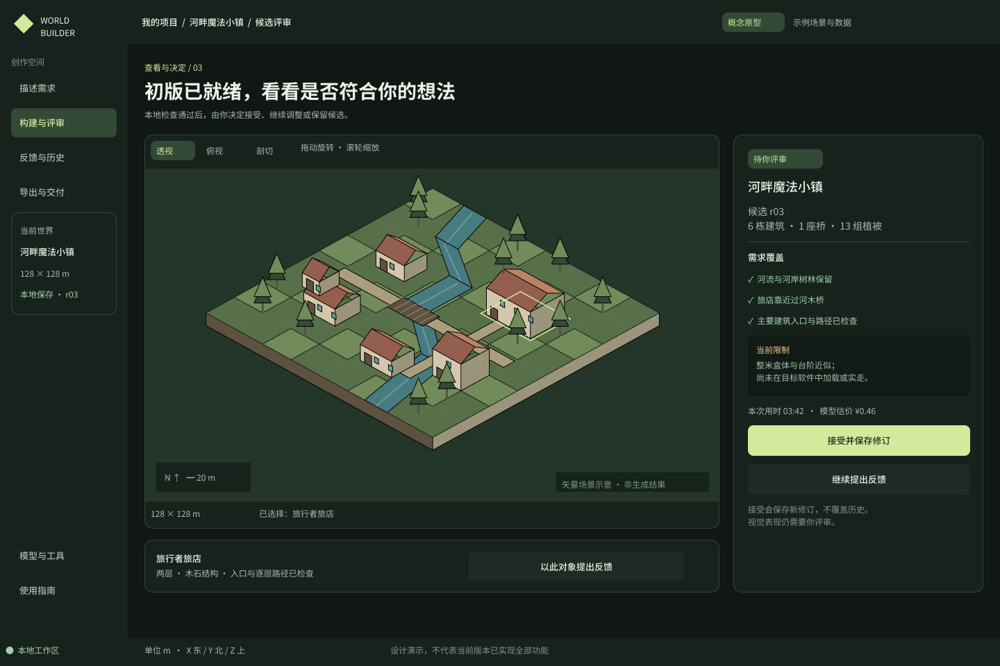
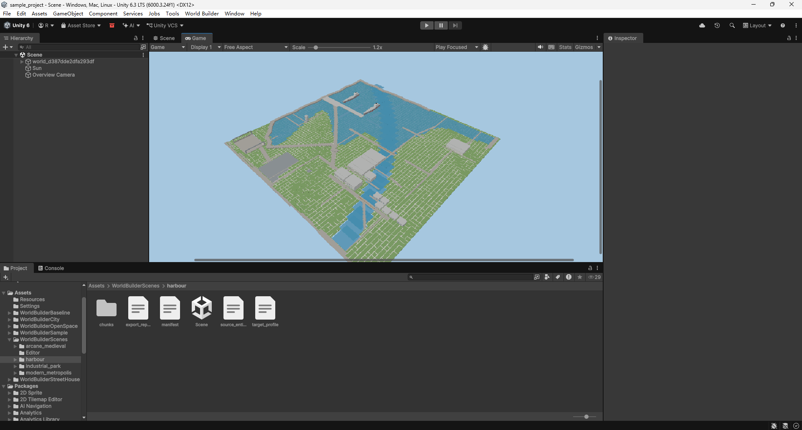
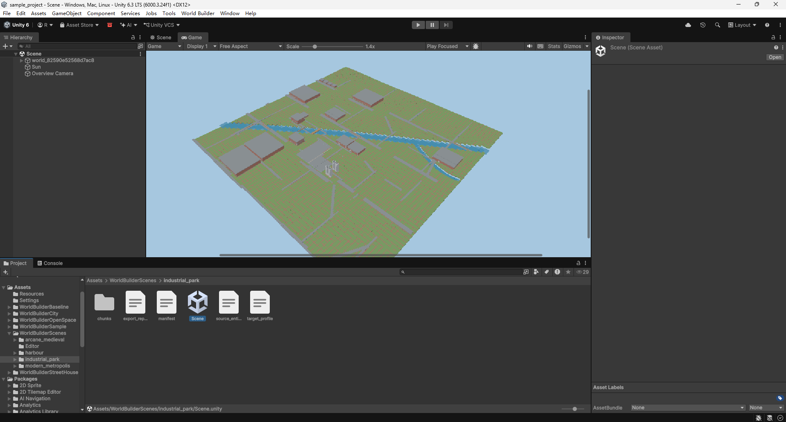
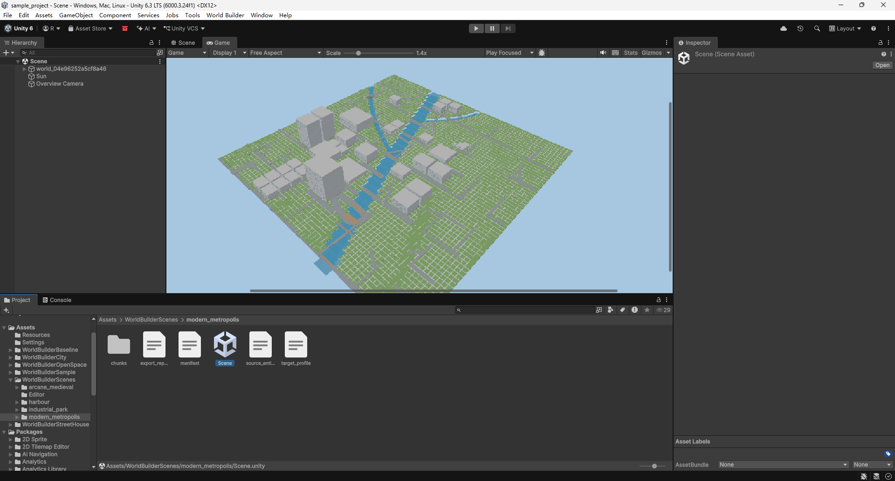
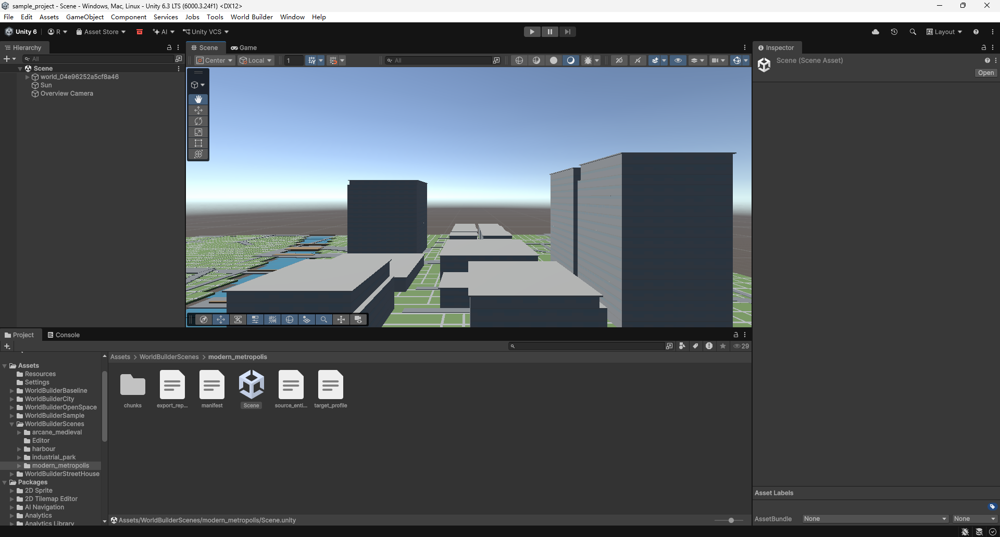
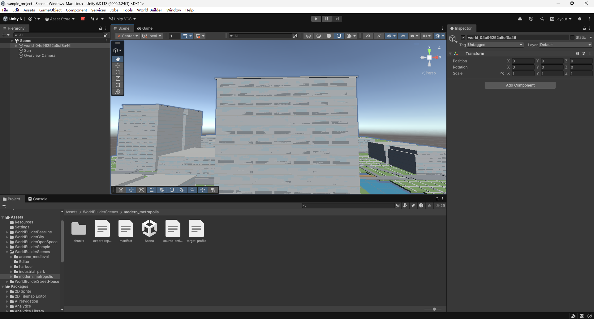
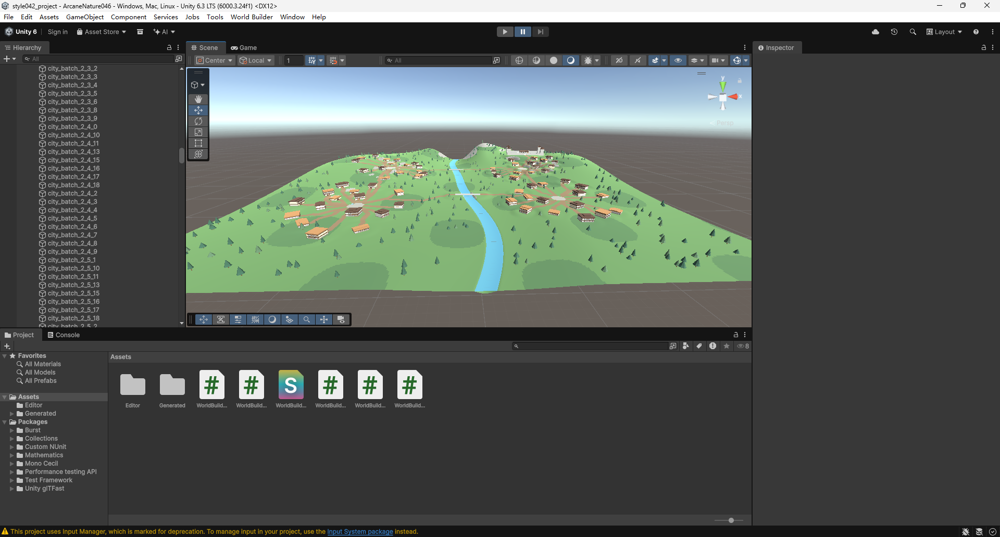
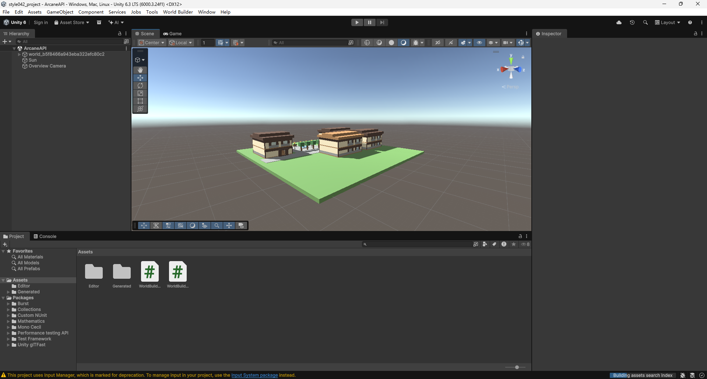
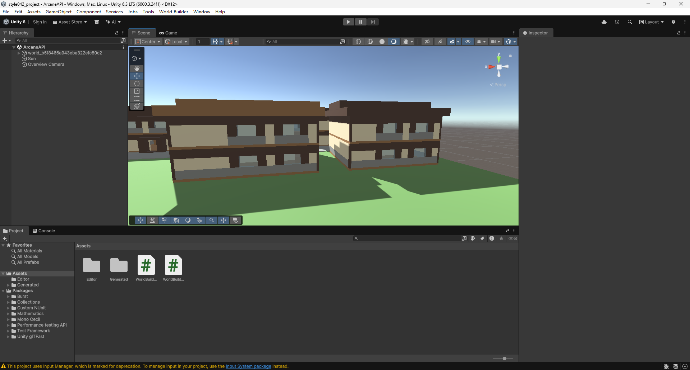
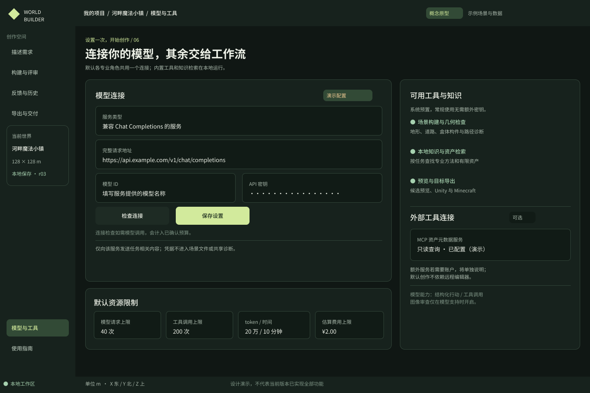

<h1 align="center">World Builder</h1>

<p align="center"><strong>把场景描述变成可预览、可导出的地图初稿。</strong></p>

<p align="center">
  <a href="https://github.com/misaka15135/world_builder/commits/main/"></a>
</p>

<p align="center">
  <a href="#快速开始">运行样例</a> ·
  <a href="#运行截图">运行截图</a> ·
  <a href="#开发进度">开发进度</a> ·
  <a href="#系统设计">系统设计</a>
</p>

<p align="center">
  <a href="https://www.figma.com/proto/yty38Et9sHKzPhfrztMM22/World-Builder-%C2%B7-Agent-%E5%88%9B%E4%BD%9C%E5%B7%A5%E4%BD%9C%E5%8F%B0?node-id=2-87&amp;scaling=min-zoom&amp;content-scaling=fixed&amp;page-id=0%3A1&amp;starting-point-node-id=2%3A85"></a>
  <br>
  <sub>候选评审 · <a href="https://www.figma.com/proto/yty38Et9sHKzPhfrztMM22/World-Builder-%C2%B7-Agent-%E5%88%9B%E4%BD%9C%E5%B7%A5%E4%BD%9C%E5%8F%B0?node-id=2-87&amp;scaling=min-zoom&amp;content-scaling=fixed&amp;page-id=0%3A1&amp;starting-point-node-id=2%3A85">打开 Figma 交互原型</a></sub>
</p>

## 当前可运行

**0.1.0 原型**按固定 A–F 流程处理场景描述。模型提供分阶段的结构化 JSON 计划，本地程序校验并编译几何，将结果保存为平台无关的世界中间表示 **WIR**。

- **构建场景**　从需求、地形和对象清单推进到选址、逐场地构建与整场审查。当前几何以整米盒体、格状地形和静态水为主。
- **检查和回放**　在浏览器或 Windows 桌面查看阶段事件和诊断，回放历史运行。空间预览为只读，支持旋转、剖切和拾取。
- **导出文件**　下载自包含的 `.worldpkg`、Unity 静态 `.glb`、Minecraft Sponge v3 `.schem` 及映射与损失报告。

离线样例使用人工编写的响应，全程无需密钥。Unity 的 GLB 需在目标端导入，Minecraft 的 schematic 需用目标工具放置。真实模型的输出质量和目标实走按后续里程碑验收。 [0.1.0 工作台实拍](artifacts/desktop-026/application.png) · [桌面验证](artifacts/desktop-026/validation.json) · [双目标样例](work_order/archive/legacy/021_style_building_cross_target_sample.md)

## 运行截图

### 规则生成样例

Unity 编辑器里可查看港区水面与码头、工业园的厂房与道路，以及现代都市的河道、桥梁与建筑体块。三组场景的世界 ID 对应同一份[规则生成基准报告](artifacts/scene-benchmark-v1-current/report.json)。

<table>
  <tr>
    <th width="50%">港口 · 俯视</th>
    <th width="50%">工业园 · 俯视</th>
  </tr>
  <tr>
    <td><a href="artifacts/readme/unity-harbour-overview.png"></a></td>
    <td><a href="artifacts/readme/unity-industrial-park-overview.png"></a></td>
  </tr>
</table>

<table>
  <tr>
    <th width="50%">现代都市 · 俯视</th>
    <th width="50%">现代都市 · 街区</th>
  </tr>
  <tr>
    <td><a href="artifacts/readme/unity-modern-metropolis-overview.png"></a></td>
    <td><a href="artifacts/readme/unity-modern-metropolis-street.png"></a></td>
  </tr>
</table>

<details>
<summary>现代都市 · 建筑立面近景</summary>

<a href="artifacts/readme/unity-modern-metropolis-facade.png"></a>

</details>

### Agent 构建试验

**山谷聚落**展示起伏地形、河道、桥梁与分散的建筑群。**魔法街区**展示小尺度街区布局与木构建筑立面。两组均为实验分支在 Unity 中的实拍。 [山谷聚落实验](https://github.com/misaka15135/world_builder/blob/4dcebc9913976a7bd1b4bf0c6d2c5d65a1f1c5cc/docs/12_nature046_organic_map.md) · [魔法街区实验](https://github.com/misaka15135/world_builder/blob/4dcebc9913976a7bd1b4bf0c6d2c5d65a1f1c5cc/docs/10_style042_arcane_street.md)

<p align="center">
  <a href="artifacts/readme/unity-valley-trial.png"></a>
  <br>
  <sub>山谷聚落 · Unity 编辑器</sub>
</p>

<table>
  <tr>
    <th width="50%">魔法街区 · 总览</th>
    <th width="50%">魔法街区 · 立面</th>
  </tr>
  <tr>
    <td><a href="artifacts/readme/unity-arcane-street-overview.png"></a></td>
    <td><a href="artifacts/readme/unity-arcane-street-facade.png"></a></td>
  </tr>
</table>

## 开发进度

Part II 已完成[系统详细设计](system_design/README.md)和[课程设计与汇报](work_order/054_course_assignment2.md)。Part III 依次验证单栋工具闭环、小场景双目标交付和局部修改。

- ![048 工单状态][status-048]　**[统一契约与世界基础](work_order/048_agent_foundations.md)**<br>统一行动契约、候选与修订，明确目标能力。
- ![049 工单状态][status-049]　**[双协议运行时](work_order/049_agent_execution.md)**<br>运行行动、工具与观察循环，记录预算与可恢复回执。
- ![050 工单状态][status-050]　**[M1 单栋闭环](work_order/050_single_building_m1.md)**<br>原生工具调用和行动 JSON 分别用真实模型完成诊断、修正与人工接受。
- ![051 工单状态][status-051]　**[M2 小场景](work_order/051_scene_delivery_m2.md)**<br>支持建筑、自然与混合场景，验证同一修订在 Unity 和 Minecraft 的加载、重开及通行。
- ![052 工单状态][status-052]　**[M3 局部修改](work_order/052_scene_revision_m3.md)**<br>保留锁定对象，验证局部修改、修订历史与撤销重做。

徽章从 `main` 上各工单的状态字段读取，刷新受缓存影响。验收证据和下一步见工单正文。 [工单总览](work_order/README.md) · [主线提交记录](https://github.com/misaka15135/world_builder/commits/main/)

## 快速开始

在仓库根目录使用 Python 3.10 或更新版本。

```sh
python -m pip install -e .
python tools/run_workbench.py --open
```

打开 [本地工作台](http://127.0.0.1:8765)，保留默认的「离线样例」，点击「开始构建」。完成后可旋转预览、检查 A–F 事件并下载两种目标格式。要输入自己的描述，在「连接设置」配置模型后切换到「我的 API」。 [工作台使用指南](docs/06_web_workbench.md) · [Windows 桌面构建](docs/07_desktop_application.md)

<details>
<summary><strong>命令行运行同一离线样例</strong></summary>

```sh
generate-world --prompt "一条街旁的一栋两层木构商铺和一座公共大厅，都能进入，商铺上层可达。" --region-m 32 --fixtures examples/agent_scene.responses.json --output artifacts/agent-runs/readme-demo --minecraft --unity
```

再次运行时请指定一个尚不存在的输出目录。离线样例使用固定响应，改写描述不会让它生成新布局。

</details>

## 系统设计

以 **河畔营地**为例。创作者要求保留溪流与树林，并在岸边搭建一座可进入的庇护所。规划角色生成任务图，地形与资产准备可以并行，布局完成后由构建角色读取几何诊断并修正。例如，工具发现入口净高只有 1 米，构建角色按 2 米约束调整并复检。

目标流程中，创作者预览并接受候选后，本地仓库复核基础版本和锁，保存新的 **WIR 修订**。Unity 和 Minecraft 从同一份已接受修订派生，分别记录格式损失和目标加载、通行证据。

<details>
<summary>查看 Figma 原型的「模型与工具」界面</summary>

[](https://www.figma.com/proto/yty38Et9sHKzPhfrztMM22/World-Builder-%C2%B7-Agent-%E5%88%9B%E4%BD%9C%E5%B7%A5%E4%BD%9C%E5%8F%B0?node-id=2-90&scaling=min-zoom&content-scaling=fixed&page-id=0%3A1&starting-point-node-id=2%3A85)

[在 Figma 中体验模型与工具设置](https://www.figma.com/proto/yty38Et9sHKzPhfrztMM22/World-Builder-%C2%B7-Agent-%E5%88%9B%E4%BD%9C%E5%B7%A5%E4%BD%9C%E5%8F%B0?node-id=2-90&scaling=min-zoom&content-scaling=fixed&page-id=0%3A1&starting-point-node-id=2%3A85)

</details>

| 资料 | 内容 |
| --- | --- |
| [目标架构](docs/08_agent_target_architecture.md) · [迁移决策](docs/09_agent_migration_plan.md) | A–F 角色、双协议工具调用、里程碑与实施边界 |
| [详细设计](system_design/README.md) · [设计图索引](system_design/15_diagram_catalog.md) | 逻辑与部署架构、候选到修订的交互、导出与验收 |
| [项目基线](docs/00_project_baseline.md) · [文档索引](docs/README.md) | 当前实现、分支职责与契约入口 |

[status-048]: https://img.shields.io/badge/dynamic/regex?url=https%3A%2F%2Fraw.githubusercontent.com%2Fmisaka15135%2Fworld_builder%2Fmain%2Fwork_order%2F048_agent_foundations.md&search=%5E-%20%E7%8A%B6%E6%80%81%EF%BC%9A%28planned%7Cin_progress%7Cblocked%7Cdone%7Ccancelled%29%5Cr%3F%24&replace=%241&flags=m&style=flat-square&label=048&labelColor=223B34&color=496D80
[status-049]: https://img.shields.io/badge/dynamic/regex?url=https%3A%2F%2Fraw.githubusercontent.com%2Fmisaka15135%2Fworld_builder%2Fmain%2Fwork_order%2F049_agent_execution.md&search=%5E-%20%E7%8A%B6%E6%80%81%EF%BC%9A%28planned%7Cin_progress%7Cblocked%7Cdone%7Ccancelled%29%5Cr%3F%24&replace=%241&flags=m&style=flat-square&label=049&labelColor=223B34&color=496D80
[status-050]: https://img.shields.io/badge/dynamic/regex?url=https%3A%2F%2Fraw.githubusercontent.com%2Fmisaka15135%2Fworld_builder%2Fmain%2Fwork_order%2F050_single_building_m1.md&search=%5E-%20%E7%8A%B6%E6%80%81%EF%BC%9A%28planned%7Cin_progress%7Cblocked%7Cdone%7Ccancelled%29%5Cr%3F%24&replace=%241&flags=m&style=flat-square&label=050&labelColor=223B34&color=496D80
[status-051]: https://img.shields.io/badge/dynamic/regex?url=https%3A%2F%2Fraw.githubusercontent.com%2Fmisaka15135%2Fworld_builder%2Fmain%2Fwork_order%2F051_scene_delivery_m2.md&search=%5E-%20%E7%8A%B6%E6%80%81%EF%BC%9A%28planned%7Cin_progress%7Cblocked%7Cdone%7Ccancelled%29%5Cr%3F%24&replace=%241&flags=m&style=flat-square&label=051&labelColor=223B34&color=496D80
[status-052]: https://img.shields.io/badge/dynamic/regex?url=https%3A%2F%2Fraw.githubusercontent.com%2Fmisaka15135%2Fworld_builder%2Fmain%2Fwork_order%2F052_scene_revision_m3.md&search=%5E-%20%E7%8A%B6%E6%80%81%EF%BC%9A%28planned%7Cin_progress%7Cblocked%7Cdone%7Ccancelled%29%5Cr%3F%24&replace=%241&flags=m&style=flat-square&label=052&labelColor=223B34&color=496D80
