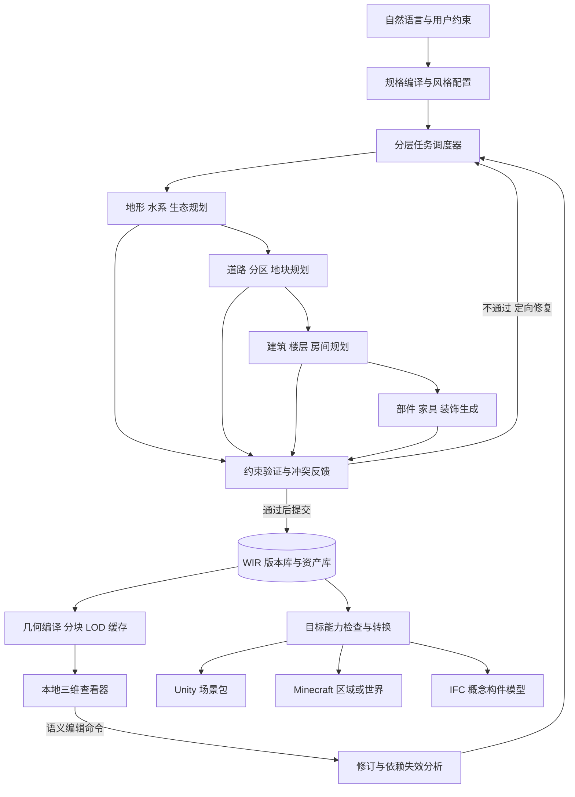

# 自然语言驱动的分层世界生成系统：正式技术方案

## 当前适用说明（2026-10-10）

当前方案入口为 [项目基线](00_project_baseline.md) 与 [总规划](../work_order/000_project_master_plan.md)。下文是早期混合架构设计：WIR 权威、独立校验与派生导出原则继续适用；规则算法默认承担规划、旧 M0—M6 顺序、调用预算和 IFC 必经阶段不再作为当前产品路线。main 已实现的模型规划闭环见 [05](05_api_agent_pipeline.md)，通用调度/资产/反馈修改仍属 029—037。

## 2026-09-21 原始记录（保留历史）


版本：0.1。日期：2026-09-21。状态：设计方案，尚未实现或实测。

需求基线见 [问题重述](01_problem_restatement.md)，证据与替代方案见 [可行性调研](02_feasibility.md)。

## 1. 总体决策

采用 **语言模型规划 + 程序化几何生成 + 约束求解/验证 + 世界中间表示 + 目标适配器** 的混合架构。

语言模型负责将描述转化为语义需求、风格参数和有限候选方案；可复现的算法负责地形、网络、地块、建筑部件与物体布局；验证器负责判断尺寸、连通、相交、支承和平台兼容性。世界中间表示 WIR 保存可编辑的源数据，各导出器将同一世界版本投影到目标表示。

选择该路线是对已确认资源和需求的工程判断，不是已有产品端到端能力的声明。第一阶段不训练大模型，也不让模型逐个输出三角形或方块。

## 2. 系统结构



首版采用一个本地服务、受限数量的生成工作进程、一个 WebGL 查看器。模块边界先明确，暂不拆成分布式微服务。生成与渲染分进程，关闭查看器不会丢失已提交世界。

## 3. 世界中间表示 WIR

### 3.1 它不是一棵简单的场景树

WIR 由五类互相关联的数据组成。

| 数据面 | 核心内容 | 作用 |
|---|---|---|
| 语义实体与包含树 | 地区、地块、建筑、楼层、房间、门、楼梯、家具及稳定 ID | 对象身份、编辑范围、导出映射 |
| 关系图 | 邻接、连接、支承、跨越、服务于、属于同一路网 | 表达场景树不能表达的跨对象联系 |
| 空间和几何 | 高程场、折线、面、多边形洞、体积、参数化部件、网格引用 | 计算边界、布局、碰撞与可视化 |
| 约束与生成配方 | 硬/软约束、规则、资产选择、随机种子、生成器版本 | 重生成、解释和错误定位 |
| 修订与来源 | 作者/agent、父版本、模型响应引用、锁定项、依赖签名 | 撤销、恢复、增量计算与审计 |

包含树只负责主要归属。空间查询通过独立索引完成；桥梁横跨两个区块仍只有一个语义 ID。关系图允许实际世界中的环路，任务执行依赖必须是无环图；相互依赖的规划步骤组合成一个有迭代上限的求解任务。

### 3.2 核心实体及表达

- `WorldSpec`：原始描述、目标面积、数量预算、风格配置、精细度、目标兼容配置、世界种子、允许的幻想例外。
- `Entity`：`id`、`kind`、`parent_id`、局部变换、包围盒、属性、语义完整度、来源及生成状态。
- `Relation`：有类型的实体关系；例如 `door.connects(room_a, room_b)`、`bridge.crosses(river)`。
- `Constraint`：作用域、相关实体、规则 ID、版本、参数、单位、容差、严重度、优先级、来源、验证结果。
- `Geometry`：参数化源描述与编译结果引用；不得只保存最终三角网格而丢失房间/墙体身份。
- `Asset`：内容哈希、尺寸、锚点、碰撞体、可通行空间、风格标签、许可、来源和适用目标。
- `Recipe`：输入签名、生成器及版本、资源预算、固定种子、依赖、选定候选、模型响应哈希。
- `Revision`：不可变修订 ID、父修订、变更集、创建者、验证摘要；保存当前分支头引用。

Schema 采用显式版本和命名空间扩展。升级通过可追溯迁移完成，旧快照不被原地悄悄改写；读到无法解释的必需能力时拒绝加载，可忽略的扩展仍原样保留，避免跨工具读写时静默丢失信息。

地形首版使用高程场和水面/河道几何，适合普通地表；洞穴、悬崖内凹、浮岛下表面需后续局部体积或网格表达，不能假装单张高度图已经覆盖。建筑保留轮廓、层高、墙、洞口、屋顶和楼梯的参数化描述；游戏网格和概念 IFC 从这些描述分别派生。

语义完整度和渲染 LOD 独立：外观高精度并不意味着内部结构或构件属性完整。未生成室内必须标记 `interior_state: deferred`，不能用空房间冒充完成状态。

### 3.3 坐标、单位与精度

源数据采用米、弧度、右手坐标系，`+X` 东、`+Y` 北、`+Z` 上；采用列向量和局部到父级变换，组合规则为 `T_world = T_parent × T_local`。核心空间数值使用双精度，查看器在相机附近使用局部原点。

Unity、glTF、Minecraft 与 IFC 的轴向/单位变换均由适配器明确记录为矩阵及比例，不能在多处隐式交换坐标。涉及反射时处理面绕序、切线和法线。以带方向标记的不对称测试建筑验证左右、朝向、尺度与门铰链，避免对称立方体掩盖错误。

首版使用局部平面坐标。真实地理位置后续增加 CRS 标识、地理锚点和投影变换，不能把经纬度直接作为米坐标。长度容差按验证规则配置，不共用一个覆盖毫米构件和千米地形的全局阈值。

### 3.4 说明性数据片段

下面展示预期字段语义，不是已经实现或冻结的完整 Schema。005 工单负责正式定义、示例和迁移规则。

```json
{
  "schema_version": "0.1.0-draft",
  "world_id": "world_demo_001",
  "revision_id": "rev_0007",
  "units": {"length": "m", "angle": "rad"},
  "coordinate_frame": "RH_X_east_Y_north_Z_up",
  "entity": {
    "id": "building_0042",
    "kind": "building",
    "parent_id": "parcel_0018",
    "local_transform": {
      "translation": [4.0, 6.0, 0.0],
      "rotation_quaternion_xyzw": [0.0, 0.0, 0.0, 1.0],
      "scale": [1.0, 1.0, 1.0]
    },
    "attributes": {
      "use": "library",
      "storeys": 2,
      "style_profile": "arcane_stone_v1",
      "interior_state": "deferred"
    },
    "geometry_recipe_ref": "recipe_building_0042",
    "constraint_refs": ["constraint_inside_parcel_0042"],
    "locks": ["footprint"],
    "provenance_ref": "generation_run_0011"
  }
}
```

### 3.5 存储与事务

运行时以 **SQLite 中的语义/修订记录 + 内容寻址的不可变资源文件** 为权威数据；关系使用普通表，空间候选查询使用 R*Tree，首版无需独立图数据库。SQLite R*Tree 提供范围检索，精确相交和距离仍需几何计算；其索引精度不作为几何真值。[SQLite 官方文档](https://www.sqlite.org/rtree.html)

便携交换包建议采用 `.worldpkg` 压缩目录，包含以下逻辑内容。

```text
manifest.json             # schema、单位、坐标、修订和资源校验和
snapshot/entities.jsonl   # 指定修订的实体快照
snapshot/relations.jsonl
snapshot/constraints.jsonl
snapshot/recipes.jsonl
assets/<content-hash>/... # 资产及许可元数据
fields/<content-hash>/... # 高程和其他场数据
history/changes.jsonl     # 可选修订历史，范围由 manifest 声明
derived/                 # 可选缓存；删除后应可重建
```

包中的快照是数据库导出的交换表示，不是第二套可独立修改的主数据。完整离线复现包必须包含引用资产、配方、模型已接受输出和依赖版本；精简包可只含外部资源引用，但须明确无法保证离线重建。

新资源先写临时位置并计算哈希，再发布到不可变路径，最后通过数据库事务提交引用和新修订。中断时保留上一已提交修订，未引用资源可延迟回收。提交前校验引用完整性；可见版本不允许引用半写入文件。便携包先完整构造和校验，再原子替换最终输出。实际文件系统对原子操作的支持需在 005/006 中验证。

## 4. 分层规划与生成

### 4.1 输入规格

将输入编译为经 Schema 校验的 `WorldSpec`。模型只允许产生有限种类的声明式规划提案，不直接执行代码或文件操作。候选规格中标注用户明确要求、规则推导和默认补全；保存完整接受结果以供复现。

示例默认规格：512 m × 512 m、1 条主河、3 个功能分区、80 栋建筑、5 栋详细室内、石材与尖顶为主的魔法城邦、Java/Unity 双目标、普通笔记本预算。仅当必要参数互相矛盾时返回冲突，否则先生成可编辑草案。

风格配置独立保存建筑部件词汇、形态参数范围、配色、资产过滤器和地标配额；首版不把“魔法”作为需要重新训练模型的类别。

### 4.2 阶段、输出和检查

| 阶段 | 主要方法 | 产物与向下约束 | 关键检查 |
|---|---|---|---|
| 区域骨架 | 低频高程、山脊/谷线控制、受约束河道与局部地形修整 | 高程、水系、边界、保护区、可建设适宜度 | 河道与地势一致、明确入/出水边界、水面和地表冲突 |
| 生态与用地 | 海拔/坡度/湿度规则、密度场、分层采样 | 植被分区、建设范围、资源与地标候选 | 植被与水路/建筑冲突，预算和主题匹配 |
| 路网与分区 | 需求节点、成本场寻路、分区规则、受限迭代 | 主/次道路、桥、街区、公共空间 | 主路连通、坡度、跨水设施、可建设面积 |
| 地块与建筑体量 | 多边形分割、退界、类型模板、高度规则 | 建筑轮廓、入口、层数、基础标高、服务核心预留 | 边界包含、体量相交、道路可达、地形接触 |
| 楼层与房间 | 空间邻接图、模板/离散约束、几何细化 | 房间、墙、门洞、楼梯/走廊连续预留 | 房间可达、楼梯落地与上下层对齐、净空 |
| 家具与装饰 | 资产检索、锚点放置、碰撞/通行约束 | 带支承和使用空间的物体实例 | 穿墙、悬空、挡门、占用通道 |
| 几何编译 | 参数化部件实例化、三角化、简化和合批 | LOD、碰撞代理、目标几何缓存 | 几何有效性、预算、单位/法线一致 |

地形与河流不是互不相关的随机层。先确定边界条件和低频地形，再建立排水/河道，再局部修整，必要时反向调整；首版追求视觉和拓扑自洽，不声称提供真实流体或水文工程仿真。道路与用地类似地进行有上限的协调迭代。

楼梯与竖向通道在建筑体量/楼层阶段预留，家具规划只能使用剩余空间。对城市街网、建筑房间和目标游戏导航，采用不同的可达性图，不将三者混为一份导航数据。

### 4.3 约束求解与失败处理

硬约束必须满足，例如实体不得越过锁定边界、普通家具必须有支承、入口和楼梯必须可达。软约束作为代价，例如临河偏好、对称性、景观朝向、风格多样性。用户明确的硬约束不能被模型自行降级。

离散房间/家具布局可使用 OR-Tools CP-SAT；其整数变量要求将尺寸映射到明确网格。连续几何、曲线和精确相交交由几何算法处理；CP-SAT 不等同于通用 CAD 求解器。[OR-Tools 官方文档](https://developers.google.com/optimization/cp/cp_solver)

任务完成原因与可行性分开记录：执行结果为完成、超时、预算耗尽、取消或错误；可行性为 `feasible`、`infeasible` 或 `unknown`。只有规则直接证明矛盾或求解器完成无解证明时才能记录 `infeasible`；启发式没有找到候选、超时或预算耗尽均不能证明无解。候选违反约束只证明该候选无效。失败报告包含作用域、违反规则、涉及实体、诊断信息、候选修复与是否需上层变化；不能保证所有算法都能给出数学最小冲突集。

默认处理顺序：局部重新放置 → 更换兼容模板 → 在授权范围内调整父层布局 → 输出具体冲突。每步有候选数量、计算时间和模型调用预算，达到上限即保留上个有效版本；不得无限重试或悄悄放宽用户锁定条件。

### 4.4 任务调度与确定性

任务签名包含世界种子、实体稳定 ID、操作类型、生成器版本、输入内容哈希和目标配置。子任务随机数由这些字段派生，避免依赖执行顺序；无关联的建筑可并行执行。同一实体的所有权和边界合同明确后才并行。

语言模型即使使用相同参数也不承诺完全确定；因此复现基于缓存的已接受规划结果。算法输出的位级一致性只在已固定版本和环境的验证范围内要求；跨平台浮点几何按容差比较。记录模型标识、模板版本、响应哈希、资产哈希和实际依赖版本。

首版提供命令行和应用内任务队列，支持进度、取消、失败恢复、批量执行和检查点。取消只放弃未提交任务，已完成版本保持可用。外部 API 不可用时，仍能加载、修改已生成世界，并使用本地预置规格运行程序化路径。

## 5. 局部编辑与增量再生成

查看器发送领域命令，例如 `MoveEntity`、`SetFootprint`、`SetRiverPath`、`LockProperty`、`RegenerateScope`，而不是直接把屏幕中的网格当成唯一数据修改。命令携带 `base_revision`、目标实体、参数和操作 ID。

处理流程如下。

1. 验证基础修订和锁定条件，计算命令直接修改的源数据。
2. 沿显式依赖和空间邻域寻找受影响对象；共享边界、桥接关系和缓存分别标记失效。
3. 在暂存分支生成变更，验证局部结果及必要的边界/全局不变量。
4. 将受影响区域、对象数量和潜在冲突反馈给界面；常规有效编辑可直接提交并保留撤销记录。
5. 对会改变锁定对象或突破明确预算的修复，展示具体差异供选择。
6. 事务提交新修订，更新当前可见区块，保留旧版本用于回退。

改变椅子位置通常只影响房间碰撞和通行；改变建筑轮廓会影响室内、相邻退界与目标缓存；改变河道可能沿水系/桥梁/道路依赖传播到较大范围。系统承诺给出失效范围，不承诺所有宏观修改都能限定在一个区块。

手工修改作为源数据覆盖和字段级锁保存，生成结果不能无条件覆盖它。并发写入采用修订比较和乐观冲突检测；首版不实现实时 CRDT。撤销创建恢复语义的修订，不删除历史。

## 6. 本地轻量三维查看器

建议首版使用 TypeScript + Three.js + 本地服务，直接在浏览器访问本机地址；流程稳定后再选择 Tauri 桌面封装。GLB 负责可视化资产，WIR 查询负责对象属性、约束和稳定 ID 映射。

Three.js 提供 glTF 加载、实例绘制和距离 LOD，适合验证此路线；这些基础能力不自动提供大世界流式加载、编辑事务或 BIM 功能，需要本项目实现。[GLTFLoader](https://threejs.org/docs/pages/GLTFLoader.html)、[InstancedMesh](https://threejs.org/docs/pages/InstancedMesh.html)、[LOD](https://threejs.org/docs/pages/LOD.html)

首版界面包含世界层级树、三维视图、属性/约束面板、任务与错误面板；支持鸟瞰/步行视角、对象选择、平移旋转、少量参数编辑、锁定、撤销重做、局部重生成、保存和导出。选中实例时必须从渲染实例索引映射回稳定实体 ID。

轻量化依靠分块加载、可见性裁剪、实例化、纹理预算、按需室内和可回收缓存。编辑中的对象可暂时从合批分离，提交后重建相关批次；合批不能破坏选择身份。Tauri 可复用系统 WebView，但侧车服务、三维资源和平台差异仍决定整体体积与兼容性。[Tauri 进程模型](https://tauri.app/concept/process-model/)

本地服务仅监听回环地址，写接口使用会话校验，模型 API 密钥由服务端/系统凭据设施管理；世界包不得携带凭据。此处仅包含运行应用所需的基本边界。

## 7. 多目标导出

导出在不可变 `revision_id` 上运行：目标配置检查 → 语义能力检查 → 几何/构件编译 → 坐标与材质转换 → 目标验证 → 产物和报告。报告记录适配器/目标版本、对象数量、转换映射、近似误差、丢失字段和未支持能力。

双目标不意味着把全部源数据压缩到最保守的共同能力。世界规格可提前纳入双方共同要求；遇到无法共用的形态或材质，保留源设计并生成有来源记录的目标变体，明确其偏差。导出清单同时声明选区和所需语义完整度；室内尚未细化时，可以明确导出外壳或触发所需细化，不能声称建筑内部已经完整。

| 目标 | 首批交付形态 | 保留重点 | 必须声明的边界 |
|---|---|---|---|
| Unity | 分块 GLB、场景清单、材质/碰撞配置、C# Editor 导入器 | 变换、层级、稳定 ID、实例和基本交互空间 | glTF 导入不自动产生可用导航、Unity Terrain、脚本或原生项目 |
| Minecraft Java | 指定版本的 Sponge `.schem` + 放置/比例清单 | 占据空间、方块材质、开口、楼梯和基础可达性 | 需兼容加载工具，不是独立世界目录；体素化造成细节和尺寸损失 |
| Minecraft Java 世界 | 后续生成 `level.dat`、region 等完整目标所需数据 | 可直接打开的有限区域世界 | 版本相关，涉及区块、实体、光照/高度图等，单个 `.mca` 不是完整世界 |
| IFC 概念模型 | 固定 schema 的空间与建筑构件交换文件 | 场地、建筑、楼层、空间、墙/板/门/楼梯等受支持语义 | 需专门参数和属性；不是结构设计、规范审查或施工图交付 |
| OpenUSD | 后续场景组合与 DCC 交换 | 层次、实例、变体、可加载大型场景 | 不替代本项目领域约束、生成配方和编辑事务 |

Unity 首版固定一个实际安装并验证的编辑器版本、渲染管线与 glTF 导入包版本；正式验收应包含导入后可走通道路、进入样例室内与碰撞检查，不仅验证文件能读取。

Minecraft 首版默认 1 m/方块，可配置统一缩放。先把墙/门/楼梯/道路等语义映射到方块构造规则，再对其他物体使用量化或体素化，不能只给三角网格上色。若通道或装饰小于目标分辨率，选择预声明的加宽、替代、删除或拒绝策略并写入报告；连续几何有效不代表方块世界仍可通行。流体、重力方块、门的上下部与 block state 需要目标测试；红石和完整游戏逻辑不在首版内。

建筑工程路线要求从源数据维护构件、材料层、空间边界、尺寸与单位；需要随目标增补真实设计输入和领域检查。IFC 文件可被解析与模型可用于施工是不同条件。长期架构为专业验证保留接口，不承诺凭一句风格描述生成可直接施工成果。

所有适配器是单向发布管线。未来若要从 Unity、Minecraft 或 BIM 工具修改后回传，必须新建同步工单，定义身份映射和冲突规则；首版不宣称外部工具修改能无损回写。

## 8. 规模、性能和成本

### 8.1 可控的首版负载

- 512 m × 512 m 区域，地形初始采样间距 2 m，257 × 257 采样点。
- 应用空间区块为 64 m × 64 m；它与 Minecraft 自身区块及渲染批次独立。
- 约 80 栋建筑先生成外壳，5 栋进行内部细化，至少 2 栋为有连通楼梯的多层建筑。
- 复用约 20—40 种参数化/基础资产；美术数量为工作量估算，最终取决于许可与视觉目标。
- 初始渲染预算建议为当前可见 50 万三角形量级与受限纹理集合，根据设备测量调整。

绝不把全部空间存成密集体素：512 × 512 × 256 的例子已包含约 6711 万格，单个 32 位索引数组约 256 MiB，尚未包含其他数据。WIR 使用稀疏实体、场和参数化几何，体素只在目标导出时分批产生。

### 8.2 待实测的验收目标

以下数字是初始工程目标，不是研究证明或性能承诺；006 开始前记录基准硬件、版本、资产、测量脚本和场景。

| 项目 | 初始目标与测量口径 |
|---|---|
| 加载已生成世界 | 低精度总览在 5 s 内可交互；本地冷启动与暖缓存分开记录 |
| 查看器交互 | 1080p、固定漫游路径、可见预算内，95% 帧耗时不超过 33.3 ms；后台生成另测 |
| 内存 | 基准运行工作集总量目标不超过 4 GiB；统一统计服务和查看器，GPU 内存单独记录 |
| 椅子级编辑 | 不含云调用的校验和画面更新 p95 目标小于 200 ms；复杂重生成异步反馈 |
| 初次生成 | 分别报告模型等待、规划/求解、几何编译、导出耗时；实测前不固定端到端分钟数 |
| API 预算 | 设置每世界 token/费用上限、并发数和重试次数；达到上限暂停未提交任务 |

模型只处理世界规格、风格和有限模板规划，重复建筑尽量共享类型配置，不为每棵树或每件家具调用模型。费用按输入 token、输出 token、其他 API 调用和实际供应商价格计算，日志记录用量；当前不使用会过时的固定价格估算。

### 8.3 扩大世界的路线

先稳定 512 m 样例，再验证数公里区域；按低精度全局规划、分层空间索引、依赖边界、磁盘缓存和局部原点扩展。跨区块道路和河流由稳定的上层图决定，边界采样和对象归属有唯一责任方；并行任务使用相同边界合同，不能各自随机拼接。

无限世界、多人实时编辑和分布式生成均不属于首版；增加规模前先用基准确认瓶颈属于语义规划、几何、存储、GPU 还是 API。

## 9. 技术选型与模块边界

| 模块 | 首选方案 | 选择理由与验证要求 |
|---|---|---|
| 核心/任务服务 | Python，类型化数据验证，本地 HTTP/事件流 | 利用几何和优化生态；长任务放工作进程，具体依赖版本在 005 固定 |
| 约束布局 | 模板 + 几何算法；必要时 OR-Tools | 先解决有限约束问题，避免每层引入通用求解器 |
| 存储 | SQLite、空间索引、不可变资源文件 | 单机事务与便携性；先验证恢复和模式迁移 |
| 查看器 | TypeScript + Three.js/WebGL2 | 快速建立本地可视化与语义编辑闭环 |
| 美术/离线几何 | 参数化部件，必要时 Blender 批处理 | 首版不要求用户一直启动 DCC，也不把重型生成放在 UI 线程 |
| 几何交换 | glTF/GLB；OpenUSD 后续可选 | 渲染和 DCC 各自适配，不以交换格式取代 WIR |
| Unity | Editor 导入适配器 + 固定 glTF 包 | 包装层级、碰撞与语义映射，实测导入版本组合 |
| Minecraft | 自有语义方块映射 + 经验证的 NBT/格式实现 | 先 `.schem`，再完整 Java 世界；不扩展到 Bedrock |
| IFC | IfcOpenShell 等候选工具 | 独立验证类型、单位、关系、几何和接收工具兼容性 |

推荐的未来代码模块为 `core`、`planners`、`geometry`、`validation`、`storage`、`viewer`、`adapters`、`assets`、`benchmarks`。当前仅创建文档，不提前建立大量空模块或引入所有依赖。

## 10. 验收方法

测试前固定四类需求：标准河畔魔法城邦、山地阶梯城邦、密集街区城邦、包含互相冲突条件的需求。前三类各预登记 10 个种子，共 30 个预期可行输入；在运行前冻结资产、生成器、模型已接受计划的使用方式、每任务预算和最多 3 次候选尝试。记录全部输入的首次通过率、预算内最终成功率、重试次数和失败原因，不能只保留成功种子。

初始验收门槛为 30 个输入中至少 27 个在预算内成功，且每类至少 8 个成功；所有成功结果必须通过硬约束。该门槛是待样件试验校准的设计目标，变更必须在新一轮测试前记录，不能在看到失败后删除样例或改分母。预期不可行输入、强制超时和故障注入单独成组，要求返回正确的可行性/执行状态并保持上一有效版本，不混入正常成功率。

自动验证至少覆盖：Schema 和引用完整性、父子包含及允许例外、道路/房间/楼梯连通、禁止相交、用户锁定保留、存档恢复、确定性边界、单位和坐标变换、增量修改范围。游戏通行阈值按所选角色体积和平台配置定义，不当成真实建筑规范。

视觉与功能验收使用同一世界版本：总览、河桥相交位置、道路入口、多层楼梯、一个家具房间。Unity 与 Minecraft 都实际加载，并重复关键通行路径。审美由固定视角、风格规则覆盖与人工评审综合判断，不以“模型认为好看”作为唯一标准。

首版成功条件是一个可保存、可局部修改、可恢复，并能在两个目标中使用的代表性世界；单张好看的图、能打开但没有语义的网格、仅通过 JSON 校验均不构成完成。

## 11. 实施阶段与工期估算

以下为个人/小团队熟悉相关技术时的工作量估算，未经实际速度验证；采用现成或简化资产，不包含大规模美术制作。可在阶段完成后调整后续工单，不据此承诺固定上线日期。

| 阶段 | 工单 | 核心验收门槛 | 粗略工作量 |
|---|---|---|---|
| M0 研究与方案 | 001—004 | 需求、来源、正式方案、独立审查和协作制度齐全 | 当前阶段 |
| M1 数据契约 | 005 | WIR Schema、三个手工样例、坐标/版本/事务/适配能力契约 | 1—2 人周 |
| M2 最小生成链 | 006 | 固定规格生成地形到室内，保存恢复、冲突检测及基准 | 3—5 人周 |
| M3 查看与编辑 | 007 | 语义选择、锁定、撤销与局部重生成 | 2—3 人周 |
| M4 双目标发布 | 008、009 | 同一修订在 Unity 与 Java/WorldEdit 中可用，附损失报告 | 合计 2—4 人周 |
| M4b 独立 Minecraft 世界 | 010 | 新世界目录可在固定 Java 版本中直接加载 | 1—3 人周 |
| M5 建筑语义验证 | 011 | 小型构件样例完成 IFC 语义和接收工具验证 | 2—4 人周，需相关经验 |
| M6 扩展验证 | 012 | 数公里样例的边界、流式加载和资源基准 | 2—4 人周起 |

核心游戏方向 MVP 为 M1—M4，初估 8—14 人周；M4b、M5、M6 单独投入。可并行不意味着工期按人数线性缩短，WIR 和跨模块验收是主要依赖。

008、009 在 005 手工样例就绪后即可进行坐标、门洞和楼梯转换小试验，与 006 的局部生成器并行；006 扩大到完整城邦前必须通过这些小样转换子项。完整城邦的目标验收仍需 006 和 007，不要求 008/009 整张工单先完成，因此不存在整单依赖环。小样门槛通过后重新校准工作量估算，再投入大规模内容生成。

## 12. 风险与决策门槛

| 风险 | 早期验证 | 决策 |
|---|---|---|
| 语义数据过泛，无法支持真实编辑 | 005 手工构造桥、楼梯与房间修改样例 | 在生成器开发前修正类型与关系 |
| 单向分层导致下层无解 | 006 构造楼梯放不下、道路被河切断的样例 | 验证向上反馈和有限修复 |
| 目标之间不能保持几何/玩法 | 005 定义能力矩阵；009 复测方块通行 | 明确降级规则或拒绝，不静默丢失 |
| 风格内容质量受资产限制 | 用小型参数化套件完成固定视角评审 | 优先补高复用资产，再考虑模型训练 |
| 普通电脑资源不足 | 006/007 测分阶段资源和可见预算 | 减少同时细化范围，调整分块/实例化 |
| 修改导致全局重算 | 桥/河/建筑边界依赖专项样例 | 允许必要传播，记录范围并重用无关缓存 |
| 模型输出不稳定或费用失控 | Schema、配方缓存、预算、失败回退 | 保留已接受计划；原型稳定前不训练模型 |
| 建筑工程用途被过度承诺 | 011 将语义交换和专业验证分开验收 | 按具体设计任务补齐输入和专业流程 |

推荐下一步是执行 005 工单，把 WIR v0.1 和三个小型手工世界定下来，再用 006 证明生成、保存、修复和恢复闭环。先建立可以修改和解释的世界源数据，后续才有扩大规模与提高视觉质量的稳定基础。
