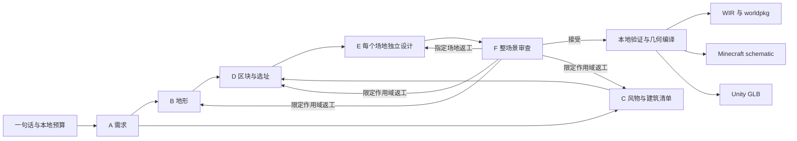

# API 驱动 A—F 多智能体流水线

版本：0.1.0；日期：2026-09-29；当前产品分支：`main`（2026-10-10 由 `codex/api-agent-pipeline` 重命名，已同步 origin/main）；实现工单：[023](../work_order/023_api_agent_pipeline.md)；分支调整：[027](../work_order/027_branch_role_alignment.md)；推送记录：[040](../work_order/040_remote_branch_publication.md)。

## 运行机制

本文描述 main 已实现的 0.1.0 原型，固定阶段和建筑场地约束仍有效。产品目标及后续通用任务架构见 [当前项目基线](00_project_baseline.md)；029/030/031/035 尚未改变此版本，032/033 的稳定修订与用户修改也尚未实现。文中回放与 F 返工不等于用户可持续编辑同一世界。

模型负责需求、地形、类型清单、选址、逐栋构件与整场景审查。每个 agent 有独立的阶段说明、JSON Schema、依赖快照和响应记录；可以共用一个模型，也可以通过 `stage_models` 分别指定模型。E 按场地建立独立任务。



B/C 和各 E 任务可并发。A、D、F 等待完整依赖。运行时不会调用 `compile_brief()`、`plan_terrain()`、`plan_siting()` 或 `design_sites()` 来补写模型计划。保留的本地代码只执行已提交的计划：校验、遍历整数网格、构件平移、地基填充、坐标转换、文件编码与事务存档。

F 提交装配决定与质量审查，本地程序执行 WIR 序列化。让 F 自行重写整份世界 JSON 会增加引用损坏、遗漏实体和上下文膨胀，所以 F 只能接受完整场景，或指明 B/C/D/E 的返工范围。它不能改变 A、用户预算或校验规则。

## API 配置

已有 Python 环境需具备项目依赖 `jsonschema`；没有增加供应商 SDK。当前源码仓库路径可直接运行：

```powershell
$env:PYTHONPATH = 'src'
Copy-Item config/agents.example.json config/agents.local.json
```

在本地配置里替换 endpoint 和 model 的 `yourapi`。密钥只通过 `WORLD_BUILDER_API_KEY` 环境变量读取：

```powershell
$env:WORLD_BUILDER_API_KEY = 'yourapi'
python tools/generate_agent_world.py --config config/agents.local.json --prompt '一条河畔商业街，包含旅店、商铺和公共广场' --region-m 128 --output artifacts/agent-runs/my-scene --minecraft --unity
```

这里的 `yourapi` 都是占位符，运行前必须换成自己的实际值。代码会拒绝占位 endpoint/model/key；不会把它发送到网络。`config/agents.local.json`、`.env` 与 `artifacts/agent-runs/` 已忽略；程序不自动读取 `.env`。

| 配置 | 作用 |
|---|---|
| `endpoint` | 完整 HTTPS POST 地址，例如自己的 `/v1/chat/completions`；不自动拼接路径 |
| `model` | 用户模型 ID；不给出未经验证的默认商业模型 |
| `stage_models` | A—F 分别指定模型；此处值为 `yourapi` 表示继承全局 model |
| `protocol` | `chat_completions` 或 `json_contract` |
| `response_format` | Chat 协议的 `json_object` 或 `json_schema`；后者要求服务支持使用的 Schema 子集 |
| `token_parameter` | Chat 协议的 `max_completion_tokens` 或兼容服务的 `max_tokens` |
| `api_key_env` | 保存令牌的环境变量名；配置不含实际密钥 |
| `deepseek_thinking` | 可选，仅 DeepSeek 官方 Chat endpoint 可用；`enabled`/`disabled` 显式控制其思考模式，省略时沿用服务端默认值 |

Chat 协议使用 system 消息加载本地 skill，user 消息提供请求、依赖与 Schema。服务器要返回一个完成的文本 choice 和整数 token usage；拒绝 tool calls、拒答和截断响应。JSON 模式仍需本地 Schema 校验。[OpenAI 官方 Structured Outputs 文档](https://developers.openai.com/api/docs/guides/structured-outputs)说明了 JSON 模式与 Schema 约束的区别、截断与拒答处理；访问日期 2026-09-29。此来源用于协议字段，不构成其它供应商兼容性承诺。

`json_contract` 用于自建网关。请求为 `{model,max_output_tokens,request}`，返回为 `{model,response,usage}`；其中 `response` 必须符合 A—F 响应契约，usage 必须包含整数 `input_tokens` 和 `output_tokens`。连接另一种供应商协议时，只需实现 [Provider.complete](../src/world_builder/agents/providers.py)；无需修改规划或几何代码。

## JSON 与硬规则

[契约说明](contracts/api-agents-v0.1.md)解释所有阶段的数据、约束、坐标和适用范围。JSON Schema 为可审查文件，运行时代码为同一份定义的来源：

- [请求 Schema](../schemas/agent-request-0.1.0.schema.json)
- [响应 Schema](../schemas/agent-response-0.1.0.schema.json)
- [配置 Schema](../schemas/agent-config-0.1.0.schema.json)

所有规划对象禁止额外字段。响应须匹配当前版本、阶段、request_id 和 scope_id。JSON 不接受重复键、NaN/Infinity、Markdown 包裹或代码。JSON Schema 之后再次检查数量覆盖、地面标高、场地与构件边界、道路连接、实体引用、逐层通路及局部净空。模型写“通过”不能覆盖这些规则。

空间由模型直接给出。首版为整数米盒体，可组合阶梯坡屋顶、不同体量和立面细节；没有调用旧的房间、屋顶或城堡模板。地形是模型给出的格状台地，水体为静态盒体。场地可明确要求地基填充；程序不会悄悄推平地形。

每个 stage 加载仓库里的实际 skill：[A](../skills/world-agent-a/SKILL.md)、[B](../skills/world-agent-b/SKILL.md)、[C](../skills/world-agent-c/SKILL.md)、[D](../skills/world-agent-d/SKILL.md)、[E](../skills/world-agent-e/SKILL.md)、[F](../skills/world-agent-f/SKILL.md)。E 同时加载设计原则参考。完整已加载文本参与请求哈希；修改技能后，旧响应不会被当作新指令的有效回放。

## 失败、预算与返工

格式或几何失败会把规则代码、错误位置和受限长度的原响应作为数据回传同一 agent。默认每任务最多 3 次尝试；失败后整次运行明确返回 unknown，不静默删楼、不调用旧生成器、不扩大尺寸。

024 真实模型首例发现 A 曾把道路、入口、室内房间误拆成独立场地需求。现在 A/C skill 明确 `requirement` 对应可建场地类型，附属特征写入描述和验收条件；A 超出 `max_sites` 报 `brief.site_budget`，可在原尝试预算内反馈重提，硬上限不变。此修改只影响新请求/skill 哈希，旧失败仍保留于其原批次。

F 最多请求默认 2 轮返工。B/C 变更使 D、全部 E、F 失效；D 变更使全部 E、F 失效；E 变更只重新设计指定场地，再进行 F 审查。已废弃结果仍保留在审计日志。若上游本身不可行而当前阶段在尝试内修不好，本版会停止，不无限回溯。用户修改请求后应开启新运行。

全局预算包括调用次数、token、并发、超时、场地数、构件数与体素分配。默认 32 个场地、3 个并发工作线程、128 次调用、单响应 16,000 output tokens；这些是可调资源上限，不是质量保证。发送前用请求字节数加 output 上限保守预留 token；返回后按服务 usage 结算。无法获知 usage 的失败请求保守扣掉预留值。服务仍可能违规超发，程序会检测并停止；本地计数不能替代供应商账户费用上限。

网络无隐式重试，不跟随重定向。每次重试都入账。运行设墙钟时限，请求 socket timeout 取剩余时间与单次上限的较小者，返回后再次检查。取消/错误保留请求、响应和失败记录；已发出的网络请求只能等待其传输超时，本版没有供应商端取消 API。

## 离线验证与回放

[样例](../examples/agent_scene.responses.json)是人工编写的“两层商铺＋公共大厅”响应，region 必须为 32。每栋 E 分别调用 provider，初次共 7 次响应。

```powershell
$env:PYTHONPATH = 'src'
python tools/generate_agent_world.py --prompt '一条街旁的一栋两层木构商铺和一座公共大厅，都能进入，商铺上层可达。' --region-m 32 --fixtures examples/agent_scene.responses.json --output artifacts/agent-runs/example --minecraft --unity
python tools/generate_agent_world.py --prompt '一条街旁的一栋两层木构商铺和一座公共大厅，都能进入，商铺上层可达。' --region-m 32 --replay artifacts/agent-runs/example --output artifacts/agent-runs/replayed --minecraft --unity
```

每次输出目录必须不存在。回放要求 prompt、seed、region、预算、skill 和依赖相同，按 request_id 寻找确切记录并核对响应哈希。改变请求或篡改响应时失败，绝不联网补齐。fixture 只验证程序；录制的真实 API 响应才能用于真实生成结果的离线回放。

## 产物与验收边界

| 路径 | 内容 |
|---|---|
| `calls/<request-hash>/` | 完整请求、原始响应、模型/usage/响应哈希及失败记录 |
| `events.jsonl` | 调用、接受、拒绝、失效、返工与完成事件 |
| `plans-round-*.json` | 每轮 F 审查后的完整计划 |
| `accepted.json` | 最终接受计划、响应身份及 skill 哈希 |
| `repository/scene.world.json` | WIR 源世界，资源在相邻 `assets/` |
| `scene.worldpkg` | 自包含世界包，含计划资产，可再次导出；原始调用日志留在运行目录 |
| `minecraft/` | Sponge v3 分块、坐标/哈希 manifest、目标配置与对象级损失报告 |
| `unity/` | GLB、材质/源 ID、manifest、目标配置与对象级损失报告 |
| `result.json` | 完成或失败、调用统计、文件导出结果、目标验证状态 |

Minecraft 1 m = 1 block；WIR (east,north,up) → Minecraft (x,up,-north)。按 manifest 的放置坐标与清理窗口操作；`//paste -a` 不能清除旧内容，清空窗口需在目标侧单独完成。程序不会操作现有存档。

Unity 导出为 GLB 静态网格，沿用已验证的坐标序列化器；本分支没有新增自动 Unity 场景导入、碰撞体生成或 NavMesh。消费者需添加实体碰撞（排除水体），再验收实际控制器行为。

当前能力限制：轴对齐整米构件、有限材质、格状地形、静态水；不支持通用曲面、布尔挖方、漂浮载具物理、自由旋转、细尺度楼梯或实际光照计算。地形上的场地要求干燥且由地面/地基支撑，因此旧主线的船只/干船坞能力不能直接宣称已迁移。通路验证是一格宽、两格高、最多一格跳跃的离散几何检查，无法证明 Unity 常规角色自动爬上整格阶梯。

这是当前 main 的模型规划产品入口；旧规则路线在 codex/local-validation 保留作对照。替换用户 API 可以保持契约、校验和导出规则，无法保证不同模型给出相同方案或美术质量。真实模型稳定性、成本与目标实走由 [024](../work_order/024_api_agent_live_evaluation.md) 分批预登记验收；后续自然/混合场景和用户修改批次随 031/034/036 的实现增加。当前离线证据与旧规则目标证据不能代替这些验收。
