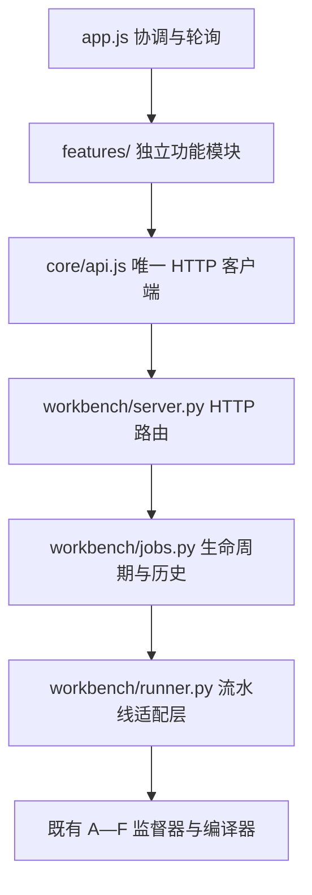

# 本地网页测试台

版本：HTTP API v1 / UI 0.1；工单：[025](../work_order/025_modular_web_workbench.md)。

## 启动与使用

在项目根目录双击 [start_workbench.cmd](../start_workbench.cmd)，或执行：

```powershell
python tools/run_workbench.py --open
```

默认打开 `http://127.0.0.1:8765`。当前 Python 环境需具备项目依赖 `jsonschema`；网页使用原生 ES modules 和 Canvas，无需 Node、npm、打包步骤或 CDN。服务终端保持开启；按 Ctrl+C 停止。若服务已在运行，直接打开同一网址；端口冲突可用 `--port 8766`。首次页面连接失败时，确认服务已启动后刷新。

### 三种运行方式

1. **离线样例**：默认模式，固定“两层商铺与公共大厅”、32 米、seed 1。点击“开始构建”即可验证真实后端流程。人工响应不根据改写的描述生成场景，因此此模式锁定描述/区域/种子，明确标记零 API 网络调用。
2. **我的 API**：在“连接设置”填写完整 endpoint、模型和密钥，切换此模式后输入自己的需求。高级配置可设置每阶段模型、并发、调用/token/时间/几何上限。保存设置会调用本地 Schema 校验，不调用外部模型。`yourapi` 占位符会在发起任务前被拒绝。
3. **历史回放**：从已结束的运行点击“回放此运行”。服务沿用原 prompt、seed、region、配置和导出选项，只用原调用目录中的记录。不同 skill 或缺失记录会明确失败，不联网补齐。失败记录也可以尝试回放，不保证能成功生成。

同时允许一个场景任务；场景内部 B/C 与多个 E 仍按监督器配置并发。取消是协作式：未发出的任务尽快停止；已发出的 HTTP 请求等待返回/超时。进入本地编译的任务可能已完成提交，此时保存完整结果并标为完成。中断服务后，历史中未结束的任务标记 `interrupted`，不会自动继续付费调用。

### 预览与检查

- **空间预览**：读取生成的 WIR 实体盒体，以米为单位、X 东/Y 北/Z 上；拖动旋转、滚轮缩放、俯视、地形开关和高度剖切均为只读视图操作。点击构件显示源 ID、类型、材质与尺寸。
- **流水线**：显示真实事件中的 A—F 请求、校验、拒绝和失效。E 按场地汇总；“完成”来自任务结果，不用计时器伪造进度。
- **交付与诊断**：下载 worldpkg、Unity GLB、Minecraft schematic 和源 JSON；下拉框可按阶段/作用域/尝试检查请求、响应、错误、导出报告等。JSON/JSONL 预览上限 2 MB，其余文件可下载。
- **智能体与契约**：查看六份实际运行 skill（E 包含设计参考全文）与各阶段的响应 JSON Schema。这里是只读检查入口；修改应在源代码版本管理下进行。
- **运行档案**：刷新页面或重启服务后仍可打开旧运行。当前列表展示最近 100 项；文件不会自动删除。

预览是轴对齐盒体的轻量示意，Canvas 使用面深度排序，复杂构件存在遮挡近似；没有光照、碰撞、物理或材质透明度模拟。它不代替 GLB/游戏引擎验证，也没有完整编辑、撤销和增量再生成。007 的完整查看编辑器仍需独立实施。

## 配置与数据位置

服务默认从 `config/agents.local.json` 读取配置（存在时），否则读取 [占位示例](../config/agents.example.json)。也可用 `--config` 指定文件。网页保存的非密钥配置位于当前浏览器 origin 的 `localStorage`，可以通过“恢复服务端默认值”后保存来重置。

网页密钥仅保存在当前页面内存中，提交一次 API 运行后从页面状态移除；服务只将它交给该次 provider，不修改进程环境变量。留空时使用配置的服务端环境变量。密钥不写入任务 JSON、浏览器存储或 HTTP 日志；不读取 `.env`。

默认数据目录为 `artifacts/agent-runs/workbench/`，已由 `.gitignore` 排除。可用 `--runs` 替换。每项运行包含：

```text
<job-id>/
  job.json       # 生命周期、时间、结果摘要和错误
  input.json     # 不含密钥的实际输入
  config.json    # 不含密钥的运行配置，供精确回放
  output/        # 023 原始输出：calls、events、worldpkg、目标文件等
```

服务只绑定回环地址，不开放局域网。写接口检查本地 Host、Origin（如有）和页面会话令牌；重启服务后需刷新页面。静态文件只在 `web/` 内提供，下载只允许运行产物清单中的文件，不公开 SQLite 或任意本地路径。该服务用于单用户本地开发，不能直接作为公开网站部署。

## 模块边界与更新方式



| 层 | 文件 | 更新约束 |
|---|---|---|
| 页面布局/主题 | [index.html](../web/index.html)、[styles.css](../web/styles.css)、[theme.css](../web/theme.css) | 改视觉不需要改生成代码 |
| 功能模块 | [composer](../web/features/composer.js)、[settings](../web/features/settings.js)、[progress](../web/features/progress.js)、[history](../web/features/history.js)、[artifacts](../web/features/artifacts.js)、[preview](../web/features/preview.js) | 每个模块创建自己的视图，通过回调/方法与应用协调 |
| 前端协调 | [app.js](../web/app.js)、[core](../web/core/api.js) | 不承载模型决策；HTTP 调用集中在 api.js |
| 本地接口 | [server.py](../src/world_builder/workbench/server.py) | 路由、同源边界、文件响应；不执行规划 |
| 任务服务 | [jobs.py](../src/world_builder/workbench/jobs.py) | 状态、持久化、队列限制与取消；可独立测试 |
| 适配层 | [runner.py](../src/world_builder/workbench/runner.py) | 唯一执行 Supervisor/save_world 的模块；替换生成后端时主要改此处 |

例如升级 WebGL 查看器时只替换 `preview.js` 的 `load/clear` 接口；增加后端模型协议时改 Provider；增加任务队列时改 JobService；引入桌面壳时可继续加载相同本地网页和 HTTP API。本版是“本地应用 + 网页界面”，没有额外制作 Electron/Tauri 安装包或公网部署。

## HTTP API v1

所有接口位于 `/api/v1`，JSON 使用 UTF-8，响应 `Cache-Control: no-store`。错误统一为 `{error:{code,message}}`。POST 必须携带 `Content-Type: application/json` 与 `X-Workbench-Token`；令牌来自 bootstrap，仅用于本机页面写请求。

| 方法与路径 | 请求/返回 |
|---|---|
| GET `/bootstrap` | api_version、session_token、默认 config、固定 sample、credential_available（布尔值）、六份 skills |
| POST `/config/validate` | 请求为 023 CONFIG_SCHEMA；成功 `{valid:true}`；不联网、不保存 |
| GET `/contracts/{A…F}` | 当前阶段响应 Schema |
| GET `/jobs` | `{jobs:[Job]}`，按创建时间倒序，最多 100 |
| POST `/jobs` | 成功 202/Job；忙碌 409；无效输入或占位配置 400 |
| GET `/jobs/{id}` | Job + events、resources、scene_available |
| POST `/jobs/{id}/cancel` | `{}`；返回当前 Job；对已结束任务幂等 |
| GET `/jobs/{id}/scene` | 原始 WIR 快照；未生成时 404 |
| GET `/jobs/{id}/document?path=…` | `{path,text}`；仅允许小型 JSON/JSONL |
| GET `/jobs/{id}/file?path=…` | 下载产物清单中的精确相对路径 |

创建任务只允许字段：`mode`（fixture/api/replay）、`prompt`、`region_m`、`seed`、`minecraft`、`unity`、`config`、`api_key`、`replay_id`。fixture 使用固定样例默认值；API 需要非空 prompt，默认边长 128；回放只使用 mode/replay_id，其他运行参数沿用原记录。网页种子范围为 JavaScript 安全整数 `0…9007199254740991`，区域为 `32…512` 且必须是 16 的倍数，导出选项必须为布尔值，配置服从 023 严格 Schema。请求最大 256 KiB。

Job 包含 `id/mode/prompt/region_m/seed/status/phase/created_at/updated_at/result/error/replay_id`。状态为 `running → succeeded | failed | cancelled | interrupted`，取消过程为 `cancelling`；phase 进一步区分 planning/compiling/completed。错误结果不等于场景不可行。运行日志沿用 023 的事件格式，HTTP v1 仅包装生命周期，不修改 A—F 契约。

## 验证

```powershell
python -m pytest -q tests/test_workbench.py tests/test_agent_pipeline.py --basetemp artifacts/pytest-workbench-check
python tools/check_project_docs.py
```

025 验收证据见 [记录](../artifacts/workbench-025/validation.json)。真实模型、各供应商兼容性和 Unity/Minecraft 内连续通行仍在 [024](../work_order/024_api_agent_live_evaluation.md) 验收；当前网页验证使用人工样例、真实本地任务和离线回放，没有调用付费模型。
