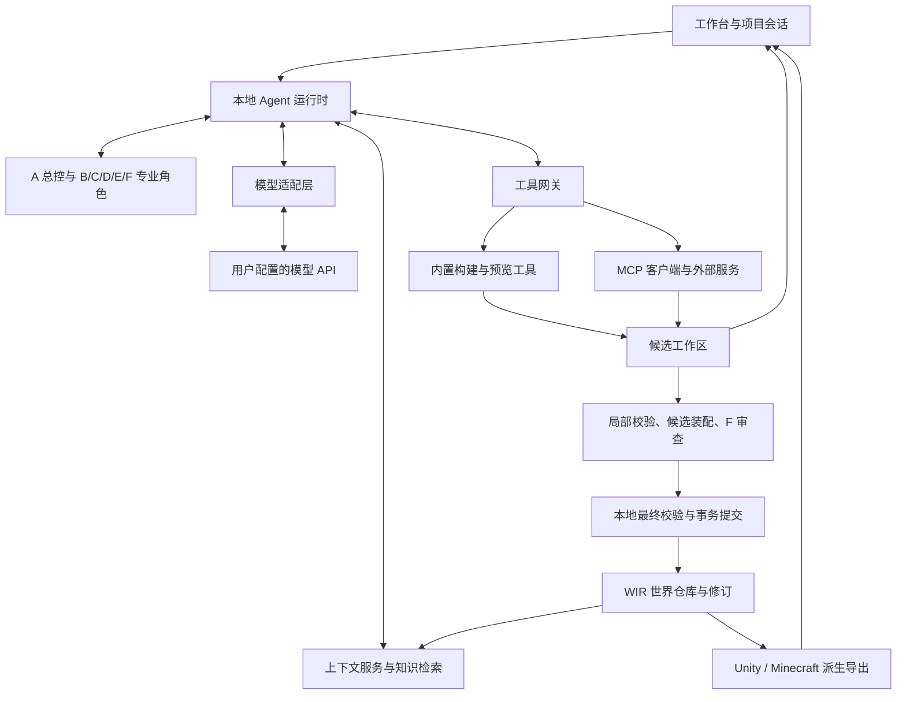

# Agent 场景构建目标架构

日期：2026-10-29。性质：目标设计，未实现；本次只更新文档。需求见 [00 基线](00_project_baseline.md)，执行顺序与决策见 [09 迁移方案](09_agent_migration_plan.md)。当前可运行行为仍由 [0.1.0 契约](contracts/api-agents-v0.1.md)描述。本文的接口名称为设计草案，不是已发布 API。工单重构后职责由 048—052 承接；执行顺序只在 [工单入口](../work_order/README.md)维护。

## 1. 产品与部署边界

用户配置受支持的模型连接后，通过描述、预览和反馈完成场景构建。系统持有工作流、专业知识、工具连接和世界状态；外部模型提供推理与设计能力。基础知识检索与内置构建不要求用户另购服务；需独立账号的远程资产/工具为可选连接。不能承诺任意 API 或模型具备相同能力、成本和质量。

建议先采用本地模块化应用：复用 Python 服务、网页测试台及桌面宿主，计算密集构建进入工作进程，MCP 服务按需连接。模块边界先独立，网络微服务、特定 Agent 框架和向量数据库暂不作为前置条件。技术实现可由后续工单在满足接口与验收的前提下选择。

## 2. 组件与控制权

图中 MCP 到候选区表示经网关转换和验证的产物；远程工具没有世界仓库的直接提交权。预览界面明确标记候选与正式修订。

| 组件 | 职责 | 权限边界 |
|---|---|---|
| A 总控 | 理解需求、提出任务图与范围调整、解释进度 | 任务建议须经运行时接受，不能关闭必要检查 |
| B 地形 | 地势、水系、岸线与可建设区域设计 | 按已注册几何能力构建候选 |
| C 对象/资产 | 类型、数量、功能、资产与配方选择 | 不虚构可用资产或遗漏必需对象 |
| D 布局 | 分区、交通、地块与实例空间关系 | 冲突可请求上游修订，不能暗改需求 |
| E 专项角色 | 建筑、设施、自然实例组等构建 | 仅修改任务授权的对象和区域 |
| F 整体审查 | 需求覆盖、风格、关系与候选效果审查 | 输出接受建议或返工；不能覆盖硬性检查 |
| 运行时 | 接受任务图、调度、工具循环、预算与恢复 | 负责执行控制，不暗中替模型补全设计 |
| 世界仓库 | 稳定身份、候选接受、修订、资源归档 | 唯一正式源数据；沿用 Repository |

A—F 是角色，不要求六个模型或常驻进程。默认可共享一个模型连接；每个任务有独立作用域、上下文和预算。多个 E 可并发；重复对象允许显式复用配方和变体，关键地标可独立设计。自然场景按所需能力调度，不能仅凭类别跳过对象、布局或审查。

## 3. 任务图与 Agent 执行循环

运行时检查 A 的任务建议：能力存在、输入输出版本匹配、依赖无环、必需需求有覆盖、总预算可满足。每轮是有向无环图；返工创建新任务版本并传播失效，保留旧产物。B/C 可并行产出初稿，D 发现岸线/容量等冲突时提出受限上游调整。

单任务循环：组装上下文 → 模型提出行动 → 校验行动与预算 → 执行工具 → 返回观察结果 → 模型修正或提交候选 → 本地接受。允许的行动至少包括查询、检索、构建候选、检查、预览、提交候选、请求受限重规划、报告能力缺口。模型文本中的“完成”不能直接终止任务或发布世界。

建议状态包括等待依赖、可运行、执行中、等待工具、等待用户、待验收、已接受、失败、取消和失效；这些运行状态与工单状态分开。未知工具、缺必要能力在调用前诊断；格式错误可限次修正，空间失败返回对象与约束定位，资源耗尽明确停止。用户选择待答时只继续依赖独立的任务，预选项和超时均不视为批准。

模型调用、工具步数、并发、墙钟时间、输出大小、几何和资产资源均有全局及任务上限；每轮返工仍计入同一 operation 的预算。费用估算与实际账单分开记录，缺 usage 不伪造精确 token 或费用。

## 4. 模型适配与兼容性

模型连接配置负责 endpoint、认证引用、模型 ID、协议适配器和能力声明。运行时接收统一的工具调用、最终候选、拒绝、截断和错误结果。适配器只转换协议，不做场景规划或执行工具；工具执行由网关管理。

用户已确认 D02：首批同时支持原生工具调用与结构化行动 JSON。两种适配器归一到同一行动/工具结果契约，使用同一运行时、工具网关、权限、预算和候选验收规则；不得创建两套场景执行逻辑。连接显式选择协议并通过能力检查，失败不静默切换协议。旧版 json_contract 返回阶段计划，与新版行动循环不是同一个协议。行动 JSON 路径必须验证行动类型、调用 ID、参数、终止规则、错误回传与限次修正，不能以任意文本可聊天为兼容依据。

首批交付要求两条路径分别跑通工具调用、观察回传、失败后修正和候选提交，并在 050/051/052 分协议记录真实服务结果。同一具备相应能力的服务可分别验证两种模式，不要求为比较而新增供应商；一种模式成功不证明另一种可用。格式修正和重试计入总预算，非法 JSON、未知动作、坏引用、重复调用与截断均需明确处理。

连接需检测结构化输出、工具调用、上下文、可选图像输入、usage 和超时行为。能力测试与真实设计质量评估分开。默认同一连接服务所有角色；多连接路由作为可扩展配置。密钥以凭据引用使用，不进入 worldpkg、提示词、日志或回放。需要图片审查但模型不支持时，显示该检查未执行，不能当作视觉验收通过。

## 5. 工具网关与 MCP

内置工具和 MCP 工具映射到统一注册表。工具描述至少包含名称/版本、输入输出 Schema、单位/坐标、读写范围、所需能力、目标兼容性、超时/取消、资源上限及幂等性。具体字段由 048 冻结。

| 工具组 | 示例能力 | 结果 |
|---|---|---|
| 查询 | 对象、地形、邻域、约束、目标能力 | 可定位的结构化事实 |
| 检索 | 设计知识、资产和配方搜索 | 来源、版本、适用性及引用 |
| 构建 | 墙体、开口、楼梯、道路、分布实例 | 候选引用与资源摘要 |
| 检查 | 支撑、碰撞、净空、路径、覆盖 | 约束、对象和位置诊断 |
| 预览 | 平面、剖面、局部与鸟瞰 | 图像、相机和对象映射 |
| 导出 | 指定修订与 target profile 编码 | 文件、映射、损失与检查状态 |

模型决定布局和参数，工具执行明确构建规则；工具不得为满足参数而隐式减数量、扩大场地、改动锁或切换旧生成器。每种构建能力都有输入、算法版本、原语/精度和适用限制，添加工具不自动增加曲面、船只、挖方等能力。

world_builder 充当 MCP Host，通过客户端连接工具服务。工具发现后须按注册策略映射，不将服务暴露的所有写操作自动交给所有角色。首个 MCP 验收建议采用只读本地知识/资产查询服务；场景构建先通过候选区执行。外部编辑器直接修改已有项目不属于首个工具闭环，后续需要独立副作用边界。

每次调用记录 call_id、输入摘要、执行状态、结果引用和工具版本。超时不等于未执行：先查询回执或按幂等键恢复，不能盲目重复有副作用的调用。取消后迟到结果不得提交世界。只读调用可按声明重试；远程副作用不由 WIR 回滚来假装撤销。

## 6. 上下文、Skill 与检索

上下文包包含原始需求引用、任务约束、当前修订、相关对象/邻域、已接受依赖、所需 Skill、检索片段和最近诊断。按对象/产物引用加载大数据，模型可查询缺失信息，不每次注入全场景。恢复依据持久状态和完整执行记录，摘要只辅助阅读。

- Skill 是版本化的工作方法，由系统按任务装载；不赋予新的执行权限。
- 知识检索为设计案例、平台资料和配方说明提供证据；检索内容作为参考数据，不能覆盖用户约束或执行策略。
- 世界坐标、对象尺寸、锁和修订由精确查询提供；不以语义检索或聊天记忆替代。
- 资产除语义标签外，需要尺寸、来源/使用条件、版本、原点、单位、材料、包络和目标支持信息。

首版建议采用本地标签、元数据与关键词检索；向量检索是后续可替换实现。固定查询集测量相关性、来源覆盖、过期资料处理和上下文大小。记录实际读取的知识/Skill/工具版本，使缓存和任务失效能解释；未检索到资料时明确缺口，不伪造引用。

## 7. 世界、候选与并发

| 对象 | 生命周期 |
|---|---|
| World | 长期世界身份，不随每次运行改变 |
| Revision | 已接受的不可变快照，记录父修订 |
| Operation | 一次用户创建或修改请求及总预算 |
| Task | 有依赖、作用域和版本的执行单元 |
| Candidate | 基于指定修订的候选修改与产物 |
| Artifact | 几何、资产、配方、预览、报告、导出文件 |
| ToolCall | 工具调用状态、回执和可恢复记录 |

候选构建在隔离工作区进行，局部检查后装配候选场景供 F 审查，再由本地最终校验和事务接受。中间任务产物被接受不等于正式世界头推进。F 不直接重写 WIR；编译器负责稳定引用和序列化。

并发 E 从不可变基础修订读取；记录实际读集合、写集合和邻域约束。提交检查基础修订、对象锁、写入冲突及跨边界关系。不同对象 ID 也可能发生空间冲突；不得以 ID 不重复代替空间验收。失败、取消、预算耗尽和旧修订冲突不推进世界头。

用户局部修改经过同一命令服务。系统计算真实依赖传播，重做受影响任务及边界检查；保留无关对象身份。撤销/重做恢复已有修订，不重新付费生成。目标侧手工编辑不自动回写 WIR。

## 8. 目标平台、数据与版本

规划前读取 target profile；源端能力、已实现工具和平台限制共同决定可执行范围。WIR 保留语义、几何/配方和资产，不降为所有平台的最低公共表示。Unity 与 Minecraft 可使用不同派生表达，但近似必须被允许且逐对象记录，关键需求损失使导出失败。

当前右手坐标 X 东/Y 北/Z 上与米单位继续作为兼容基础；新原语、精度、坐标或字段需独立版本化。Agent 协议、工具、WIR、HTTP API 和目标适配器分别版本化，新 Agent 协议不自动要求 WIR 升版。旧 0.1.0 请求/响应和世界包不可原地改写，新版本具体编号由 048 冻结。

导出绑定已接受修订、资源摘要及 profile 版本。文件生成、结构检查、实际目标加载、碰撞/连续通行、视觉评审分别记录，未执行保持未验。Unity 场景文件或 GLB 不等于任意 Unity 游戏可直接使用；Minecraft schematic 不等于独立完整存档。

## 9. 可观测性与验收

工作台展示任务依赖、工具执行摘要、复用/返工原因、预算、候选/正式修订及失败定位；不展示或存储模型私有思维链作为产品要求。用户正常授权范围内自动执行，歧义、必需能力缺失和重大方案选择才进入明确等待状态。

最低 Agent 行为证据是：真实模型选择工具，收到实际失败诊断后改变有效参数，产出通过本地检查的候选，提交后可重开与回放。人工响应和模拟工具仅证明机制；真实模型批次归 050/051/052。视觉能力、目标加载、局部修改分别验收，不因单栋闭环成功而宣布全系统完成。

## 10. 设计依据与适用范围

- [MCP 官方架构](https://modelcontextprotocol.io/docs/2026-07-28/learn/architecture)，访问 2026-10-29：支持 Host/Client/Server 与工具/资源交换的职责区分；不证明本项目已接入 MCP，不冻结未来 SDK 或服务兼容版本。
- [Anthropic：Building effective agents](https://www.anthropic.com/research/building-effective-agents)，访问 2026-10-29：用于预定义工作流与模型动态使用工具的概念区分。本文的世界事务、角色划分与迁移步骤是项目设计判断，不是该文的实测结论。
- 本地依据：[当前 Provider](../src/world_builder/agents/providers.py)、[运行时](../src/world_builder/agents/runtime.py)、[编译器](../src/world_builder/agents/compiler.py)。2026-10-29 读取确认当前 Provider 拒绝 tool_calls、运行时加载固定 skills 并调度 A—F；未运行真实模型或目标环境。
