# 01 系统结构与模块边界

日期：2026-11-11。性质：目标设计；实际功能边界见 00 章与旧 0.1.0 契约。

## 1. 系统上下文

用户通过本地工作台或桌面宿主操作世界；外部模型只提供候选行动。可选 MCP 服务提供受限知识/资产工具。Unity 和 Minecraft 是派生产物消费端，不持有 WIR 写权限。网络微服务、云账户和向量数据库不作为基础构建前置条件。

## 2. 逻辑组件

| 模块 | 输入 / 输出 | 持有状态 | 不得承担 |
|---|---|---|---|
| Workbench | 用户命令、选中对象 / 预览、进度、诊断 | 展示与临时视图状态 | 直接改库、把按钮禁用当权限验证 |
| Application Service | 经过认证的命令 / Operation、事件、资源流 | 命令幂等记录、会话 | 场景规划、几何拼装 |
| Runtime/Scheduler | 需求、任务图 / 行动、观察、任务结果 | 任务、预算、取消代数 | 绕过网关执行工具 |
| Model Adapter | 上下文、工具声明 / 统一 Action | 协议能力、请求元数据 | 权限判断或世界写入 |
| Context Service | 精确世界查询、检索请求 / 有出处上下文 | 依赖和版本摘要 | 用语义记忆替代坐标与锁 |
| Tool Gateway | 统一 ToolCall / ToolResult | 白名单、回执、执行租约 | 自动信任 MCP 自报权限 |
| Capability Registry | 版本化工具与校验器 / 支持集合 | 能力/profile 锁 | 宣称未实现能力 |
| Candidate Workspace | 参数/配方 / 隔离 WIR patch、资源 | 临时资源与候选状态 | 正式世界头写入 |
| Geometry/Validation | 几何与规则 / 诊断、证明摘要 | 可重建索引和缓存 | 暗改必需项以通过校验 |
| Repository/Commit Service | 候选、基础修订 / 原子修订 | 世界源、锁、依赖、审计 | 执行模型推理 |
| Export Service | 已接受修订、profile / 派生包、损失报告 | 导出缓存与验证证据 | 静默回写 WIR |

代码依赖指向内部领域接口：UI → 应用服务 → 运行时/领域；基础设施实现 Repository、Provider、Worker、ArtifactStore 等端口。领域类型不依赖 HTTP、供应商 SDK 或前端类型。编译器可以消费冻结的候选快照，不能从网络拉取未知资源。

## 3. 建议代码组织及现有映射

以下路径是迁移建议，除标记“已有”外不代表目录已经存在；不要求一次性改名。

| 目标职责 | 当前复用点 | 建议扩展 |
|---|---|---|
| 协议与类型 | `src/world_builder/agents/` 及现有 schema | `agents/contracts/` 分离 Action、ToolResult、TaskGraph |
| 调度与执行 | 已有 `agents/runtime.py` 固定 Supervisor | 新版执行器按显式协议路由，旧版保留 |
| 模型端口 | 已有 `agents/providers.py` | 原生工具、行动 JSON 适配器，共用归一结果 |
| 编译 | 已有 `agents/compiler.py` | stable ID 输入、候选编译、能力注册 |
| 世界持久化 | 已有 SQLite Repository、事务/锁/快照基础 | 候选、修订 CAS、锁、依赖及调用日志 |
| 展示/导出 | 已有网页、桌面壳与目标适配器 | 命令服务、动态任务、损失和目标检查状态 |

当前 Provider 拒绝 `tool_calls`，固定运行时不等于新版 Agent；编译身份从接受计划摘要派生，不能直接满足持续编辑。迁移时不把旧模板生成器作为新 Agent 失败后的隐藏回退。

## 4. 进程与并发

推荐一个本地控制服务拥有调度和数据库写入，几何/预览/导出在受限工作进程执行。进程隔离是资源与故障边界，并不自动构成恶意代码沙箱。任务并发与模型调用并发分别限额；几何 worker 没有凭据或 DB 写连接，只接收内容引用与有限参数。

同一世界正式提交串行化；不同世界可并行。多个 E 读取同一不可变修订，候选隔离；接受时重新检查读依赖、空间冲突与锁。首版遇基础修订过期返回冲突，后续经测试才开放显式重基。服务重启通过持久状态恢复，不依赖工作进程内存。

## 5. 端到端数据流

1. 应用服务保存用户原始需求、约束、目标和预算，生成 Operation。
2. A 提出 TaskGraph；运行时检查能力、DAG、必需项覆盖与资源可行性。
3. 就绪任务加载精确快照、工具白名单和相关知识，经模型适配器产生 Action。
4. 网关验证作用域、参数与预算，执行工具并保存回执；模型读取真实观察修正。
5. 任务产物先通过局部校验；装配候选后进行跨边界检查、F 审查和本地最终接受。
6. Repository 原子创建修订、推进头、追加审计/事件；UI 从事件恢复和展示。
7. 导出绑定修订与 profile，保存逐对象映射/损失；文件、目标加载和实走分别记录。

## 6. 横切策略

| 策略 | 唯一执行点 | 消费模块 |
|---|---|---|
| 用户授权与工具权限 | 应用服务 + 网关 | 所有行动路径 |
| 总预算预留/结算 | Runtime BudgetLedger | 模型、工具、返工、重试 |
| 正式接受 | Repository Commit Service | 创建、修改、撤销/重做 |
| 输入/输出版本 | 契约注册器 | API、模型、工具、包和导出 |
| 可观察诊断 | 统一 Diagnostic + 事件 | 模型观察、UI、验收 |
| 外部来源可信度 | Context/Asset intake | 检索与资产导入 |

限制必须在服务端执行；重复放到 UI 的限制仅改善体验。重大方案选择进入明确待答状态，独立任务可继续，不能借超时默认改变范围。

## 7. 可替换性与扩展规则

新增模型只实现协议映射、能力探测、usage/错误归一；新增工具同时交付 Schema、作用域、幂等/取消声明、资源边界、诊断和负例；新增原语同时修改 WIR 扩展、编译器、检查器、preview 与 target loss 规则；新增平台提供 profile、转换、资源完整性校验和实际加载证据。插件未达到这些门槛只可标记实验性，不能扩大公共能力声明。

明确技术选型和版本见 [16 技术栈](16_technology_stack.md)，代码目录、接口和线程/进程边界见 [17 实施蓝图](17_implementation_blueprint.md)；权衡记录见 13 章。本次补充设计不改变运行实现。
