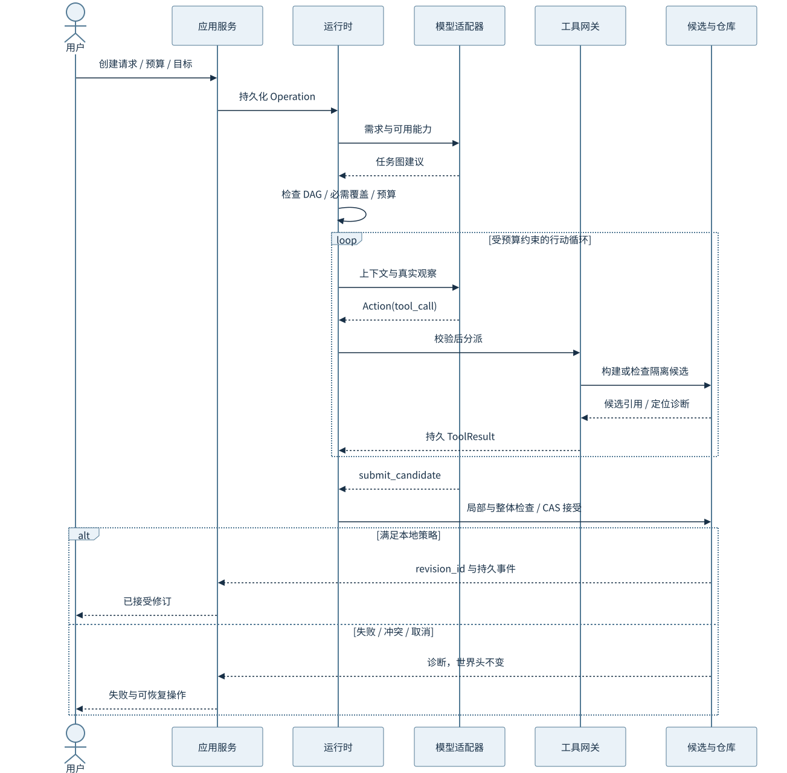

# 02 Agent 运行时、任务编排与恢复设计

日期：2026-11-11。设计标识：`design-2026-11-11`。本文为目标设计草案，不是运行契约或功能完成证明；字段、版本与默认阈值由 048 冻结。当前固定 A—F 的 0.1.0 实现继续适用原契约。

## 1. 目标与责任划分

运行时将模型提出的计划转为受预算、能力、作用域和验收规则约束的行动。模型负责设计判断；运行时决定行动能否执行、任务能否接受以及候选能否进入世界仓库。运行时不生成隐式替代设计，不为成功率删除必需对象，也不通过旧规则生成器补齐失败结果。

| 模块 | 输入与输出 | 核心不变量 |
|---|---|---|
| OperationService | 用户意图、基础修订、目标配置 → Operation | 一次请求具有稳定身份和独立总预算 |
| TaskGraphValidator | A 提议的任务节点/边 → 已接受图版本或诊断 | 无环、能力匹配、必需需求覆盖、资源可行 |
| Scheduler | 已接受任务图、账本、租约 → 任务执行许可 | 无依赖缺失启动；全局和任务预算同时生效 |
| ContextAssembler | Task、Revision、已接受产物 → ContextBundle | 精确状态来自仓库；参考资料不能改写策略 |
| AgentLoop | ContextBundle、Observation → Action | 行动必须经过统一校验和网关 |
| BudgetLedger | 预留、实际结算、不确定消耗 → 可用额度 | 并发预留原子；未知费用不伪装为零 |
| CandidateCoordinator | 任务候选、检查报告、F 建议 → 装配候选 | 局部接受不等于推进正式世界头 |
| RecoveryCoordinator | 持久状态、回执、运行租约 → 恢复计划 | 不盲目重放不确定副作用；旧 worker 不能提交 |

建议采用一个控制进程管理调度与事务，受限工作进程承担几何、预览和导出；异步 I/O 承担模型/MCP 请求。Agent 角色是任务配置，不是必须常驻的六个进程。模型供应商适配与工具进程都不拥有世界头写权限。

## 2. A—F 的目标职责与触发条件

| 角色 | 主要职责 | 产物与接受条件 |
|---|---|---|
| A 需求与规划 | 把原始意图映射为 requirement、硬/软约束和任务建议 | 保留原文引用；需求数量和禁用项明确；任务图经本地批准 |
| B 基底 | 设计地形、水体和基础空间 | 明确采样精度、水位语义、边界与地形依赖；不隐式模拟水动力 |
| C 对象与资产 | 建筑/自然物/设施清单、配方与素材来源 | 必需数量完整；许可、尺寸、目标支持可核查 |
| D 布局 | 对象、分区、道路和分布规则的空间协调 | 对象类型适用的冲突、支撑、可达性与生态规则通过 |
| E 专项构建 | 在授权范围内构建建筑、自然实例组或设施 | 几何与语义输出契约明确，资源和作用域可检查 |
| F 场景审查 | 需求覆盖、风格和空间关系，提出受限返工 | 引用具体证据；只能给出建议，不拥有验收绕过权 |

无建筑的森林可以不创建建筑 E 任务，但仍需要对象清单、分布、边界约束和整体审查。无道路不意味着失败；只有存在道路/通行要求的对象才检查对应规则。要求超出已注册能力时，产生 capability gap 并明确等待需求调整或失败，不能把任务标成“可选”后跳过。

同一 Operation 内，所有角色默认共享已验证的模型连接；多连接配置必须为每个角色记录实际模型、协议、能力快照和价格表引用。连接路由失败不得静默改用另一协议或更昂贵模型。

## 3. Task 与任务图

Task 的设计字段如下；详细持久实体与版本规则见数据设计文档。

| 字段 | 含义 |
|---|---|
| `task_id` / `task_version` | 稳定逻辑任务与一次不可变执行定义；返工递增版本 |
| `operation_id` / `role` / `task_type` | 归属、角色、精确能力类型 |
| `requirement_ids` | 覆盖的必要/可选需求；不能只记录自由文本 |
| `depends_on` | 上游 task 版本及所需产物类型/版本 |
| `base_revision_id` | 一致性基础；新建世界也使用明确的初始修订 |
| `declared_scope` | 可写对象/空间/字段；运行时分配，不由模型扩大 |
| `required_capabilities` | 工具、几何、目标和模型能力 |
| `input_refs` / `output_contract` | 带摘要的输入引用与输出 Schema 版本 |
| `budget_slice` | 调用、工具、token、时间、资源限制的子额度 |
| `acceptance_rules` | 必须运行的规则 ID 和适用条件 |
| `state` / `state_version` | 状态和乐观并发版本 |

图接受步骤：校验字段和引用；以拓扑排序检测环；检查每个必需 requirement 至少有生产任务及最终验证出口；验证消费者输入版本和生产者输出版本；核对能力交集与互斥约束；计算资源最低需求和并发可行性；保存不可变图版本。只有校验通过的图参与调度。

新增边或节点必须提交 `request_replan` 并由监督器接受。返工不在原图中增加回边，而创建新图版本及 task 版本，保留旧图和产物。A/F 不能通过返工修改用户预算、锁、必需项或既有授权。图修改使旧图执行租约失效；可以保留未受影响任务的已接受产物，必须重新证明输入和规则指纹一致。

### 3.1 调度算法

1. 从持久快照加载图、状态、全局预算和取消代际，完成失效传播后计算就绪集合。
2. 只选择依赖全部 `accepted`、输入摘要匹配、能力仍可用的任务；排序采用用户优先级、关键路径、等待年龄、`task_id` 的稳定次序。
3. 在同一控制事务中校验 `state_version`、预留资源并创建带过期时间和 fencing token 的执行租约，随后转换到 `running`。
4. 任务执行一次模型/工具步骤后持久化观察与 checkpoint；等待 I/O 时释放可复用 worker 槽位，但保留尚未结算的预算预留。
5. 产生候选后进入 `validating`；通过任务级检查时标为 `accepted`，只唤醒消费该产物的任务。
6. 任意失败按错误类别决定有限重试、重新规划、等待用户或终止。父任务失败使必需下游保持不可运行并给出阻塞原因；不伪造下游成功。
7. 所有必需任务和场景级检查完成后装配候选，由本地仓库执行正式接受事务。

同一时刻只有一个有效租约可修改该 task 的状态。租约过期不代表远程调用未执行；新 worker 必须先接管回执恢复。低优先级任务通过等待年龄提升获得机会，避免地标大任务永久占用资源。相同对象的写任务串行；不同对象的任务仍需记录空间读依赖，并在场景装配时检查跨对象冲突。

## 4. 单任务行动循环

每轮执行：加载确定性上下文 → 预留模型预算 → 调用适配器 → 解析统一 Action → 检查身份、权限、状态与预算 → 执行工具或控制动作 → 形成 Observation → 更新上下文。模型返回普通“完成”文本只作为解释，不改变任务状态。

统一 Action 类型为 `tool_call`、`submit_candidate`、`request_replan`、`request_input`、`report_gap`；具体结构见 [协议与工具设计](03_protocols_and_tools.md)。一次合法候选提交通过 `candidate_id` 引用已经产生的 Candidate；必要诊断、满足的 requirement 和限制保存在 Candidate 中，由运行时加载，不作为本版 Action 的额外字段。模型不能上传任意文件路径作为已通过候选。

终止条件分开处理：有效候选提交、模型拒绝、能力缺口、重复无进展、总预算耗尽、用户取消、不可恢复异常。配置 `max_model_calls`、`max_tool_calls`、`max_invalid_actions`、`max_replans` 和 `max_no_progress_rounds`，每个上限有限；数值由验收批次固定，不作为当前实现默认值。

“无进展”通过有效产物摘要、已解决诊断、检查覆盖率或新增有效证据衡量。连续产生相同参数/相同诊断、空检索或无新增信息的预览不算进展。检测重复只触发诊断与终止控制，不由运行时私自修改设计参数。

## 5. 任务状态机与转换约束

| 当前状态 | 允许的主要后继 | 条件与副作用 |
|---|---|---|
| `waiting_dependencies` | `ready`、`cancelled`、`invalidated`、`failed` | 所有必需输入接受后就绪；上游永久失败给出明确因果 |
| `ready` | `running`、`cancelled`、`invalidated` | 获得预算和租约才执行 |
| `running` | `waiting_tool`、`waiting_user`、`validating`、`failed`、`cancelled`、`invalidated` | 每次转换持久化产生该转换的 action/event |
| `waiting_tool` | `running`、`failed`、`cancelled`、`invalidated` | 成功或可修复失败均作为观察返回；unknown 未澄清不恢复依赖写入 |
| `waiting_user` | `ready`、`cancelled`、`invalidated`、`failed` | 显式答复经校验后恢复；超时不是同意 |
| `validating` | `accepted`、`running`、`failed`、`cancelled`、`invalidated` | 允许有限修正；接受要求全部强制规则通过 |
| `accepted` | `invalidated` | 输入、规则或授权变化使结果过期；不会原地改写已接受产物 |
| `failed` / `cancelled` / `invalidated` | 无原版本恢复 | 再尝试创建新 task 版本，关联前因并保留历史 |

Operation 的汇总状态由必需任务、场景候选和提交结果计算；不能把已接受任务数量当作百分比线性推导“世界完成”。等待用户时可继续互不依赖的任务，其预算仍受同一 Operation 约束；超过 Operation 的绝对截止时间可以结束等待并保留失败原因，但不得自动采用选项。

## 6. 上下文、知识与记忆边界

ContextBundle 包含：原始需求引用、已接受需求结构、不可变基础修订、精确对象/邻域查询、任务许可、工具能力、Skill 摘要与版本、检索证据、最近 Observation 和剩余预算。预算和授权由控制层注入，模型不得重写。

上下文装载优先级：硬约束与锁 → 当前任务及实际输入 → 关键诊断 → 需要引用的知识 → 历史摘要。数据超出窗口时按对象、区域或分页查询，不截掉硬约束。无法容纳最低必要上下文时报告模型能力不足，而不是丢弃约束继续。

模型会话摘要仅帮助理解；恢复和依赖失效以结构化日志、读取集合、版本与摘要为准。系统保存行动、结果、解释和引用，不以模型私有思维链作为调试或审计前提。对检索文本与工具返回内容使用显式的数据边界；内容中的命令不升级为系统指令。

Skill 的变更使消费该 Skill 的后续执行缓存失效；已接受世界修订保持历史事实。检索结果保存来源、检索时刻、内容摘要与适用版本，外部原文消失不导致历史引用无法解释。精确坐标、对象锁与正式版本禁止来自语义检索缓存。

## 7. 预算与资源账本

| 维度 | 预留方式 | 结算与停止行为 |
|---|---|---|
| 模型调用 | 每次网络发送前占用调用名额；修复也计数 | 网络失败同样记录实际尝试；无隐式无限重试 |
| token | 可用 tokenizer 估计输入并添加安全余量；输出按上限预留 | 有效 usage 结算；缺失/不可信 usage 保留保守扣减与 unknown 标记 |
| 费用 | 按固定价格快照估算，支持供应商预算上限提示 | 本地估算不声明等于账单；无法估价时不伪造金额 |
| 工具 | 步数、并发、时间、输入/输出 bytes | 失败和恢复重试计入；只读缓存命中单独计数 |
| 几何 | 对象数、构件数、体素、三角形、内存估算 | 构建前检查，构建进程再设硬限制 |
| 资产 | 单文件/总量、解压量、纹理像素、下载带宽 | 不信任压缩包声明大小；超额拒绝候选 |
| 时间 | Operation 绝对截止、task 与 call 超时 | 时钟使用单调计时；跨重启保存累计耗时及截止元数据 |

并发下保持 `已计费 + 未结算预留 ≤ 总上限`。任务子额度之和可以按策略动态再分配，但不扩大全局上限；已发出的预留不可转给另一任务。重规划继续消耗当前 Operation 总预算，不通过新 task_version 重置。

对于无法可靠预估的供应商，输入字节与输出上限可作为保守本地阈值；该阈值不保证供应商不会违规超发。发现 usage 超额即停止新的工作并记录已发生消耗。缺 usage 的同一次调用在恢复时若取得回执，按唯一 request 身份调整一次账本，防止重复扣费或重复释放。

## 8. 故障与恢复

| 故障 | 自动处理 | 不能做的行为 |
|---|---|---|
| 非法 JSON/动作/Schema | 返回带路径的有限诊断；消耗修复次数 | 拼补缺字段后装作模型原响应 |
| 可修复几何冲突 | 定位对象/规则/空间范围，交回 Agent 修正 | 自动移动对象或削减数量 |
| API 临时失败 | 按显式策略、剩余预算和退避重试 | 隐式更换协议、模型或凭据 |
| 工具超时且结果未知 | 状态 `unknown`，查询回执或幂等恢复 | 直接当作失败再执行副作用 |
| worker 崩溃 | fencing token 失效，回执核对、重建安全步骤 | 同时让旧 worker 和新 worker 提交 |
| 检查规则升级 | 重验受影响候选，保留旧证据版本 | 原地把旧修订标为新规则通过 |
| 取消与迟到结果 | 记录取消代际，拒绝旧代际接受 | 将迟到候选推进世界头 |
| 基础修订过期 | 标记候选 stale，计算冲突与重新验收范围 | 无条件覆盖用户最新世界 |

持久化顺序：记录调用意图和预算预留 → 发送 → 保存原始结果/回执 → 规范化与验证 → 结算 → 发布事件。崩溃可能发生在任意两步之间，因此恢复扫描未完成 ToolCall/模型请求，通过幂等键和回执确认结果；无法确认的副作用保持 unknown 并停止依赖任务。

模型生成请求具有“传输结果未知”时，允许用户或策略选择新一次付费尝试，但需要保留前次费用未知和两个 request 身份。新响应不能伪装成原请求的精确回放。已确定的任务结果恢复不重新调用模型。

## 9. 缓存、重用与增量失效

缓存键包含任务类型/版本、基础对象或空间读集摘要、需求约束摘要、Skill、工具/规则版本、模型协议配置以及影响输出的 target profile 字段。全局原始 prompt 作为审计来源，不应成为所有局部任务的唯一失效键；解析后真正使用的全局风格等仍必须纳入依赖。

读集合由查询层和工具网关记录：具体对象版本、邻域范围/空间索引 epoch、资产/知识版本、配置字段。模型宣称“未读取”不能删去工具实际读取记录。空间负查询例如“此区域没有树”也建立范围依赖，避免新增对象绕过失效传播。

用户修改使相关读取、写入或约束验证失效；不受影响对象保持 ID、几何和修订来源。仅修改导出分辨率或目标编码参数时，重新生成派生产物，不重跑源世界设计。复用原始模型输出只在请求和版本指纹完全匹配时成立；种子相同不能证明远端生成确定性。

## 10. 接受门槛与实施映射

- 048：冻结 Task/Action/预算/身份与状态语义，提供坏引用、循环图、缺必需覆盖、锁与并发冲突负例。
- 049：统一双协议执行循环、工具网关、预算账本、取消和恢复；使用确定性 fixture 验证机制。
- 050：两种协议分别在真实模型上完成工具选择、真实失败诊断、有效参数修正、候选接受和重开；固定场地不冒充完整自然语言场景。
- 051：自然/建筑/混合任务图，知识与资产，目标加载与实走/观感分层证据。
- 052：同一世界局部修改、真实读依赖、撤销/重做和工作台。

关键验证包含：并发预算竞争、超时前后断电/进程退出、重复 action、未知工具、迟到结果、图版本变化、邻域负查询失效、不可用模型能力、无建筑场景。设计审查通过不代替上述执行结果。

## 11. 依据与适用边界

2026-11-11 读取核对：[当前基线](../docs/00_project_baseline.md)、[目标架构](../docs/08_agent_target_architecture.md)、[迁移方案](../docs/09_agent_migration_plan.md)、[运行时](../src/world_builder/agents/runtime.py)、[Provider](../src/world_builder/agents/providers.py)。现有 runtime 的固定阶段与 Provider 对 tool_calls 的拒绝是实现证据；本文调度、租约、持久预算和恢复机制为项目设计判断，尚待实施。
