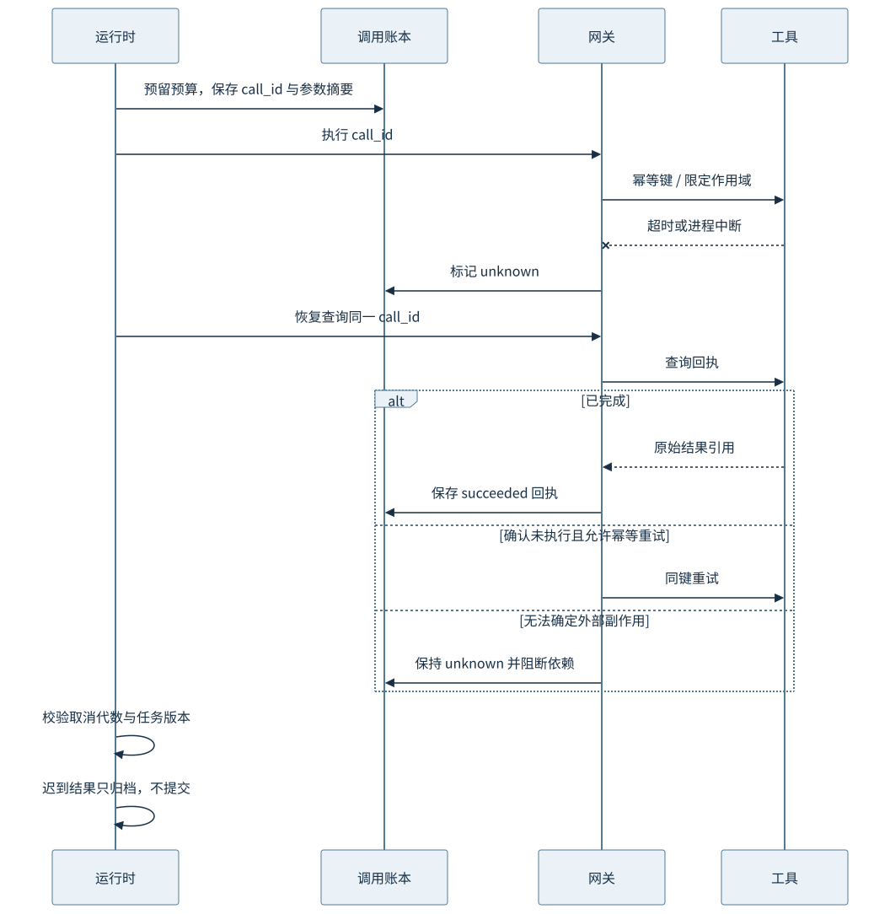

# 03 模型协议、统一行动与工具网关设计

日期：2026-11-11。设计标识：`design-2026-11-11`。目标设计草案；不是已发布 API。示例用于说明契约边界，实际 Schema、版本、限额与兼容清单由 048/049 冻结。旧 `json_contract` 仍只表示 0.1.0 阶段计划协议。

## 1. 分层与双协议要求

协议分为五层：供应商 HTTP/流式封装 → 模型适配器 → 统一 Action/Observation → 工具网关 → 内置或 MCP 工具。角色、预算、权限、校验和候选存储只实现一套；供应商适配器不得执行工具、写世界或修补模型设计。

| 模式 | 模型侧形态 | 本地归一结果 | 首批要求 |
|---|---|---|---|
| `native_tools` | 服务支持的原生工具调用与关联结果 | Action/Observation | M1 必须独立验收 |
| `action_json` | 严格 JSON 动作 envelope 与观察消息 | 同一 Action/Observation | M1 必须独立验收 |
| legacy `chat_completions` / `json_contract` | 固定 A—F 的完整阶段 JSON | 0.1.0 阶段 payload | 保持旧入口/回放，不升级解释为工具循环 |

连接选择明确包含 `adapter_id`、`adapter_version`、`model_id`、`protocol_mode`、`endpoint_ref`、`credential_ref` 和能力快照。连接测试仅证明特定时间、特定配置下的协议行为，不证明设计质量。失败不得静默降级到另一模式。

## 2. 模型连接与能力探测

| 检测项 | 用途 | 不满足时 |
|---|---|---|
| 身份、TLS、认证、超时 | 确认可访问连接 | 给出脱敏错误；不进入生成 |
| 原生工具调用或严格行动 JSON | 确认所选模式 | 明确拒绝当前模式 |
| 调用 ID 与工具结果关联 | 防止错配观察 | 协议不兼容 |
| 结构化参数、拒绝、截断 | 识别不同终止语义 | 适配器必须可区分；不能把截断当完整候选 |
| 上下文与响应大小 | 最低任务可执行性 | 缩小可支持任务范围或要求换连接 |
| usage 字段与含义 | 成本与 token 账本 | 标为 unknown/估算；按保守预算策略运行或拒绝 |
| 可选图片输入 | F 视觉辅助审查 | 显示该项未执行；不伪造视觉通过 |
| 并发/限流/重试响应 | 调度器容量 | 显式限流并保留退避原因 |

探测使用无副作用的受控测试工具及小型固定样本；测试本身可能产生模型费用，计入独立 ProbeRun 预算（无 World/Revision，不复用世界写 Operation 表）并在界面说明。缓存能力快照按连接配置摘要和适配器版本绑定；模型升级、协议模式或端点变化后重新探测。支持矩阵记录“已验证/未验证/不兼容”，不承诺任意兼容地址可用。

## 3. 统一 Action 契约

顶层字段固定为 `contract_version`、`operation_id`、`task_id`、`action_id`、`type`、`payload`。未知字段拒绝；字符串长度、数组数量和嵌套深度有限制。控制层验证 operation/task 与当前调用上下文一致，模型提交的身份不能切换授权对象。

```json
{
  "contract_version": "design-2026-11-11",
  "operation_id": "op_example",
  "task_id": "task_building_01",
  "action_id": "action_0007",
  "type": "tool_call",
  "payload": {
    "call_id": "call_0007",
    "tool_name": "geometry.validate",
    "tool_version": "draft-1",
    "arguments": {"candidate_id": "candidate_01", "rule_set": "building_access"}
  }
}
```

上述 ID 与版本仅为设计示例。Action 绑定模型请求、task_version 和执行代际，绑定关系由运行时记录；不能只凭字符串相同将旧动作应用于新任务。

| `type` | 本版 payload 必填字段 | 执行控制 |
|---|---|---|
| `tool_call` | `call_id`、tool name/version、arguments | 网关验证工具、权限、资源与幂等账本 |
| `submit_candidate` | `candidate_id` | 从 Candidate 加载验证报告、覆盖与限制，触发本地完整验收；不是直接 commit |
| `request_replan` | `reason`、`affected_task_ids` | 监督器从 TaskGraph 取得当前图版本及需求关联，检查范围、预算、必需项和失效集合 |
| `request_input` | `question`、`options` | 运行时生成 question_id/version，绑定阻塞任务与范围；显式回答才解除依赖 |
| `report_gap` | `capability`、`reason` | 运行时关联相关需求；原因可解释可行替代与影响，替代需满足原授权或用户确认 |

本版精确字段以 [Action Schema](contracts/action.schema.json) 为准，payload 禁止额外字段。验证报告、覆盖需求和限制归 Candidate；图版本与需求关系归 TaskGraph；问题身份与影响范围归运行时持久等待项。未来增加结构化替代方案等字段时由 048 冻结新版本，不能直接添加到本版 payload。

`request_input` 不能要求用户重新批准已授权的常规构建。原生模式下上述控制动作可以映射为专用控制函数，但它们仍归一为 Action，不经过任意外部工具执行路径。

### 3.1 两种模式的映射规则

原生模式保存 provider request ID、原生 call ID 与本地 `action_id/call_id` 的一一映射。没有合法原生 call ID、重复 ID 对应不同参数、响应包含不支持的工具字段时拒绝。工具结果以供应商要求的关联方式回传，模型文本说明单独保存。

行动 JSON 模式一次响应返回一个 Action；多工具并发首先由运行时在多个独立任务间提供。未来如支持批量 Action，须独立版本化并定义整批合法性与依赖，不能将任意 JSON 数组自动视为并行许可。解析拒绝代码围栏、重复键、NaN/Infinity、超限数据与未闭合内容；参数不得自动补全为有效值。

原生模式可能返回多个工具调用：适配器先完整解析该轮调用集合，逐项绑定身份并检验全部基本结构。运行时仅并发执行作用域可证明独立且策略允许的调用；不独立的调用串行或返回批次诊断。任一结构非法时整轮不执行，避免“先写一半，再发现后半部分非法”。已完成工具动作与候选修改在日志中各自保留，不能假装外部副作用可由批次回滚。

拒绝、截断、内容过滤、传输错误和非法 Action 保持不同错误类别。流式输出只展示临时进度，工具调用必须在参数完整且通过校验后启动；半截参数不能边接收边执行。

## 4. Observation 与诊断

Observation 是运行时对模型的观察封装，包含 `observation_id`、operation/task/action 关联、事件类型、时间与摘要；工具结束观察携带统一 ToolResult，其最小字段为 `call_id, tool_name, tool_version, status, output_refs, diagnostics, usage, receipt_ref`。ToolCall 账本状态采用 `queued/running/succeeded/failed/unknown/cancelled`；最终 ToolResult 仅采用 `succeeded/failed/unknown/cancelled`，排队与执行中是进度事件，不能作为最终成功结果。无 ToolCall 的控制动作观察不带 ToolResult，但必须关联 action。

诊断项采用结构化字段：`code`、`severity`、`message`、`constraint_id`、`object_ids`、`location`、`parameter_path`、`retryable`、`suggested_scope`、`evidence_refs`。建议范围不是自动授权。对结构化错误给出可供修正的事实，例如“门洞净高 1 m，小于当前规则 2 m”，避免只回传“设计失败”。

大结果落为 Artifact，观察只携带摘要、分页引用和资源大小。图像包含相机、坐标、渲染版本、候选/修订身份及对象拾取映射；模型未实际接收图像时，不能声明视觉审查已执行。原始供应商/MCP 响应保留受控诊断副本并脱敏，用户可导出安全报告。

## 5. ToolSpec 注册表

| 字段组 | 必需信息 |
|---|---|
| 身份 | 名称、版本、owner、实现摘要、后端类型 |
| 数据 | 输入/输出 Schema ID 与摘要，最大 bytes、分页规则 |
| 空间 | 单位、坐标、原点、精度、支持原语、包络计算规则 |
| 语义 | capability、输入前置条件、后置条件、限制和失败码 |
| 权限 | 可读资源类型、可写候选范围、外部网络/文件副作用 |
| 目标 | 支持的 target profile 能力及损失条件 |
| 资源 | CPU/内存/时间/产物量估算与硬上限 |
| 恢复 | 幂等语义、幂等键支持、回执查询、取消能力 |
| 审计 | 输入/输出摘要、依赖提取器、秘密字段脱敏规则 |

工具元数据不来自模型自由创建；外部服务声明也须经本地注册策略验证。工具版本更新不覆盖历史定义。Schema 相容不代表语义相容，几何精度、默认坐标、随机算法或许可条件变化都需要独立兼容评估。

### 5.1 首批工具分组与权限

| 工具组 | 草案示例 | 读写边界 |
|---|---|---|
| 精确查询 | `world.query_objects`、`world.query_region`、`target.capabilities` | 只读固定修订或指定候选；记录负查询空间依赖 |
| 检索 | `knowledge.search`、`assets.search`、`recipes.get` | 返回来源与版本；资产获取另受许可/资源控制 |
| 构建 | `geometry.build_parts`、`geometry.build_stairs`、`instances.distribute` | 只写候选隔离空间；参数显式，无隐式改需求 |
| 校验 | `geometry.validate`、`scene.check_coverage`、`navigation.check` | 只读候选，输出版本化诊断 |
| 预览 | `preview.render`、`preview.section` | 只产生 Artifact；限制像素与渲染时间 |
| 导出 | `export.create` | 只读取指定已接受修订，写派生产物目录 |

所有工具名称是设计草案。M1 只启用经验收的单栋构建/查询/校验/预览子集；自然分布、检索与目标适配按 051 落地。列入目录不等于工具已经存在。

## 6. 网关执行流程

网关依次核对：身份与任务状态 → 工具注册版本 → 参数 Schema → 能力/许可 → 作用域及锁 → 参数推导资源 → 预算预留 → 持久调用意图 → 调用 → 输出 Schema/摘要 → 依赖提取 → 候选隔离写入 → 观察发布。

授权能力令牌由运行时签发，绑定 task_version、基础修订、对象/区域范围、工具集合、资源限额、过期时间和取消代际。工具进程只接收最小数据和能力令牌；模型不能通过在 arguments 中写入 `allow_all` 获得额外权限。工具不接受任意 shell 命令、输出路径或未登记下载 URL。

输出先作为不可信产物处理：校验 MIME、大小、路径、哈希、引用和实际几何包络，再引入候选。外部工具返回“检查通过”只构成其自己的证据；本地强制规则仍独立执行。

## 7. 幂等、回执、超时与取消



`call_id` 是一次逻辑调用的唯一身份；重试保留 call_id 和幂等键，新的设计参数必须创建新 call_id。推荐内部幂等键由 operation/task_version/call_id/工具版本/参数摘要绑定。账本记录请求摘要、状态、attempt、外部回执、结果摘要、取消代际和预算预留。

- 同一 call_id、相同参数已成功：返回已验证结果；不重复执行。
- 同一 call_id、不同参数：拒绝 identity conflict。
- 已有 running：附着既有等待或查询状态；不并发再发。
- 超时/断线无法判断是否执行：转 `unknown`；先查回执。
- 服务支持可验证幂等：用原幂等键恢复；服务不支持且有外部副作用：停止依赖任务并报告人工核对需求。
- 只读操作在预算与速率限制内可以重新调用；仍记录尝试，不能抹掉首次未知结果。

取消先在本地持久化取消代际并停止新增派发，再向支持的后端发送取消请求。远程取消可能迟到或不被执行；本地立即阻止结果进入正式世界。只对隔离临时文件执行可验证清理；WIR 回滚不能撤销外部编辑器已改的项目、远程发布或第三方费用。

## 8. MCP 连接设计

world_builder 是 Host；MCPConnector 管理每个配置服务器的客户端、传输和协议版本。先发现服务能力，再通过本地 ToolSpec 映射策略暴露白名单工具；不能将整个外部服务器工具列表直接交给所有 Agent。首个 MCP 验收使用只读本地知识/资产查询服务，降低对外部副作用的依赖。

MCP 架构区分 Host、Client 与 Server，并支持本地 STDIO 与远程 Streamable HTTP；此职责分界参考 [官方架构文档](https://modelcontextprotocol.io/docs/2026-07-28/learn/architecture)，查阅日期 2026-11-11。本文不据此选择具体 SDK 或宣称协议兼容实现。

### 8.1 协议版本不能混用

2026-07-28 官方文档描述新的发现与每请求元数据行为；2025-11-25 规范具有自己的连接生命周期。连接配置必须固定 `mcp_protocol_version` 与实现适配器，并按该版本执行发现/初始化、能力协商、请求关联和取消。不得把旧版本的 `initialize` 顺序与新版本 `server/discover` 任意拼合。2026-11-12 的具体候选选型为官方 Python SDK 2.3.0 与协议 2026-07-28（见 [16 技术栈](16_technology_stack.md)）；049 按该基线实施并记录真实互操作证据。

工具的 `tools/list`/`tools/call`、输入输出 Schema 和结构化结果处理可参考 [2025-11-25 工具规范](https://modelcontextprotocol.io/specification/2025-11-25/server/tools)，仅适用于声明使用该版本的连接，查阅日期 2026-11-11。外部描述与 annotations 不构成本地授权，输出仍需验证。

取消是版本相关的尽力操作，不能保证副作用未发生；[2025-11-25 取消规范](https://modelcontextprotocol.io/specification/2025-11-25/basic/utilities/cancellation)明确区分一般请求与任务化请求的取消方式，查阅日期 2026-11-11。新版本适配器必须单独核对其取消与长任务扩展语义。

### 8.2 连接安全与更新

STDIO 服务从用户/产品明确登记的可执行程序和参数启动，使用最小环境，不拼接模型文本为命令；退出应用时按进程所有权清理。本地服务不是天然可信：限制工作目录、文件权限、网络、输出量和资源。远程服务只连接批准端点，凭据由 credential_ref 注入，不转发给模型或其他服务器。

工具列表变化先生成差异并重新验证映射；正在执行的任务继续绑定原工具版本，或显式失效后恢复。外部 sampling、用户输入和资源访问请求没有自动权限；只有当前支持、授权且具备预算的能力才开放。服务器返回的 URL/资源引用必须通过来源、路径和下载策略后才能获取。

## 9. 错误码分类与对外语义

| 前缀 | 例子 | 调用方行为 |
|---|---|---|
| `protocol.*` | malformed、truncated、unsupported_mode | 限次修复或调整连接；不改写世界 |
| `action.*` | identity_conflict、unknown_type、invalid_payload | 拒绝动作并给出字段路径 |
| `capability.*` | missing、version_mismatch | 展示相关需求和可选调整 |
| `permission.*` | scope、locked_object、expired_grant | 不执行；只有有效授权变更可解除 |
| `tool.*` | unavailable、timeout、result_schema、unknown_outcome | 根据幂等和回执能力处理 |
| `budget.*` | calls、tokens、memory、deadline | 停止新增工作；保留候选和证据 |
| `candidate.*` | stale、invalid_reference、check_failed | 返回具体对象与复验范围 |
| `execution.*` | cancelled、worker_lost、lease_expired | 恢复账本与代际；拒绝迟到提交 |

上述小写领域错误码用于运行时/工具内部诊断；对 HTTP 调用方按 [API 契约](10_api_contract.md) 映射为状态码与大写通用 code，具体领域码保留在 diagnostics，不让调用方依赖异常字符串。所有错误包含机器码和用户可读解释。用户报告默认隐藏 credential、敏感 URL 参数和原始网络报文；安全诊断包仍可包含 request ID、时间、适配器和状态码。

## 10. 验证矩阵与接口演进

双协议共用同一组语义测试：未知工具、非法参数、重复 ID、观察错配、截断、拒绝、预算竞态、作用域越界、过期租约、失败诊断后修正、候选提交。原生协议另测多 tool-call 批次关联；行动 JSON 另测重复键、围栏、额外字段及控制动作。两条路径分别保留真实服务证据，不能只测解析器后宣称完成。

网关使用内置确定性假工具验证超时窗口：发送前崩溃、执行后回执前崩溃、回执持久化后崩溃、取消后迟到、相同 ID 不同参数、服务无幂等。MCP 额外验证版本不匹配、工具列表更新、分页、断连、恶意返回内容和未授权资源请求。

协议新字段不得直接覆盖旧版 Schema；输入兼容、语义兼容与回放兼容分别声明。ToolSpec 更新后保留旧执行器/解码器或提供只读回放方式。弃用需要版本、替代路径与迁移记录，不自动改写历史调用数据。

## 11. 现状依据

2026-11-11 读取 [0.1.0 运行说明](../docs/05_api_agent_pipeline.md)、[0.1.0 契约](../docs/contracts/api-agents-v0.1.md)、[providers.py](../src/world_builder/agents/providers.py)。现有 Provider 只返回完整阶段文本并拒绝原生 tool_calls；本文连接能力探测、统一动作、MCP 网关与回执恢复属于目标方案。
