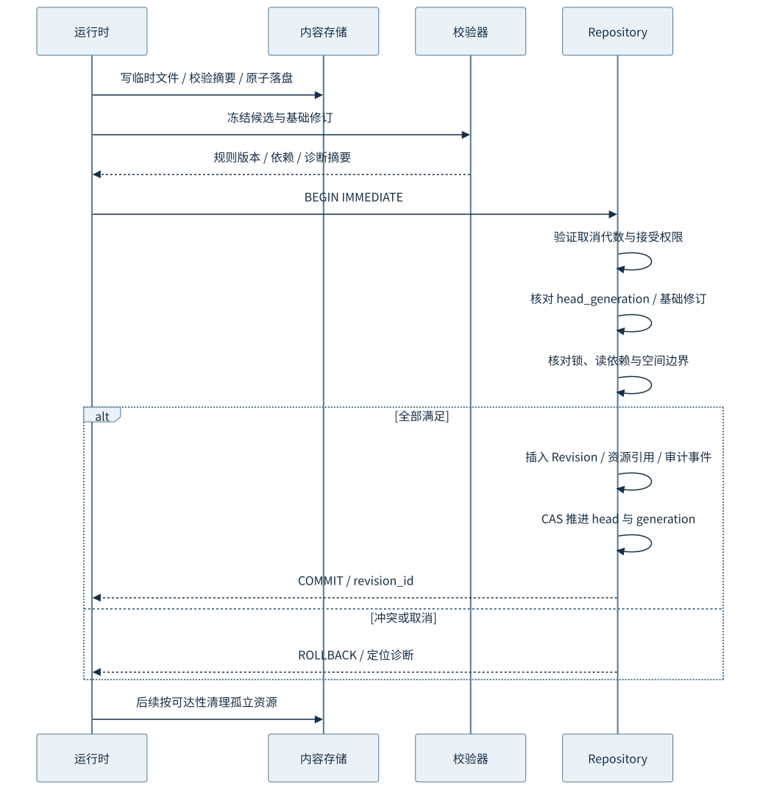

# 04 世界数据、修订与事务设计

日期：2026-11-11。设计标识：`design-2026-11-11`。本文是待实施详细设计；正式字段、Schema 版本及迁移脚本由 048 冻结，持续修改由 052 交付。

## 1. 已有基础与新增边界

2026-11-11 核对 `src/world_builder/storage/repository.py`：现有 Repository 使用 SQLite，启用外键和 `synchronous=FULL`，提交以 `BEGIN IMMEDIATE` 比较 `expected_head`，检查已有字段锁，校验资源摘要并在事务内写入快照、资源引用与世界头。`publish()` 已使用同目录临时文件、文件 fsync 和替换发布内容寻址资源。本文复用这些机制，不把它们误列为全部待开发。

现有 `agents/compiler.py` 从全体接受计划的摘要生成 world/revision ID。因而已有修订存储不等于稳定世界身份、候选隔离、任务依赖或持续编辑已经完成。当前 worldpkg 是快照交换包；完整修订历史交换须单独版本化，不能改变旧包含义。

## 2. 领域模型与身份规则

| 实体 | 最小字段 | 不变量与所有者 |
|---|---|---|
| World | world_id、name、head_revision_id、head_generation、created_at | Repository 分配长期不透明 ID；提示词、模型和重试不得改变它 |
| Revision | revision_id、world_id、parent_revision_id、snapshot_hash、operation_id、validation_ref | 接受后不可修改；首版线性父链；分支合并不是隐含支持 |
| Object | object_id、kind、parent_id、transform、bounds、geometry_ref、semantic、material_refs | 对象 ID 与内容 hash 分离；属性改变保留身份；复制产生新 ID |
| Operation | operation_id、world_id、base_revision_id、request_ref、budget、cancel_epoch | 一次用户意图及所有返工共享预算；取消代数阻断迟到提交 |
| Task | task_id、task_version、operation_id、capability、scope、dependencies、read_set、write_set | 任务版本递增；旧版本产物保留但不可继续被当作有效依赖 |
| Candidate | candidate_id、base_revision_id、operation_id、task_versions、patch_ref、read_set、write_set、status | 隔离修改；不能仅通过 UI 预览或 F 同意就成为 Revision |
| Artifact | artifact_id、content_hash、media_type、byte_size、producer、provenance、retention_class | 内容不可变；下载路径由服务端解析 ID，模型不得提供文件系统路径 |
| ToolCall | call_id、operation_id、task_id、idempotency_key、input_hash、status、receipt_ref | 重复相同键/相同输入回读回执；同键不同输入冲突 |
| Constraint | constraint_id、kind、scope、severity、parameters、source | 硬规则与用户锁只能由本地策略或用户命令管理 |
| Lock | lock_id、object_id 或 region、field_pointer、owner、version | 用户创作锁不是数据库锁；模型不能解除或通过删除对象绕开 |
| Evidence | evidence_id、subject_ref、check_kind、status、environment、artifact_refs | 本地检查、文件、目标加载、实走、观感各自记录 |

创建 World 时分配一个已接受的空初始修订（通过空世界契约校验），使首次 Operation 也有明确 base；不把空世界当作完成用户场景。

ID 采用本地生成的不透明随机标识；格式和字符集由 048 冻结。资源按 SHA-256 去重。禁止用 prompt hash、数组位置或可变名称作对象身份。配方实例拥有独立 instance_id，修改单个实例不能重排其他实例 ID；实例组重采样是显式替换操作。

引用采用 `{kind, id, revision_id?, content_hash?}`；跨世界引用必须显式允许。创建父子树时禁止环、悬空 parent_id 和对象跨世界迁移。删除采用 revision 内的墓碑/缺失语义，历史版本仍可读取；新对象不得重用已删除对象 ID。

## 3. Repository 逻辑表与访问路径

下表是目标逻辑模型；现有 `worlds/revisions/records/resource_blobs/revision_resources/branches` 等表逐步扩展，不能按此表直接覆盖旧数据库。

| 表或索引 | 主键/约束 | 主要索引与访问 |
|---|---|---|
| worlds | world_id；head 指向同世界 Revision | 最近更新世界列表 |
| revisions | revision_id；FK world_id；snapshot_hash | `(world_id, created_at, revision_id)`；按父链恢复 |
| records | `(world_id, revision_id, record_id)`；payload_hash | `(revision_id, record_type)`、parent_id；整包与局部读取 |
| object_bounds | revision/object 键；min/max 合法 | R-tree 或分块包络索引；空间候选查询后精确校验 |
| operations | operation_id；base 与 world 一致 | world/status；恢复未完成操作 |
| tasks | `(task_id, task_version)` | operation/status；依赖就绪队列 |
| dependencies | consumer_task/version + producer_ref + dependency_kind | 反向索引查失效传播；包括对象字段与空间查询谓词 |
| candidates | candidate_id；base_revision_id；patch_hash | operation/status；只读取授权作用域 |
| tool_calls | call_id；唯一 `(operation_id, idempotency_key)` | status/lease_until；恢复未知调用 |
| artifacts/resource_blobs | artifact_id；唯一 content_hash | hash 查重；retention_class/last_access 用于缓存清理 |
| revision_resources | `(revision_id, artifact_id)` | 资源反向引用；防止删掉历史依赖 |
| locks | lock_id；world/object/region；lock_version | 对象与空间查询；提交重新检查最新版本 |
| events | `(operation_id, sequence)` | 单调递增事件游标；UI 补拉与回放 |
| export_jobs/evidence | export_id/evidence_id；revision/profile/hash | 同修订缓存和分层验收结果 |

大几何、图片、日志附件和资产文件进内容寻址文件库；小型结构元数据进 SQLite。快照可先保留现有完整 records 方式，后续在实测存储压力下引入分块持久化；增量补丁不能成为唯一恢复来源。事件记录用于审计和恢复，但不以重演任意外部副作用重建世界。

## 4. 候选与正式提交

Candidate 状态：`draft → validated → accepted`；可进入 `rejected/stale/abandoned`。`validated` 绑定 patch_hash、基础修订、检查器版本、目标能力和锁版本；候选内容变化后必须回到 draft。`accepted` 只能由本地接受事务产生。失败修正创建新候选或显式新版本，不覆盖已留证内容。

候选可以聚合多个已通过任务级检查的产物。任务 accepted 只代表输出可作为依赖，世界头只在整次操作的最终候选完成接受时推进；不能让用户取消时留下半个场景。

提交接口建议为 `accept_candidate(candidate_id, expected_head, expected_head_generation, operation_epoch, idempotency_key)`。执行顺序如下：

1. 在固定 base 快照上装配候选，完成结构、引用、数量、空间、目标能力及必要任务覆盖检查；F 输出建议另行保存。
2. 生成最终快照、诊断和资源清单；资源先进入候选暂存目录，校验长度、摘要、媒体类型和闭包完整性。
3. 将资源发布到同一数据根的内容寻址目录；文件 fsync、原子替换后按平台能力同步父目录。禁止跨文件系统 rename 假定原子。
4. 进入短 SQLite 写事务；校验世界头、operation 未取消、epoch 相等、所有任务版本仍有效、用户锁和策略版本未改变。
5. 默认严格要求 `head == base == expected_head` 且 `head_generation == expected_head_generation`。不匹配返回 `conflict.base_revision`，候选 stale；不在事务内启动模型或自动昂贵重构。
6. 重新核对读依赖与写范围，确认保存的 validation token 覆盖相同快照和资源。邻接约束版本不匹配须退出事务并重验。
7. 插入不可变 Revision、对象、资源引用、事件和操作结果，比较并交换世界头，在一个 SQLite 事务内提交。
8. 事务提交成功后通知 UI；通知丢失时可按 operation/idempotency_key 查询。相同提交重试返回原 revision_id。

世界头更新、head_generation 单调递增、接受回执和完成事件必须共用事务。即使恢复相同内容也不复用 generation，以防 ABA 竞争。若提交成功后进程崩溃，恢复查询返回原结果，而不是二次新建修订。数据库事务内只做有界本地复核，模型、远程工具、几何编译与大文件计算均在事务外进行。

## 5. 并发、读依赖与空间冲突

首版建议：一个世界同时可有多个候选计算，但 Repository 只有一个写入权威，接受严格比较世界头。跨世界可并行；同世界 E 子任务在同一基础快照并行，汇总后统一空间校验。按 ID 不相交不证明可合并。

记录的依赖分三类：对象字段版本，例如建筑 A 的入口；资源版本，例如树木资产包；查询谓词，例如区域 R 内所有障碍物。最后一种可发现“原来为空但被另一操作插入对象”的幻读。查询依赖保存 bounds、过滤条件、结果摘要及相应空间分块版本。

假设任务 T1 在 `[0,10)×[0,10)` 新建树木，T2 在 `[8,12)×[5,8)` 新建道路，即使 object_id 完全不同，合并仍须检查相交、退让与净空。检查范围为写入包络向外扩张约束影响半径，并包含跨边界水体、道路连通和地基支撑依赖。

后续可增加显式 rebase：比较 base→head 的差异，检查读写集合及空间谓词，重装配并重新验证后产生新候选。不得以 LWW 最后写入胜出覆盖用户修改。rebase 不自动改用户需求；若须重新调用模型，仍属于原 operation 预算或新获授权操作。

## 6. 锁与持续编辑

锁分对象整体、字段、区域三种。权限层控制谁能改锁；对象复制、父级删除、资产替换、坐标变换也必须解析到受影响对象/字段，不能借间接变更绕锁。锁变更本身有版本与审计事件；候选校验之后新增锁，在提交时必须阻断旧候选。

用户修改先转为语义命令，如移动对象、替换材料、修改约束或请求 Agent 重设计，再产生候选。局部修改影响分析对真实读依赖做反向闭包；无关对象保持 ID 和内容摘要。共享资产改动需要创建新 asset revision，再显式选择哪些实例升级，不能原地改 blob。

撤销/重做建议采用“已有快照恢复 + 新审计修订”：restore 命令引用过去修订，复用其不可变资源，不调用 LLM；当前 head 为新修订父节点，记录 restored_from。恢复前重新检查当前有效锁和策略。用户明确修改锁后才能恢复违反锁的历史状态。成功新编辑清空当前 redo 栈，但历史修订仍可选取。多分支合并与协作式撤销不属 M3 首版。

## 7. 崩溃一致性与回收

| 故障点 | 可见状态 | 恢复规则 |
|---|---|---|
| 临时 blob 写入未完成 | 世界头未变 | 按租约回收暂存；禁止被资源索引引用 |
| blob 已发布，DB 尚未提交 | 多余完整 blob | 作为孤儿保留宽限期，再按引用闭包回收 |
| DB 提交失败/磁盘满 | 世界头旧值，可能多余 blob | rollback；报告失败；不伪造 accepted |
| DB 已提交，响应未返回 | 新头和回执已存在 | 幂等查询复用结果，不重试模型或重复提交 |
| blob 后续损坏/丢失 | 数据库可能仍引用它 | 摘要校验失败，世界只读隔离；从已校验备份恢复 |
| 进程重启时有运行任务 | 任务与调用记录存在 | 查询 ToolCall 回执，unknown 不盲目执行写工具 |

SQLite 不能把外部文件操作纳入同一原子事务；正确顺序是先持久化不可变文件，再原子发布其引用。启动扫描校验已提交 manifest 与必要资源；必要资源缺失不能自动忽略。

GC 根包括：所有保留修订、活动世界头、未过期候选、活动工具回执、导出和固定证据。先 mark 后 sweep，并记录删除清单；活动 writer 持有租约，GC 不能删除其暂存成果。历史清理须为独立用户操作；普通缓存淘汰不得删除源世界、唯一资产或验收证据。

## 8. 备份、交换与版本迁移

备份使用 SQLite 备份机制或协调停写快照，并一起保存 manifest 所引用的 blob；不能只拷贝正在写入的单个数据库文件。备份完成后在隔离目录执行 integrity_check、资源闭包检查与指定修订重开。备份完成不等于恢复通过。

旧 0.1.0 包通过旧读器验证后保留原件，在新命名空间创建升级副本，保存原包 hash、旧版本及映射表。未知 major 版本拒绝写入；未知可选扩展可保留为 opaque 数据，但不能宣称可编辑；未知必要能力拒绝打开可写模式。迁移失败不得改原数据库或当前世界头。

新版 worldpkg 设计包含 manifest、一个或显式选择的一组修订、所有必要资源、来源/许可证及映射；日志、凭据、绝对路径和未选择的历史默认不进入包。可选择完整离线包或仅引用包，但后者必须声明不自包含，并在导入前检验依赖可达性。压缩包读取设置成员数、解压总量、压缩比、路径和重复文件限制。

## 9. 数据根与性能权衡

推荐继续 SQLite + 本地内容寻址资源库，复用当前 Repository；网络微服务数据库不是 M1 前提。新运行状态、候选与回执加入同一权威数据库，避免跨库事务。2026-11-12 具体选型建议本机数据根默认使用 WAL、FULL 同步与 5000 ms busy_timeout；048/049 完成恢复及并发验证后启用，配置见 [16 技术栈](16_technology_stack.md)，本次不修改运行参数。

**应用数据根必须在本机支持可靠锁和持久化语义的文件系统上。** 当前源码工作区位于 SMB 挂载卷，并不适合作为 WAL 数据根。源码可在共享卷，运行 DB 与候选目录应置于本地应用数据目录，完成后的校验包可复制到共享卷。启动检测不支持的路径并给出迁移入口；不要把锁错误当成可忽略警告。

单世界规模、记录数、资源体积和候选保留时长作为可配置配额，实施前基准后冻结。分页读取按 revision 固定快照；UI 分页期间 head 变化不能混入新修订对象。空间索引只是加速结构，可从权威 records 重建。

## 10. 验收与来源

048 必须证明：失败/取消/旧 head 不推进世界头；重复接受只返回一个 revision；锁变化与空间幻读不会漏检；崩溃点逐项恢复；worldpkg 往返资源完整；旧包原件摘要不变。052 增加局部编辑身份保持、反向依赖失效和零模型调用撤销/重做证据。

来源：2026-11-11 读取上述 Repository、compiler、worldpkg 与 `storage/migrations/0001_initial.sql`；这些支持“已有基础”的描述，不支持新增候选生命周期已实现。SQLite 官方 [WAL 文档](https://www.sqlite.org/wal.html)（访问 2026-11-11）明确同主机共享内存及网络文件系统限制；本文采用本地数据根的结论是项目部署设计，尚未执行性能或故障注入验收。
