# 05 场景构建、几何内核与分层校验

日期：2026-11-11。设计标识：`design-2026-11-11`。本文规定目标模块边界与建议算法；现有能力仍受 0.1.0 契约限制，048/050/051 分阶段实现和冻结能力清单。

## 1. 几何模型与坐标约定

源世界采用右手系：X 东、Y 北、Z 上；长度 m，角度 rad。每个几何/工具/profile 必须显式携带或引用单位与坐标版本。坐标转换属于导出层，不能改变 WIR 的源数据。区域边界、对象包络、用户保护区域和候选写范围都使用同一世界坐标。

当前 0.1.0 是整米轴对齐盒体，无自由旋转；bounds 为 `[min, max)`，三个轴均要求 min < max。B/D 为世界绝对坐标；E 局部原点是 `site.bounds.min`，编译器只作平移。整数值不能因目标显示 float 就被解释为支持任意精度。区域 32—512 m 且为 16 的倍数是输入限制，不是性能或质量承诺。

| 表示 | 第一阶段策略 | 未来扩展边界 |
|---|---|---|
| AABB 盒体 | 延续整数、半开区间；面接触不算体积重叠 | 小数精度独立能力，不全局偷偷四舍五入 |
| 地形 | 单元高程网格；格内平顶，不把单元高度解释为顶点高度 | heightfield 插值、坡面、挖方均需新工具与校验 |
| 水体 | 显式静态体积/水位、与地形关系 | 不承诺流体、排水或水面物理模拟 |
| 道路/桥 | 显式曲线采样或首版矩形片段，并声明可用版本 | 曲线道路不能被盒体旧读器静默近似 |
| 自然资产 | 有界配方/资产实例与碰撞代理 | 任意网格、LOD、旋转实例按 profile 放行 |
| 建筑 | 显式体块、空间、开口及路径 | 曲面、斜屋顶、任意布尔运算非首版隐含能力 |

后续支持小数时，建议以 geometry profile 声明 `quantum_m`、最小厚度、容差和支持的旋转自由度；内核使用整数定点格或可重复的量化策略，渲染使用浮点。不得混用“碰撞容差”和“用户允许尺寸误差”。geometry profile 变化使相关检查、缓存及目标损失评估失效。

## 2. 能力注册与模块接口

| 模块 | 输入 → 输出 | 不允许的隐含行为 |
|---|---|---|
| TerrainBuilder | 栅格/区域配方 → 地形候选、支撑查询索引 | 为适配建筑暗中填平河流 |
| WaterBuilder | 水面/边界/河床描述 → 静态水候选、淹水诊断 | 自动假设水向低处流动或自动排水 |
| BuildingBuilder | 构件/空间/入口/路径参数 → 对象图和几何 | 偷补模型未给出的设计、删层/减数量 |
| RoadBuilder | 线路/宽度/标高/桥规则 → 路面与连接关系 | 自动把断路改成传送或跨越水体 |
| InstanceBuilder | 区域、配方、数量/密度、seed、避让 → 有 ID 的实例集 | 拒绝采样耗尽后减少必需实例而标成功 |
| GeometryCompiler | 已校验语义对象与配方 → WIR 几何/资源 | 规划或更改需求；切到历史规则生成器 |
| SpatialQuery | revision/candidate + bounds/predicate → 精确引用与摘要 | 以语义检索代替空间事实 |
| Validator | 候选、约束/profile、检查范围 → 诊断与校验令牌 | 依据模型文本“已通过”跳过实际检查 |
| PreviewRenderer | 固定候选/修订、相机、剖切 → 图片及拾取映射 | 把不可见/被遮挡对象当作不存在 |

注册项需包括 capability_id、版本、输入输出 Schema、支持的原语、精度、几何和内存配额、确定性说明、可取消性与测试样本。工具返回“实际建立数量、bounds、资源用量、诊断”供模型观察；参数非法时不采用默认值掩盖错误。

参数化工具负责确定性展开，例如按给定墙厚和开口尺寸切分墙片；模型负责选择布局、尺寸与风格。展开算法及 seed 进入 provenance。工具不能自主决定牺牲哪个用户必需项。

## 3. 地形、水系与基底

地形网格索引使用 `(row, col)` 显式对应 Y/X；cell_m 必须整除区域。查询返回高程、坡度或首版台阶高度、表面材料、水深、可建设性和数据版本。地形不能只输出一张视觉高度图而丢失精确数值。

首版高度单元保持 0.1.0 的地面填充语义；扩展设计增加适用能力后才能允许负高程、地下空间或洞穴。不同地形分块边界必须共享采样规则，边界接缝作为检查项。

水体记录 water_id、surface_z、bed_ref、footprint、material、static 状态。检查水位高于所覆盖河床、边界在场景内、重复水体冲突及建筑淹水规则。自然水岸可以合法缺少道路；建筑的干燥和接路要求不能强加给森林。

地形变化影响其包络内对象的支撑、水深及与邻块连接，因此失效区域包括依赖的地基、树根、岩石、道路和水域。工程承载、地质安全和真实水文计算不在校验声明内。

## 4. 建筑、空间与连续通行

建筑语义分离 solids（墙、楼板、屋顶、柱等）、voids（开口和可用空间）、connections（门、楼梯、路径）及 decoration。首版可将开口展开为多个非重叠墙片；不能仅在语义记录写“有门”而几何仍封闭。

支撑检查针对需要支撑的对象能力：检查脚下接触与允许的跨越类型，按结构关系向下追踪到地形。桥、悬挑和浮动物体须明确能力与限制，不能统一用“所有体素下方都必须实体”或完全忽略支撑。首版只证明游戏场景的简化支撑规则，不证明结构安全。

通行 profile 必须冻结角色横截面/高度、允许台阶、跳跃、坡度、碰撞规则和最小净空。源端检查为以下分层：

1. 入口和目的空间存在且归属正确；每项必需可达需求有目标节点。
2. 检查实体占用、脚下支撑、角色占用体和转角净空；路径连接边由实际格位或几何生成。
3. 在适用能力范围内做连通性搜索；输出阻断位置、相关对象及违反的 profile 参数。
4. 对整楼逐层访问和户外连接核对完整性；路径声明不能替代实际障碍验证。
5. 目标引擎导入后另用对应角色/碰撞体实走；源端通过不能继承为目标实走通过。

当前 0.1.0 路径为一格宽、两格高空气格，水平曼哈顿相邻、可跨一米高差；这是跳跃近似，不能标为平滑楼梯、无障碍或 CharacterController 已验证。

## 5. 自然实例和混合场景

实例分布输入包含区域多边形/格域、排除区域、资产候选、数量区间或密度目标、最小间距、坡度/水深/海拔范围、seed 与算法版本。选择资产后按真实包络或碰撞代理进行放置，不能只以资产原点判断避让。

建议首版使用有界网格/拒绝采样，支持固定 seed 重放；若以后使用 Poisson disk，算法和浮点处理也要固定。达到尝试次数、时间或实例上限后返回 `placement.capacity`，记录 requested/placed/rejected_by_reason。必需数量不足时整个相关任务不 accepted；可选密度目标可产生清楚的降级报告。

每个实例独立 instance_id，源位置、变体参数、asset hash 与随机序列索引可追溯。组级编辑声明是否保留已有实例；“重布森林”不应伪装成只移动一棵树。自然对象允许共享几何资源，但拾取、锁、诊断及修改仍按实例定位。

混合场景统一检查树冠/枝干与道路净空、岩石与入口、水域与地基、植被与视线等适用规则。各规则须声明硬约束或风格偏好；偏好评分不能抵消硬约束失败。

## 6. 校验顺序和结果模型

| 层 | 内容 | 阻断条件 |
|---|---|---|
| V0 输入安全 | 字节/深度/数组限额、重复键、有限数值、Schema | 任一不合法即拒绝解析后续步骤 |
| V1 引用与语义 | ID、父子关系、版本、必需数量、任务覆盖 | 坏引用、环、缺必需能力或对象 |
| V2 局部几何 | 正体积、bounds、重叠、精度、材料可用性 | 不可解释/不支持的几何 |
| V3 空间与功能 | 地形支撑、水域、净空、入口、连通、跨对象关系 | 适用硬规则失败 |
| V4 全场景与目标预检 | 汇总数量、锁、资源预算、目标损失 | 必需项丢失或超过已允许损失 |
| V5 接受事务 | base、epoch、锁/策略/检查版本 | 任何并发或取消失配 |
| V6 目标验收 | 文件、导入、重开、碰撞、实走、观感 | 单独结果；不回写虚假的源端成功 |

校验诊断建议字段：`diagnostic_id, code, severity, check_id, check_version, object_refs, bounds, expected, actual, repairable, message, evidence_ref`。`error` 阻断；`warning` 保留；`info` 解释。状态为 passed/failed/not_run/not_applicable；not_applicable 必须给出能力规则依据，不能以未实现冒充不适用。

检查产生 validation token，绑定 candidate content_hash、base、geometry/profile/validator 版本、资源闭包摘要、规则集和执行范围。调用工具检查之后修改任何关联对象都使 token 失效。

## 7. 空间索引、增量与性能

首版可复用 SQLite 空间 bounds 索引，构建 worker 内建立分块空间哈希或 AABB 树。宽相筛出可能相交对，窄相用该原语的精确规则检查；AABB 重叠对旋转网格只表示“需进一步检查”，不能直接判碰撞。未支持窄相时明确能力缺口。

增量检查输入为写集合包络、受影响约束和反向依赖；扩张区域覆盖道路连通、地形支撑及净空半径。全场景计数、必要需求与全局连通等不能被局部包络裁掉。新增对象必须能使先前“无障碍”空间查询失效。

控制性能的参数包括最大对象/实例数、体素/栅格单元数、三角形数、候选字节数、空间查询命中上限、检查步数、worker 内存和截止时间。预计体素量超过预算时在分配前拒绝，不能等内存耗尽。分块调度应可取消；取消后中间块保留为未接受缓存。

避免建立完整 `512³` 空占用数组作为每个任务默认成本。稀疏块和对象包络是建议实现；具体分块大小通过 050/051 基准确定，不在设计中冒称已达吞吐率。

## 8. 预览与质量评审

预览记录 candidate/revision ID、相机内外参或正交参数、剖切面、渲染器版本、可见层和图像 hash。拾取颜色/对象映射与图像同版本；隐藏层和视锥外区域不能作为已检查证据。剖切视图仅供诊断，不改变源几何。

F 结合结构诊断、需求覆盖和可用图像提出受限返工；视觉评分是解释性建议。模型无图像能力则 image_review 为 not_run。布局美感、风格一致性和构图由独立量表评估，不能以截图存在或“渲染成功”替代观感通过。

## 9. 验收样本与实施归属

| 样本 | 正向目标 | 必须包含的负例 | 工单 |
|---|---|---|---|
| 单栋两层房屋 | 门洞、逐层路径、材料映射 | 封门、无支撑楼板、低净空、越界部件 | 050 |
| 无建筑森林溪流 | 地形/水/树石，无强制道路 | 数量不足、资产缺失、不可用坡度、树冠堵道 | 051 |
| 森林营地 | 自然与建筑共同空间校验 | 入口积水、地基悬空、共享资源误改 | 051 |
| 局部地形/对象编辑 | 相关任务失效，无关 ID 稳定 | 更新支撑却未重验建筑、锁区域越界 | 052 |
| 坐标基准场景 | 原点、三轴、非对称 L 形一致 | 手性镜像、max 端多一格、单位错千倍 | 048/051 |

每个几何工具须具备边界和负例测试、资源上限测试、确定性回放与配方/资产缺失诊断。随机 seed 用于重现本地算法，不保证远端模型确定性。

来源：2026-11-11 核对 [0.1.0 契约](../docs/contracts/api-agents-v0.1.md)、`agents/compiler.py`、`wir/transforms.py`。新增实例分布、能力注册、增量检查和视觉评审规范是本次设计建议；未执行几何新实现或目标环境验收。
