# 07 目标平台、坐标映射与导出设计

日期：2026-11-11。设计标识：`design-2026-11-11`。目标设计草案；首批 profile/契约由 048 冻结，文件交付由 050、真实目标加载由 051 验收，修改后导出由 052 验收。

## 1. 源与派生边界

WIR 是源世界，Unity/Minecraft 产物绑定同一已接受 Revision；目标适配器不能为导出方便回写源对象、删除必需项或改变锁。改变导出设置仅使派生产物失效，不能重跑模型生成。目标编辑器手工修改不自动反向合并到 WIR。

导出服务负责 profile预检、派生几何/材料转换、对象映射、资源闭包、编码与损失报告。目标引擎加载器、测试角色和验收证据属于独立阶段。GLB不是完整Unity游戏，schematic不是独立Minecraft存档；不得在界面混用这些交付名词。

## 2. 已有行为与当前代码依据

2026-11-11 核对 [Agent 编译与导出](../src/world_builder/agents/compiler.py)的 `export_geometry()`：当前导出整数盒体、有限材质、静态 GLB 和 Sponge v3 schematic，并记录 `target_load=not_run`；Unity碰撞体须由消费端添加，当前源端跳跃近似路径不证明引擎角色可行走。

Agent GLB复用 [unity/sample.py](../src/world_builder/adapters/unity/sample.py) 的 `_glb()`；[unity/scene.py](../src/world_builder/adapters/unity/scene.py) 是旧开放空间样件，不是新Agent通用场景入口。现有版本常量与历史加载证据只能按原输入解释，不能迁作本设计验收。

当前代码中的 Unity `6000.3.24f1`、Minecraft `1.21.11`、glTFast `6.20.0` 及相关DataVersion是本地代码/历史环境快照，不作为最新版本推荐。048必须重新确认实际可用环境后冻结完整profile，不从某个常量推断已完成互操作。

## 3. TargetProfile 契约

| 字段组 | 必须固定的内容 | 使用阶段 |
|---|---|---|
| 身份 | profile_id、profile_version、content_hash、adapter_id/version | 请求、缓存、产物与证据 |
| 引擎环境 | 平台、引擎精确版本、操作系统、依赖/插件版本 | 加载前检查 |
| 表达能力 | 原语、精度、层级、实例、材料、碰撞、地形/水体限制 | 规划前可行性检查 |
| 坐标 | 源/目标坐标、单位、矩阵约定、原点、量化策略、反射处理 | 编码和对象映射 |
| 资源限额 | 对象、网格、三角形、纹理、体素、文件和内存上限 | 规划与导出预检 |
| 行为策略 | 碰撞体生成、角色净空、流体/重力更新、粘贴空块策略 | 目标功能验证 |
| 损失策略 | 可允许近似、关键需求映射、阻断规则 | 预检和逐对象报告 |
| 验收环境 | 导入器、验证器、测试场景/角色、运行配置 | 文件/加载/实走证据 |

profile不是模型自由填写的能力声明；由已验证适配器注册。未知能力按不可用处理，不按“目标引擎理论上支持”放行。多目标请求在规划前对每个必要能力分别判断：原生支持、允许近似、可选遗漏或阻断；WIR无须降到最低公共表达。

## 4. 坐标、手性与量化

源约定为右手系 `pW=(x东,y北,z上)`，长度m；以下均以列向量表示，平移另记 `o`。序列化必须注明row-major/column-major，不能仅给16个数字。半开AABB转换必须变换角点并重新求min/max，不能单独取反min。

| 路径 | 位置变换 | 适用边界 |
|---|---|---|
| 当前Agent WIR→GLB | `pG=(-x,z,y)` | `_glb()`特定编码路径，保持RH Y-up |
| 当前Agent GLB→Unity | glTFast在导入链反射X，得到 `pU=(x,z,y)` | 绑定导入器版本及验收；不得再重复反射 |
| 通用 `WIR_TO_GLTF` | `pG=(x,z,-y)` | [transforms.py](../src/world_builder/wir/transforms.py)的另一基变换，不能与上一链混用 |
| WIR→Minecraft连续坐标 | `pM=(x,z,-y)+o` | 当前目标约定，原点由manifest记录 |

Unity采用左手坐标、Y向上；glTF采用右手坐标、Y向上、米单位。格式约定分别参考 [Unity 6 手册](https://docs.unity3d.com/6000.0/Documentation/Manual/QuaternionAndEulerRotationsInUnity.html) 与 [Khronos glTF 2.0](https://registry.khronos.org/glTF/specs/2.0/glTF-2.0.html)，访问2026-11-11；上述项目矩阵属于代码核对，不是规范强制唯一选择。

Minecraft反射整数格时，源Y区间 `[a,b)` 对应目标Z区间 `[-b,-a)`；源单元索引 `j` 对应目标单元 `-j-1`，不能用连续点映射 `-j` 直接充当方块索引。当前代码正是转换盒体边界后填充半开区间。

量化必须区分实体覆盖、自由空间和装饰代理：不能统一四舍五入导致门洞封闭或墙消失。首版整米盒体可精确占格；未来细精度/旋转资产应先定义保守栅格化规则与误差阈值，再检查占用、净空、支撑及数量。关键功能损失超出允许范围时导出失败，不自动改源几何。

未来网格变换需要按逆转置处理法线、按手性修正三角绕序和切线符号；当前直接生成盒体不证明自由网格已受支持。基准场景必须含原点、三轴、非对称L形、不同面标记、负坐标和相邻边界格，分别检查坐标与可见正面。

## 5. Unity 派生路线

建议分两层：格式层输出GLB/资源/manifest；可选Unity导入层在锁定项目与依赖下建立场景层级、对象ID组件、材质和碰撞体。首批继续复用已支持格式，不把自动创建完整Unity项目设为未经确认的前置条件。

| 源内容 | 目标策略 | 必须报告的边界 |
|---|---|---|
| 实体盒体/受支持网格 | 网格节点，绑定source_id | 合并网格时保留子网格/拾取映射 |
| 地形 | 首批普通静态网格 | 不宣称Unity Terrain编辑能力 |
| 植被实例 | 共享网格与材质、独立实例映射 | GPU实例化/LOD策略不得丢失编辑身份 |
| PBR材料 | profile支持的glTF/渲染管线子集 | 透明、双面、发光与纹理颜色空间差异 |
| 水体 | 静态外观和单独碰撞策略 | 不代表流体、浮力、岸线模拟 |
| 语义、锁、历史 | sidecar或源包 | 引擎不原生执行WIR约束 |

碰撞体按solid/trigger/none分类，静态水不能自动当固体；复杂网格的碰撞代理必须版本化并记录近似。NavMesh或测试角色是可选明确能力，生成或烘焙失败单独留证；仅添加Collider不等于可连续通行。

导出预检检查纹理闭包、材料支持、索引范围、法线/绕序、节点层级、极值/NaN和预算。导入后检查对象数量/包络/朝向/材料缺失、碰撞设置、保存重开和关键视角；UI显示这些结果独立于GLB文件成功。

## 6. Minecraft 派生路线

首批输出Sponge v3 schematic及分块放置manifest，限定Java版目标profile。profile冻结Minecraft精确版本、DataVersion、WorldEdit/读取器版本、允许方块状态、流体和更新策略；不声称Bedrock版或任意mod包兼容。

流水线为WIR几何→目标连续坐标→版本化体素化→冲突解析→block-state palette→分块编码→放置映射。同一格多个实体竞争必须按显式规则检测，不能依赖遍历顺序覆盖。空气格/门洞与固体格分开处理，防止旧目标地形填住源端空间。

当前编码按128×128水平分块并检查填充后的内存预算；这属于现有实现细节，不要求未来profile固定该尺寸。每块记录文件摘要、世界半开包络、原点、局部尺寸、非空气数和source_id到方块区间映射；负坐标使用向下取整分块，不能用向零截断。

Sponge v3规定DataVersion、尺寸、Offset、Blocks和Palette等结构；Offset表达相对粘贴位置，不等于源世界坐标。[Sponge官方格式规范](https://github.com/SpongePowered/Schematic-Specification/blob/master/versions/schematic-3.md)，访问2026-11-11。manifest必须独立定义目标原点和放置步骤，避免重复施加offset。

palette允许集按目标版本验证，楼梯/门/半砖的朝向与状态显式映射。需BlockEntity的对象没有完整数据时拒绝相应能力，不能用同名普通方块冒充。源静态水与目标流体更新、重力方块和邻接更新存在语义差异，保存为profile策略并进行目标运行验证。

当前manifest要求粘贴前清理；自动清理既有游戏世界具有独立副作用，当前文件导出不授权工具自动执行。目标实测使用隔离测试世界并记录放置原点、清空方式、更新策略和回滚方法；目标发布/线上投稿仍不在范围。

## 7. 损失与对象映射

每个源对象至少对应一条映射记录；未产生目标几何的房间/关系也要说明是否以sidecar保留。记录 `source_id, source_version/hash, target_refs, classification, reason, affected_requirement_ids, magnitude?, policy_ref, evidence_ref`。分块/合并可形成一对多或多对一映射，不能丢掉追溯路径。

| classification | 含义 | 处理 |
|---|---|---|
| preserved | 对声明的属性完整保留 | 不自动意味着物理/视觉一致 |
| approximated | 量化、材料替代或碰撞代理等近似 | 给出方法/误差及允许依据 |
| omitted | 已允许的可选内容仅留源或省略 | 必需项不得归入此类后宣称成功 |
| unsupported | profile/适配器缺失能力 | 关键需求阻断，报告缺口 |
| failed | 支持能力的实际转换或验证失败 | 保留失败诊断，不能降为warning掩盖 |

汇总按对象、需求、资源及严重性计算；“文件已生成”与“满足本次交付要求”分别判断。关键门洞量化后不可达、必需树数量减少、材质依赖丢失等使本次导出不满足要求，即使格式文件仍能保存也必须标失败。

## 8. 导出事务、资源和恢复

导出读取固定修订和资源闭包，任务缓存键包含revision hash、profile hash、adapter版本、options/loss-policy与资源摘要。正式输出先写隔离目录并校验清单，完成后原子发布manifest；UI只展示已发布完整集合。失败的部分文件留在诊断区，不与成功导出混在同目录。

重试相同幂等键回读同一export job；改变参数创建新job。取消阻止发布，迟到worker产物只能归档。导出不持有世界写事务；并发新修订不会改变已冻结任务输入。资源缺失、摘要错误或许可不可再分发时在发布前失败，不通过在线URL替代完整包。

产物清单包含格式、源修订、profile/adapter、所有文件摘要、字节数、坐标/单位、映射、损失、署名和检查报告。重新导出不删除旧产物；GC按引用/保留策略执行。相同输入是否字节确定须按编码器声明测试，时间戳等非确定字段应排除或记录原因。

## 9. 分层验收与插件扩展

| 证据层 | 验证内容 | 不能推导 |
|---|---|---|
| 源端 | 结构、几何、规则、覆盖 | 目标加载或角色通行 |
| 文件 | 格式可解析、摘要、资源、映射与损失 | 引擎渲染正确 |
| 目标加载/重开 | 精确环境导入、对象核对、保存重开 | 连续通行和视觉质量 |
| 实走/碰撞 | 固定角色、碰撞与路径，记录失败位置 | 工程认证或任意角色能力 |
| 观感 | 固定相机/光照及明确量表、人工或可用视觉模型 | 无缺陷或所有视角均通过 |

证据状态统一为passed/failed/not_run/not_applicable，并附原因、环境、输入、修订和附件。旧样件加载通过不能用于新Agent修订。050分别验证双协议单栋文件，051覆盖建筑/森林/营地同源双目标加载与适用实走，052检查修改后映射稳定和旧产物失效。

新平台插件必须交付profile、源能力映射、格式编码、资源/许可规则、诊断、坐标基准、负例、版本兼容和目标实测。没有目标环境时只可声明文件级支持。IFC及独立Minecraft世界包保持条件扩展，不增加到本次首批交付范围。
