# 08 安全、隐私与可信执行

日期：2026-11-11。性质：目标设计草案 `design-2026-11-11`，不代表安全能力已经实现或通过审计。适用范围为单用户、本机运行、用户自配模型连接；远程多人部署需另行评审。

## 1. 资产与安全目标

| 资产 | 主要风险 | 设计不变量 |
|---|---|---|
| 正式 WIR、修订与用户锁 | 模型或工具越权覆盖 | 仅 Repository 接受事务可推进正式头 |
| 模型/MCP 凭据 | 提示词、日志、导出泄露 | 密钥由受控传输层按引用解析，不进入模型上下文 |
| 用户提示、私有资产、场景文件 | 未知远程传输或误共享 | 外发内容受连接与任务授权约束，记录用途及范围 |
| 本地文件与运行环境 | 路径逃逸、命令执行 | 工具只访问工作区授权路径，不向模型暴露通用 shell |
| 计算、磁盘、模型额度 | 无限循环、解压炸弹、费用失控 | 全局和任务资源限额在调用前预留、执行后结算 |
| 资产与知识来源 | 指令注入、许可证不明、污染 | 来源内容是数据；许可证及版本随引用保留 |

保密性、完整性和可恢复性都需要应用层强制执行。提示词中的“遵守规则”不能代替权限校验；进程隔离不能自动等同于操作系统沙箱。

## 2. 信任边界

- TB1：网页/桌面 UI 到本地命令服务。浏览器其他站点和其他本地进程不默认可信。
- TB2：运行时到模型 API。模型输出按不可信结构化提案处理，不把自然语言结论作为事实或完成信号。
- TB3：运行时到知识、资产、Skill 和 MCP。外来内容不能提升工具权限、修改系统策略或配置连接。
- TB4：构建 worker 到候选工作区。worker 返回候选引用；不持有正式仓库写句柄或模型密钥。
- TB5：候选到正式仓库。最终约束、版本、锁及空间检查通过后才允许原子接受。
- TB6：正式修订到平台导出/外部编辑器。导出只读指定修订；外部编辑器结果不自动回写 WIR。

操作授权与内容可信度分开：用户授权生成场景，不表示授权读取任意本机目录、执行外来脚本或自动对外投稿。

## 3. 威胁模型与控制矩阵

| ID | 威胁/入口 | 控制与拒绝语义 | 验证案例 |
|---|---|---|---|
| SEC-01 | 检索内容要求“忽略锁、读取密钥” | 结构化引用与指令区隔；网关独立鉴权；输出过滤 | 恶意知识段落无法调用未授权工具 |
| SEC-02 | 工具参数扩大对象或区域范围 | `task_id` 对应的 实际读写集合必须包含于授权 scope；拒绝越界 | E 请求改另一建筑时返回 `SCOPE_DENIED` |
| SEC-03 | 跨修订/项目伪造引用 | 每个引用解析同时检查 world、revision、owner 和版本 | 猜测 artifact ID 不获得其他项目内容 |
| SEC-04 | 恶意网页调用本地服务 | loopback、严格 Host/Origin、会话令牌、状态变更拒绝简单跨站请求 | 跨源 POST、DNS rebinding Host 不能启动付费操作 |
| SEC-05 | endpoint/资产 URL 指向内网服务 | URL 解析、允许目标、地址与跳转复核；模型不可新增目标 | metadata、IPv6 loopback、重定向绕过负例 |
| SEC-06 | 包路径逃逸/解压炸弹 | 拒绝绝对路径、上级段、链接、重复规范化名；压缩前后和条目限额 | `../`、盘符、大小写碰撞和超大包拒绝 |
| SEC-07 | MCP 描述或返回值污染 | 发现结果仅进入隔离注册候选；版本/摘要变化复核；输出 Schema 与大小校验 | 更新工具描述不扩大权限 |
| SEC-08 | 外部工具超时后二次副作用 | 持久回执、幂等键、unknown 状态；查询后决定重试 | 超时已执行不得再次创建同一资源 |
| SEC-09 | 凭据进入日志/错误/截图 | 结构化字段允许清单、凭据脱敏、受控诊断导出 | 注入测试密钥后扫描全部产物 |
| SEC-10 | 几何/检索/预览耗尽资源 | 超时、内存、输出、实例和体素上限；有界队列 | 极端数量不得拖垮控制进程 |
| SEC-11 | 原生插件/解码器恶意资产 | 首批限定数据格式；禁脚本；隔离转换进程、解码限额 | 脚本资产、畸形纹理拒绝或隔离失败 |
| SEC-12 | 假工具结果或伪成功 | 回执绑定 call_id、工具版本、输入摘要与产物摘要；本地复验 | 模型自行写“passed”不能替代检查报告 |

错误码为设计标识；正式枚举由 048 冻结。安全拒绝不得转入旧生成器或自动降低约束。

## 4. 凭据与连接生命周期

1. 用户创建连接，应用保存 `credential_ref`、endpoint、协议、模型 ID 和能力快照；密钥优先进入操作系统凭据库。
2. 首次连接测试显示拟发送的信息类别与费用属性，沿用用户已经给出的授权；不对每个正常工具调用重复弹窗。
3. 只有 Provider/MCP 传输层在发送时解析凭据。模型、构建 worker、浏览器预览和 worldpkg 均只见连接 ID。
4. 连接删除撤销本地引用与缓存会话；远端密钥轮换由提供方完成，UI 明示两者区别。
5. 凭据库不可用时进入“未配置”状态；兼容环境变量模式可保留，但不把变量值写入配置文件或崩溃报告。
6. 密钥授权与场景数据发送授权独立；切换供应商后重新显示数据接收方，不能悄悄迁移连接。

不记录 Authorization、Cookie、完整请求 URL 中的认证信息。错误消息只显示连接 ID、阶段、分类和可执行修复动作。

## 5. 本地 HTTP 与桌面宿主

现有 `workbench/server.py` 已有 loopback 地址、Host 检查及 `X-Workbench-Token` 等机制；本文是后续动态命令、连接管理和文件接口的扩展要求，不将现有保护写为缺失。

| 接口类别 | 目标规则 |
|---|---|
| 静态 UI | 仅同源应用资源；CSP 限制脚本与连接；依赖固定版本 |
| 会话初始化 | 只响应可信 Origin/Host；不接受通配 CORS；令牌不放 URL、历史或 referrer |
| 修改/取消/导出/连接测试 | 会话令牌 + Origin；仅指定 JSON content-type；GET 无副作用 |
| 事件流 | 与操作相同访问边界；断开不取消任务；重连游标不绕过授权 |
| 文件/图像下载 | artifact ID 解析；禁止请求者指定任意服务器路径；私有内容禁共享缓存 |
| 桌面桥接 | 限定消息方法/参数；禁止任意 Python/JS 执行；导航到外部站点不继承桥权限 |

本地令牌防止意外跨站访问，不承诺隔离同一用户权限下的恶意本地进程。若增加远程绑定，必须新增身份认证、TLS、项目授权、会话撤销与部署配置，不能只把监听地址改为 `0.0.0.0`。

## 6. 出站网络与 MCP

模型连接由用户显式配置，模型行动只引用已授权 connection ID。资产下载、知识更新和远程 MCP 各自使用独立网络策略；允许本机模型/MCP 的例外按具体 host、port 和用途授权，不全局开放内网。

URL 校验同时覆盖协议、主机、端口、DNS 结果、实际连接地址和每次重定向。默认拒绝携带 userinfo 的 URL、非预期协议、云 metadata 地址与跨目标凭据转发；代理配置必须保留这些策略。缓存 DNS 结果不能成为永久授权。

MCP server 的 `stdio` 启动命令来自用户/应用配置的固定参数数组，不来自模型或检索片段，不拼接 shell。按服务分配独立工作目录及最小环境变量；网络工具的令牌仅发送给预期受众，不能将模型供应商凭据透传给 MCP 服务。工具 discovery 不等于执行授权。[MCP 官方安全建议](https://modelcontextprotocol.io/docs/2025-11-25/tutorials/security/security_best_practices)

## 7. 包、资产与预览内容

worldpkg/资产包先验证清单、版本、摘要和资源上限，再写入隔离暂存目录。路径统一分隔符后规范化；拒绝符号链接、硬链接、绝对路径、上级目录、设备名及跨平台冲突。不能仅检查字符串前缀，最终路径需仍在暂存根内。

导入不执行项目脚本、着色器代码、宏或远程加载指令。HTML/Markdown 来源以转义文本或受限渲染器显示；SVG、图像与 GLB 通过已允许解码链处理，不直接嵌入不可信脚本。预览资源使用本地 artifact 代理和受控 MIME。

许可信息包括来源、作者、许可证标识/文本引用、可分发性、修改限制、抓取日期和内容摘要。许可缺失的资产可标为不可分发或拒绝用于可导出候选；不能用“可下载”推断可再分发。具体法律判断不由模型自动替用户作出。

## 8. 隐私、留存与删除

| 数据类别 | 默认保存内容 | 目标管理方式 |
|---|---|---|
| 世界/修订/锁 | 源数据、操作归因、必要资产 | 用户可导出与删除；删除前呈现派生物和引用影响 |
| 执行回放 | 规范化行动、观察、工具回执、必要输入摘要 | 支持本地精确回放；含私有原始输入的包默认不共享 |
| 模型响应 | 支持协议所需的可见结构化响应 | 不要求、不请求私有思维链；敏感字段脱敏 |
| 遥测 | 默认本地指标；外发诊断由用户主动触发 | 导出前预览范围；密钥、个人路径和私有文本排除 |
| 缓存/临时文件 | 可重建候选/预览/检索缓存 | 按配额和保留策略清理，不删除受引用资产 |

留存天数是用户策略及实施参数，不在本设计中虚构固定法定期限。备份、日志和目标导出也属于删除范围说明；删除本地索引不代表远端模型服务已删除数据。供应商留存策略在连接说明记录来源和核查日期。

## 9. 安全验收与运行响应

048 验证引用/包/候选事务边界，049 验证双协议、工具和网络边界，051 验证外部资产/知识，052 验证用户命令、授权和 UI 状态。SEC-01—12 纳入[质量计划](12_quality_and_acceptance.md)，发布前执行最小安全回归。

发现泄露或可疑工具时：停止新的相关调用、撤销连接引用、保留脱敏审计证据、隔离候选、轮换受影响密钥；已接受修订不自动删除。恢复前核对来源版本和作用域。对安全事件的任何“已修复”声明必须附可复现用例和版本。

## 10. 技术依据与边界

- [项目基线](../docs/00_project_baseline.md)、[目标架构](../docs/08_agent_target_architecture.md)、[现有本地服务](../src/world_builder/workbench/server.py)：2026-11-11 核对；证明当前边界和部分保护存在，不证明目标安全验收通过。
- [OWASP SSRF Prevention](https://cheatsheetseries.owasp.org/cheatsheets/Server_Side_Request_Forgery_Prevention_Cheat_Sheet.html)：2026-11-11 查询；用于出站目标与跳转校验原则，具体本地例外策略为本项目设计。
- [OWASP CSRF Prevention](https://cheatsheetseries.owasp.org/cheatsheets/Cross-Site_Request_Forgery_Prevention_Cheat_Sheet.html)：2026-11-11 查询；用于令牌、Origin、内容类型等组合防护，不把 CORS 当作完整认证。
- [MCP Security Best Practices](https://modelcontextprotocol.io/docs/2025-11-25/tutorials/security/security_best_practices)：2026-11-11 查询；用于 MCP 身份与权限隔离。引用页面版本不等于冻结本项目 MCP SDK/协议版本。
