# 09 用户工作台、交互流程与前后端协作设计

日期：2026-11-11。设计标识：`design-2026-11-11`。目标设计草案。当前网页测试台与 Windows 桌面壳以只读预览、历史回放和下载为主；本文的对象修改、任务图与候选接受界面尚待 050—052 分阶段实现。

## 1. 体验目标与信息层次

用户应能理解：正在创建哪个世界、模型在做什么、哪些结果已验证、正在等待什么、改动影响哪些对象以及如何恢复。界面首先呈现场景、变化与结果，技术细节在连接设置、诊断和证据面板按需展开。

核心对象为 Project/World、Revision、Operation、Task、Candidate、Artifact。项目是文件与连接配置的组织容器；世界身份与修订是创作事实。会话聊天只记录意图和解释，不作为唯一状态存储。刷新浏览器或重启桌面壳后，可从后端恢复同一 Operation 与修订。

### 1.1 信息架构

| 区域 | 用户任务 | 必要内容 |
|---|---|---|
| 项目与世界列表 | 打开、创建、管理已有成果 | 名称、缩略图、最近修订、可恢复运行、存储状态 |
| 场景视口 | 查看、选中和理解空间 | 候选/正式标识、对象选择、剖切、相机、图层、诊断定位 |
| 意图与反馈面板 | 描述目标、发起修改、回答必要问题 | 原始描述、已解释约束、选中范围、主要变化摘要 |
| 任务与进度面板 | 理解执行、返工和等待 | 当前步骤、工具摘要、真实进度事件、预算和阻塞原因 |
| 对象检查器 | 查看属性、锁与来源 | 稳定 ID、尺寸、语义类型、锁、依赖、证据 |
| 修订与比较面板 | 比较、撤销/重做、恢复 | 基础与目标修订、增删改统计、受影响对象 |
| 导出中心 | 选择目标和获取产物 | profile、损失、文件校验、加载/实走/观感状态 |
| 连接与设置 | 配置模型、工具和资源 | 凭据引用、能力状态、预算、已批准连接 |

桌面宿主复用同一前端和命令 API，仅增加本地文件选择、凭据保管与进程生命周期能力。浏览器客户端不得自行读取任意本地路径；文件访问通过后端受控 Artifact 接口。

## 2. 主要用户流程

### 2.1 首次连接与创建

1. 用户选择或创建项目，选择支持的模型连接模式，填写端点和模型，凭据存于系统凭据服务或明确配置的受控位置。
2. 界面显示连接测试范围与可能的小额调用；探测结果分别呈现可连接、动作模式、usage 与图片能力。
3. 输入场景描述、区域约束、目标平台和预算。可选模板仅帮助填写描述，不冒充后端已经支持的几何能力。
4. 后端返回解析后的需求、能力缺口和计划范围。无歧义且在现有授权内自动继续；重大范围变化、必要能力缺失才要求明确选择。
5. 展示运行与候选预览，最终区分“本地通过并保存”“候选待处理”“失败未改世界”。

M1 固定单栋边界需要在输入页明确显示：允许的场地、几何精度与目标文件能力。用户输入超出 M1 的完整自然场景时，给出可理解的未支持说明，不能先生成单栋再标注已完成原需求。

### 2.2 查看候选与接受

候选页绑定 `candidate_id`、基础修订、结果摘要和校验报告，不依赖聊天中的最近一句“已完成”。视口使用常驻徽标区分正式修订与候选；切换候选不会修改世界头。

默认可在用户已经授权的生成/修改范围内自动接受通过本地规则的候选；是否要求用户逐次点击接受是可选项目策略，必须在运行前明确。需要用户决定的重大设计差异必须先给出可审查候选和影响摘要。无论采用自动或手动策略，最终提交都由相同后端接受接口执行。

“接受”按钮只有在候选有效、基础修订未过期、必需规则已完成时可用。客户端禁用按钮不是安全边界；服务端再次验证。已过期候选显示冲突与可保留部分，引导重新检查或重生成，不能让按钮覆盖最新修订。

### 2.3 局部修改

用户选中对象/区域并描述修改，例如“把这栋店铺入口移到东侧，保持屋顶和旁边树木不变”。提交时附带选中对象 ID、基础修订、显式锁和修改意图；屏幕像素框选不直接构成后端授权范围。

后端计算读取/写入与邻域验证范围，界面显示计划改动对象、可能受影响的通路/地形和保留内容。模型扩大改动范围时返回明确差异；属于重大需求或授权变化时等待用户回答。只是需要重新验证邻域，不应被描述为邻域对象会被修改。

修改结果比较提供增删改对象列表、空间叠加与文本说明。未受影响对象维持 ID；用户可以定位每项变化。提交失败保留原正式修订，候选仍可查看、重试或放弃。

### 2.4 撤销、重做与历史

本设计采用“已有快照恢复 + 新审计修订”：撤销/重做复用目标历史快照，以当前 head 为父修订，记录 restored_from；不调用模型重新生成。恢复须重新检查当前有效锁和策略。界面明确当前历史位置，新增修改后清空当前 redo 栈，但保留原有修订可访问，不把已有数据直接删掉。后台 Operation 的基础修订因历史切换而过期时停止自动接受，给出 stale 诊断。

历史项显示时间、操作说明、来源模型/协议、对象变化、父修订和证据等级。删除某个视图记录不应被等同于删除世界资源；资源清理由仓库引用与保留规则控制。

### 2.5 导出与目标验证

用户先选择已接受修订和 target profile，再查看预检：支持能力、量化、遗漏、替代材质、包络及关键需求损失。硬性需求损失导致导出失败；非关键近似在允许的策略下生成，并在对象级报告中留证。

状态分开显示：文件已生成、文件结构已检查、目标已加载、目标重开、实际通行、视觉评审。没有目标环境时显示“未验证”，不能用绿色总勾代表全部完成。Unity GLB 与 Minecraft schematic 的适用范围用普通语言说明；文件下载不等于自动安装或线上投稿。

## 3. 前端状态模型

| 状态域 | 数据来源 | 缓存与恢复 |
|---|---|---|
| 世界与正式修订 | 查询 API | 按 world/revision ID 缓存；不可变修订可长期缓存 |
| 活跃 Operation/Task | 快照 + 有序事件 | 记录事件 cursor；断线后补齐或重新取快照 |
| 候选 | candidate 查询 | 按版本/摘要刷新，不跨候选复用几何 |
| 选择/相机/剖切 | 本地视图状态 | 可按世界保存；不改变源世界 |
| 编辑草稿 | 本地草稿 + command ID | 提交失败保留用户文本；避免重复创建 Operation |
| 预算与证据 | 后端账本/报告 | 前端只显示，不自行推断“通过”或精确费用 |
| 连接与秘密 | 脱敏配置 API | 浏览器不持久化明文 API key |

采用实体归一化状态缓存，将 server state 与 UI state 分离。命令成功后以服务端结果为准；世界头推进、候选接受、锁与修订恢复不使用未确认的乐观更新。选择、相机与面板展开可立即更新。

事件信封遵循 API 契约的 `event_id, sequence, operation_id, task_id?, type, occurred_at, payload_ref?, summary`；实体 ID 与 entity version 放在受控 payload 中。前端按 event_id 去重、按 Operation 内 sequence 排序，并按实体版本拒绝旧状态。短暂丢包不会变成任务失败。若 cursor 过期或检测到事件缺口，重新加载快照后续订阅。所有终态通过服务端快照复核。

## 4. 命令与查询消费约定

具体 HTTP 路径以 [API 契约](10_api_contract.md) 为准；下列名称描述功能边界，避免前端各页面直接拼接内部模块路径。

| 用户动作 | 查询/命令输入 | 成功反馈与冲突 |
|---|---|---|
| 发起创建/修改 | intent、base revision、scope、budget、client command ID | 返回 Operation ID；重复提交返回同一结果或冲突 |
| 获取运行 | Operation ID、event cursor | 返回状态快照与事件；断线可恢复 |
| 回答问题 | question ID、明确选择/文本、question version | 只影响对应等待项；过期问题拒绝并刷新 |
| 取消 | Operation ID、请求幂等键 | 展示已请求取消/本地已停止接受/远程未知的区别 |
| 查看候选 | Candidate ID、Artifact refs | 校验报告、变更集和预览；不改变 world head |
| 接受候选 | Candidate ID、base_revision_id、expected_head_generation、validation_hash | 返回新 Revision；冲突展示差异，不能静默覆盖 |
| 修改锁 | 对象 ID、锁字段、expected version | 后端记录新版本；正在运行任务重新验权 |
| 恢复修订 | World ID、revision ID、expected head | 返回正式位置；活动候选可能变 stale |
| 导出 | Revision ID、profile version、options、command ID | 返回导出任务与损失报告；不重跑源生成 |
| 下载 | Artifact ID | 受控文件流；不暴露任意路径接口 |

服务器错误统一包含 code、message、request ID、retryable、定位与证据引用。前端将可读解释优先显示，技术码在详情中保留，便于复现与支持。未认证、过期会话、Origin 拒绝、文件权限不足等不能错误归类为“模型能力差”。

## 5. 进度、预算与等待状态

不使用“模型思考中 83%”这类无法证实的进度。展示可观察阶段、已接受/总任务数、正在调用的工具、最近结果、返工原因和耗时。任务图会动态变化，因此数量增加必须给出原因，百分比只能用于已知总量的构建/导出步骤。

| 情形 | 主界面措辞与动作 |
|---|---|
| 正常运行 | 当前任务、最近完成内容、可取消 |
| 工具等待 | 工具名称、开始时间、超时上限；保留场景交互 |
| 等待用户 | 一个明确问题、选项影响、受阻范围；其他任务可继续 |
| 预算接近上限 | 剩余额度与可完成范围；不可自动加预算 |
| 已耗尽 | 保存的候选/证据、终止原因；重试需明确新预算 |
| 远程结果未知 | 说明回执核对中；禁止重复点击触发副作用 |
| 本地检查失败 | 定位问题、显示可修复范围和重试状态 |
| 目标未验证 | 显示缺少的加载/通行/观感证据，不与失败混淆 |
| 取消完成 | 原世界保持指定修订，候选/日志保留位置 |

费用分为估算、已知 usage 对应金额与未知区间；价格日期及币种可展开。没有价格来源时只显示调用/token 与未知金额。用户修改预算必须形成显式命令和审计事件，模型请求不能自行扩大预算。

## 6. 预览、选取与诊断定位

预览消费 WIR 派生的带对象映射几何，默认展示大比例场景并按需加载细节；不能把预览层裁剪/简化当作源世界被删除。渲染缓存键包含修订/候选摘要、渲染器版本、LOD、材质和相机参数。

拾取 ID 映射回稳定对象 ID；对象不在当前 LOD 时先加载对应包络/低模，避免选择落到错误对象。剖切和透明模式仅改变视图。坐标显示用世界米制坐标，并在目标预览中明确转换。

诊断点击后定位对象和空间包络，支持平面/剖面/三维视图。重叠、净高、支撑和路径失败采用不同标记并提供文字说明；不只靠颜色区分。多人或并发标签页修改导致对象消失时，选择失效并提示当前修订，不选中另一个复用编号对象。

视觉审查图保存相机、曝光/照明配置、裁剪、对象映射和版本。近景截图不能单独证明全场景质量；整体与关键区域的证据组由验收计划规定。模型视觉建议与用户观感意见都是审查证据，不能覆盖机器硬规则。

## 7. 可用性、无障碍与性能约束

关键操作具备键盘路径、焦点顺序、明确标签和可读状态；错误和等待提示可被屏幕阅读器感知。暂停动画/减少运动、文本缩放、颜色之外的标识及高对比模式应在工作台测试中覆盖。快捷键与目标编辑器/操作系统常用键避免冲突。

视口故障不阻塞文本诊断、取消、保存记录和下载。WebGL 不可用时提供静态预览与对象清单；这属于查看能力降级，不改变源构建或宣称目标验证通过。大模型几何加载采用分块、取消过期请求和可配置 LOD；避免每个事件重建整个场景。

性能目标需在固定设备与数据集上预登记：页面可交互时间、选取响应、相机帧率、候选切换和事件可见延迟。不得凭设计写出已经达到的指标。M1 先验证单栋视图；M2 扩展到小场景；M3 验证修改前后对象映射与历史切换。

## 8. 本地应用与安全边界

本地 HTTP 服务绑定回环接口，默认不开放局域网；仍验证会话、Origin、CSRF/请求来源和命令权限。桌面 WebView 只加载受信任应用资源；外部文档在隔离浏览器中打开。模型/工具返回的 Markdown/HTML 作为不可信内容清洗，不允许脚本和本地文件 URI 触发权限提升。

凭据输入交给受控连接服务，前端只持有脱敏标识。复制诊断、截图、导出 worldpkg 和支持包应排除密钥。链接下载、资产来源及工具输出不能借助前端点击静默执行安装、导入编辑器或访问任意本地路径。

用户已授权的可逆构建自动执行，不为每个内部工具增加确认弹窗；新增远程副作用、扩大写范围、提高预算或改变必要需求才使用具体可审查确认。确认绑定动作、对象和版本，旧问题答复不适用于新范围。

## 9. 交付阶段与验收场景

| 阶段 | 工作台最小交付 | 证据 |
|---|---|---|
| M1 / 050 | 双协议连接、单栋运行、工具与诊断、候选/正式状态、文件导出 | 两种真实调用对应界面、错误修正、取消/重开 |
| M2 / 051 | 自然/混合场景、检索来源、对象/实例展示、目标验证状态 | 三类场景、Unity/Minecraft 加载与观感/通行分别记录 |
| M3 / 052 | 选择修改、锁、差异、修订、撤销重做、依赖解释 | 同一世界稳定 ID、无关对象不变、冲突/恢复、用户流程 |

必须覆盖：断网后重连、页面刷新中任务继续、同一命令双击、两个标签页争用世界头、候选过期、已答问题重传、取消后迟到结果、后端崩溃恢复、视口不可用、下载失败、目标未安装。使用 fixture 的界面演示只证明交互机制；真实模型/目标环境证据单独登记。

## 10. 现状依据与设计限制

2026-11-11 核对 [当前基线](../docs/00_project_baseline.md)、[运行说明](../docs/05_api_agent_pipeline.md)与 [迁移方案](../docs/09_agent_migration_plan.md)。当前历史回放不是撤销/重做，拾取不是对象编辑，下载不是目标自动导入。2026-11-12 补充选型明确采用 React/TypeScript/Vite/Three.js，并复用 pywebview 宿主；M1 保留当前界面，M2/M3 分阶段迁移，详见 [16 技术栈](16_technology_stack.md)和 [17 实施蓝图](17_implementation_blueprint.md)。
