# 11 部署、运维、可观测性与发布

日期：2026-11-11。性质：目标设计草案 `design-2026-11-11`。复用现有 Python 服务、网页工作台、Windows 桌面宿主和 SQLite Repository；本设计没有安装服务、修改系统启动项或完成新的部署验收。

## 1. 推荐部署拓扑



首版建议单用户本地模块化应用，控制进程集中管理命令、任务、预算及接受事务；CPU/内存密集构建由有界 worker 池执行。模型 API、可选远程 MCP 是外部依赖；知识检索、内置几何和世界存储可本地运行。分布式集群、多人共享编辑和强制云账号不作为 M1—M3 前置。

| 单元 | 生命周期/职责 | 隔离要求 |
|---|---|---|
| 桌面宿主/浏览器 UI | 展示与发命令，不持有仓库写权 | UI 关闭和任务停止按显式策略处理 |
| 控制进程 | API、运行时、调度、预算、Repository 事务 | 同一仓库单个协调者；监听 loopback |
| 几何/预览 worker | 接收不可变输入，写候选或 artifact | 受限 cwd/环境/资源；无正式头写权 |
| 内置检索 | 查询本地索引与原始来源 | 来源只读；索引可重建 |
| 本地 MCP 子进程 | 经网关暴露批准的工具 | 固定启动参数；独立 cwd；按需启动/退出 |
| 远程连接 | Provider/MCP/可选资产服务 | 显式连接配置、超时、限流和凭据引用 |

worker 进程是故障隔离边界；若开放执行不可信代码，需要额外 OS 沙箱设计。首批不开放任意代码执行。

## 2. 目录布局与配置层级

以下为目标运行目录，不要求用户把运行数据存入代码 checkout：

```text
app-data/
  config/                  # 非敏感配置、连接引用、版本锁
  repositories/<repo-id>/
    wir.sqlite3            # 沿用 Repository，新增迁移扩展
    blobs/sha256/          # 内容寻址、不可变资产和产物
    staging/               # 未提交候选及恢复标记
    exports/               # 按 revision/profile/version 分组
  indexes/                 # 可重建检索/空间缓存
  logs/                    # 脱敏事件、指标、诊断
  backups/                 # 完整快照清单及校验和
```

推荐路径由操作系统应用数据目录解析：Windows `%LOCALAPPDATA%`、macOS `~/Library/Application Support`；Linux 支持与安装方式需实施时验证，不在本次宣称支持。路径为配置项，不拼接用户名假定固定机器。

配置优先级为内置默认 → 项目配置 → 显式会话覆盖。秘密只来自凭据引用；环境变量兼容方式在启动时解析后不进入快照。CLI 参数不传明文 API key，避免进程列表及 shell 历史暴露。

关键配置包括 schema_version、repo_path、worker_count、各类预算、连接 ID/协议、profile 版本、网络策略、日志级别、备份位置、清理策略。未知字段/版本明确失败，单位写入名称或 Schema，不静默忽略拼写错误。

## 3. 本机盘与网络盘边界

当前项目路径位于 SMB 挂载卷。代码和已封装文档可在该卷协作，不应据此把活跃数据库和 WAL 放在 SMB 上。SQLite 官方说明 WAL 依赖同机共享内存，不支持网络文件系统；具体持久化设计需使用本机磁盘并测试故障恢复。[SQLite WAL](https://sqlite.org/wal.html)

部署检测仓库路径的文件系统类型；网络路径下拒绝启用目标 WAL 模式，并提示将运行库迁移到本机应用数据目录。不得通过“仅一个用户”推断 SMB 文件锁可靠。外部盘作为运行库也需要明确可拔除风险和同步策略，不自动等价于本机固定盘。

备份可在完成本机一致性快照后复制到 SMB；复制使用临时文件名、校验和与完整性标记。断网时保留本机成功快照，网络副本标为未完成，不伪造备份成功。

## 4. 启动与关闭协议

启动顺序：解析配置 → 解析路径并检查权限/可用空间 → 获得仓库协调者锁 → 检查数据库及版本 → 必要时进行已授权迁移 → 恢复回执和待处理任务 → 启动 API/UI → 按需启动 worker/MCP。

第二个实例发现同一仓库已有协调者时连接既有本地实例或返回清晰错误，不能开两个独立接受控制器。锁持有者 PID 仅是线索，需防 PID 重用并记录启动实例 ID；陈旧锁恢复应有可验证条件。

正常退出按顺序停止接收新任务、持久化取消/暂停意图、等待受限宽限期、终止剩余受控 worker、刷新事件与事务、释放锁。已发远程调用可能仍在执行，不能把关机视为已撤销远程副作用。

用户关闭窗口时，UI 明示“停止本次运行”或保留显式任务执行；首版推荐关闭应用即进入受控停止，不安装开机自启或隐形常驻服务。进程异常退出后由用户再次启动恢复，不自行创建系统守护进程。

## 5. 崩溃恢复与幂等

| 恢复点 | 重启行为 | 禁止行为 |
|---|---|---|
| 模型请求已写 intent、无响应 | 标记结果不明；按协议/提供方能力决定重试，计入预算 | 把缺响应视为未计费 |
| 工具调用 running、无回执 | 转 unknown，先查询回执或隔离；幂等声明允许才重试 | 盲目重复外部副作用 |
| 候选 blob 写完、元数据未提交 | 验证摘要并回收/复用未引用暂存文件 | 推断正式头已推进 |
| 事务提交完成、事件未推送 | 从数据库/事件游标恢复响应；接受键返回同一修订 | 再次创建等价修订 |
| 导出中断 | 清理临时输出或按校验清单继续；结果标未完成 | 暴露半写文件为完成导出 |
| UI 断开 | 后端状态继续持久化；重连补事件并对齐快照 | UI 自行重放创建命令 |
| 预算耗尽/已取消 | 保留旧头和诊断；迟到结果仅归档 | 自动恢复为可提交任务 |

恢复默认不调用外部模型；离线回放读取已记录规范化输入/输出和固定版本工具。需要重新运行模型时形成明确的继续操作，沿用剩余预算或用户新设置的预算，不将新采样称为精确回放。

## 6. 备份、恢复与清理

备份对象包括数据库一致性快照、该快照引用的全部 blobs、版本清单、工具/profile/Skill 锁文件和可恢复配置。凭据库单独管理，不打入 worldpkg 或普通备份。活跃 SQLite 文件不能当普通单文件直接复制；采用数据库备份接口或停止写入后的完整一致性快照。

恢复流程：校验 manifest/hash → 在新目录恢复 → 检查数据库结构与外键 → 遍历修订资产引用 → 运行源端完整性检查 → 启动只读预览 → 用户切换工作目录。原目录保留至恢复验证结束。备份频率、RPO/RTO 是用户策略及性能实验结果，未在本设计中承诺数值。

GC 以可达性而非文件年龄为准：正式修订、锁定历史、可恢复 operation、候选保留策略和导出清单都是根。先生成删除计划与宽限期，再回收未引用 blob；删除过程可中断、可审计。正在写入或被回放引用的文件禁止回收。

磁盘低水位先拒绝新的构建与模型操作，保留完成事务、取消和诊断的空间；不得自动删除正式源数据以继续生成。缓存可按策略清理，正式历史压缩/删除是独立用户操作。

## 7. 可观测性设计

关联层级为 `session_id → operation_id → task_id → call_id → candidate_id → revision_id/artifact_id`。每条持久事件有 event_id、递增序号、时间、类型、版本与脱敏 payload；UI 进度来自状态和事件，不按模型文本猜测百分比。

| 类别 | 指标/事件 | 用途 |
|---|---|---|
| 运行 | 队列等待、任务时长、重试、返工、取消、失效 | 识别调度和依赖问题 |
| 模型 | 调用量、首字/完成延迟、协议失败、usage_available | 区分服务与场景质量问题 |
| 工具 | 执行时长、超时/unknown、产物大小、重复键命中 | 恢复和幂等诊断 |
| 存储 | 提交时长、冲突、事务失败、引用损坏、磁盘余量 | 防止数据丢失与容量耗尽 |
| 质量 | 规则失败类别、对象定位、缺必需项、损失等级 | 解释失败而非隐藏失败 |
| 导出 | profile、源修订、大小、结构/加载/实走状态 | 区分文件与目标证据 |

默认本地结构化日志；日志级别不改变脱敏政策。对开发诊断保留必要栈，但用户界面给可理解原因和下一动作。不得把私有思维链作为审计或产品输出要求。

费用显示分为提供方 usage、基于公开单价的估算、提供方账单三类。单价附币种、核查日期与计价单位；缺 usage 显示未知或保守预留，不生成伪精确费用。重试和失败调用仍计入操作总量。

## 8. 性能与容量规划

控制路径与重计算分离；UI 状态查询不等待几何完成；每个 worker 仅持有所需对象/区域。空间查询和 artifact 使用流式/分页接口，大文件不塞进模型上下文或事件 payload。

初始实验建议设置 worker 并发 1—2、每任务有限工具步数、分块体素化和受控预览分辨率；这些是测试起点，不是已验证能力或用户默认承诺。实施时按机器 RAM、CPU、磁盘和目标 profile 测定并固化。

需要记录 p50/p95 的本地控制响应、校验/导出时长、峰值 RSS、磁盘峰值与取消响应。模型服务延迟单独报告，避免用网络速度掩盖本地性能退化。现有输入边长 32—512 m 是契约限制，不代表满密度场景已压测。

## 9. 发布、升级与回退

发布清单绑定应用版本、Python/前端依赖锁、协议版本、WIR 读取/写入版本、工具/Skill/profile 摘要、迁移版本和验收报告。离线应用包应包含默认知识、内置工具和必要资产清单；可选下载需显示来源与许可。

数据库升级前备份并在副本运行迁移和校验；迁移状态可恢复，失败保留原件。跨版本回退先检查旧程序是否支持当前 schema；不支持则恢复升级前副本或使用兼容只读导出，不对新版库强行降级。

legacy `json_contract` 与新协议路由显式分开；升级不能把旧回放改标新 Agent 验收。发布回归覆盖旧 fixture、旧包读取、新双协议、失败不改世界头与目标导出限制。

## 10. 运维手册最小入口

| 用户现象 | 诊断顺序 | 允许操作 |
|---|---|---|
| 连接失败 | endpoint/证书/认证/协议能力/限流 | 修正连接后重新测试，不自动换模型 |
| 任务停在 unknown | 查 call_id 回执、服务状态与幂等声明 | 查询/隔离/有证据重试 |
| 无法提交 | 对照 base revision、锁、空间冲突和失败规则 | 重新规划局部范围，保留正式头 |
| 无法重开 | schema/manifest/hash/资产缺失/磁盘 | 从已验证备份恢复，不重生成冒充恢复 |
| 导出不可用 | 文件结构、profile、导入器/游戏精确版本 | 按目标证据逐级排查，不改源世界来隐藏损失 |

## 11. 依据与实施归属

2026-11-11 核对 [Repository](../src/world_builder/storage/repository.py)、[工作台服务](../src/world_builder/workbench/server.py)与[桌面宿主](../src/world_builder/desktop/app.py)，确认现有模块可复用；没有运行目标新服务。SQLite WAL 限制依据[官方文档](https://sqlite.org/wal.html)，本机盘路径、worker 生命周期和恢复流程是项目设计判断。

048 承接存储/迁移/备份接口，049 承接运行状态/调用回执/恢复，050—051 提供构建与目标资源基线，052 接通工作台和应用生命周期。详细验收见[质量计划](12_quality_and_acceptance.md)。
