# 13 架构决策、迁移与实施交接

日期：2026-11-11。版本：`design-2026-11-11`。本设计将已有确认和工程建议分开记录；用户授权完成设计文档，不等同于批准全部实现选型。重大选择在实施前按工单进行明确评审，等待期间可继续依赖独立的工作。

## 1. 决策分类与权威性

- **已确认约束**：D01/D02 来自 [09 迁移决策](../docs/09_agent_migration_plan.md)，不得重新写成待定或悄悄改变。
- **既有产品不变量**：本地接受权、WIR 源数据、硬约束/锁/预算、失败不推进世界头，来自基线和项目协作规则。
- **设计建议**：以下 ADR 作为本次推荐方案，未宣称用户批准或产品已经实现。
- **实施冻结项**：具体版本、参数、性能阈值及样本，需要对应工单通过验证后冻结。

决策更新记录日期、选项、证据、影响及承接者。文档中的“推荐”不代表默认选中或超时批准。

## 2. 已确认决策

| ID | 已确认内容 | 约束与影响 |
|---|---|---|
| D01 | M1 单栋工具闭环 → M2 小场景 → M3 局部修改 | 可以提前设计后续接口，不能用设计完成替代阶段验收 |
| D02 | 首批同时支持原生工具调用与行动 JSON | 同一运行时/网关/预算/候选接受；两协议各自真实验收 |

确认日期为 2026-10-29；仅保持原决策，不推断用户选择某个模型供应商、SDK 或具体引擎版本。

## 3. ADR 目录

| ID / 主题 | 选项与影响 | 推荐方案与理由 | 状态 / 冻结责任 |
|---|---|---|---|
| ADR-01 部署形态 | 本地模块化应用便于复用/调试；微服务带来网络一致性、部署与认证成本 | 本地控制进程 + 有界 worker；先固定模块端口，保留未来拆分点 | 建议；049，部署范围扩大需另评审 |
| ADR-02 Agent 框架 | 自建小型状态机可直接满足事务语义；第三方框架便于生态接入但需适配持久化/预算 | 明确采用 asyncio + 项目持久状态机；不引入 LangChain/LangGraph 作为首版前提 | 建议；049 |
| ADR-03 存储演进 | 增强现有 SQLite Repository 成本较低；换外部数据库增加迁移和运维 | 保留 Repository，扩展任务/候选/回执与 CAS blob；活跃库放本机盘 | 建议；048，不是从零重建存储 |
| ADR-04 接受并发 | 严格 base/head 比较简单保守；自动 rebase 提高吞吐但空间/负读依赖复杂 | 首版严格 OCC + head_generation，冲突产生 stale；后续显式 rebase | 建议；048，052 |
| ADR-05 历史恢复 | 移动 head 到旧修订简洁但审计/ABA 复杂；复用旧快照创建新审计修订历史清晰 | 后者；以当前头为父，记录 restored_from，generation 递增且零模型调用 | 建议；048/052，API与图采用此方案 |
| ADR-06 几何精度 | 保持整米轴对齐可复用现有验证；自由旋转/亚米需新原语与稳健算法 | M1 冻结已验证原语；能力逐项版本化扩展，不暗中宣称支持 | 建议；048/050；高级几何留条件后续 |
| ADR-07 检索实现 | 标签/关键词可离线且来源清晰；向量检索需模型与索引生命周期 | 首版元数据+关键词，统一 RetrievalPort；通过固定集评估后再增向量 | 建议；051 |
| ADR-08 MCP 首批范围 | 只读本地知识工具易验证；外部编辑器写操作需要不可回滚副作用治理 | 先真实只读 MCP；构建写候选，远程编辑器写另行评审 | 建议；049 |
| ADR-09 目标适配 | 最低公共几何损失源语义；各目标派生表达维护成本较高 | 保留富语义 WIR，profile 驱动导出、损失与验证 | 产品原则 + 设计建议；048/051 |
| ADR-10 接受交互 | 逐次人工确认易打断；授权范围内自动接受更流畅 | 项目明确自动/手动策略；普通授权范围内自动，重大差异显式等待 | 建议；050/052；两者均本地验收 |
| ADR-11 事件传输 | 轮询简单易恢复；SSE 更及时但需鉴权/背压设计 | 持久游标先固定，首版分页轮询，SSE 为可替换传输 | 建议；049/052 |
| ADR-12 外部服务 | 强依赖云知识/资产降低本地可用性；离线内置包需版本维护 | 内置基础知识与构建无需额外账号；外部服务按连接可选 | 产品约束；051 |

2026-11-12 具体技术补充：

| ID | 推荐选择 | 取舍与实施阶段 |
|---|---|---|
| ADR-13 后端服务 | FastAPI/Uvicorn 单 worker、Pydantic2、HTTPX | 取代新路径的手写 HTTP 分发，保留 legacy v1；049 |
| ADR-14 前端与视口 | React/TypeScript/Vite、Three.js；CSS Modules | M1 复用原生 JS，M2 预览升级，M3 完整工作台；避免前端重写阻挡单栋 |
| ADR-15 SQLite 与检索 | sqlite3直接 SQL、WAL、RTree、FTS5加版本化中文双字分词 | 延续事务与离线部署，不增加 ORM/向量服务；048/051 |
| ADR-16 桌面与发行 | pywebview/WebView2、PyInstaller onedir | 复用已有 Windows 壳；显式 GUI主线程及spawn分流；050—052 |

精确版本、配置、依赖解析验证与实现落点以 [16](16_technology_stack.md)和 [17](17_implementation_blueprint.md)为准。本次已给出推荐方案，发布验收不能由设计锁代替。未批准的新平台、远程多人模式、外部项目自动写入不进入隐含实施范围。

## 4. 待冻结清单与选择影响

| 冻结项 | 必须取得的输入 | 冻结出口 | 未冻结时允许工作 |
|---|---|---|---|
| 新协议/Schema 正式编号 | 双协议样例、错误与终止语义、兼容矩阵 | 048 版本化运行契约 | 使用 design-2026-11-11 样例评审 |
| 几何原语/精度与规则 | M1 单栋需求、量化损失、算法边界 | 048/050 能力表与负例 | 实施候选/预算/引用等独立基础 |
| Unity/Minecraft 精确版本 | 本机目标环境、导入插件/格式能力、许可与支持情况 | 048 profile；051 加载证据 | 完成映射设计与文件结构金样 |
| 受支持模型/SDK/MCP 版本 | 能力探测、双协议回传、超时/usage 行为 | 049 连接兼容表 | 假 Provider 契约测试与网关隔离 |
| 模型批次样本和成功阈值 | 场景、费用上限、可用环境、失败分类 | 050/051/052 预登记 | 离线机制测试和故障注入 |
| 性能和资源默认值 | 指定硬件/规模/密度的基准 | 各阶段基线报告 | 有限配额机制及测试工具 |
| 资产来源与可分发规则 | 许可证/作者/原始资源、目标转换需求 | 051 资产清单与包规范 | 自有/明确可用的最小测试资产 |

若某选择改变产品范围、明显增加付费依赖或取消已确认能力，必须列影响并取得明确答复。普通实现细节在现有授权和验收约束内由工程负责人决策，不新增不必要审批。

## 5. 模块迁移与代码承接

| 当前资产 | 目标处理 | 兼容门槛 |
|---|---|---|
| `agents/providers.py` | 增加统一行动适配器和能力探测；保留 legacy 路由 | 原 `json_contract` fixture 与错误语义保留 |
| `agents/runtime.py` | 提取/复用预算与事件，新增任务图/工具观察循环 | 新旧执行显式选版本，不能失败暗退旧路线 |
| `agents/compiler.py` | 将长期身份从整份计划哈希解耦；编译候选与稳定引用 | 同一世界无关对象保持 ID/内容 |
| `storage/repository.py` | 扩展 operation/task/candidate/receipt、读依赖、generation | 原子接受、旧包读取、升级副本、回执幂等 |
| 既有几何/导出模块 | 包装明确版本化 ToolPort 与 ExportPort | 不隐式启用旧模板；量化与损失可追踪 |
| 网页与 Windows 宿主 | 接入新命令/事件/候选/连接和修订流程 | 旧只读预览和下载仍准确，不假称完整手工编辑器 |

迁移目标是复用经核对的能力，而非照搬旧分支全部行为。旧规则样件证据保持原输入、版本和环境，不能转记为新 Agent 真实批次成功。

## 6. M1—M3 实施工作包与交接

| 工单 | 输入 | 可交接产物 | 下游消费 / 阻断条件 |
|---|---|---|---|
| 048 统一契约与世界基础 | 本设计 00/03/04/07/10、当前 Repository 与 Schema | 正式契约、候选/修订接口、profile、正反 fixture、迁移方法 | 049/050；字段、单位、接受权不明则阻断联调 |
| 049 双协议运行时/网关 | 048 契约与存储端口 | 原生/action_json 适配、工具循环、持久恢复、只读 MCP、事件 | 050；两协议机制不齐不能标首批完成 |
| 050 M1 单栋 | 049 runtime、048 profile 与候选接口 | 参数建筑工具、诊断修正、真实双协议批次、文件/回放 | 051；固定场地边界明确 |
| 051 M2 小场景 | M1 工具闭环和导出基础 | 知识/资产、自然/混合任务、同源双目标加载与适用通行 | 052；缺目标环境如实记录未验 |
| 052 M3 局部修改 | 稳定身份、依赖记录、可验证世界 | 语义修改、锁、历史恢复、工作台、真实修改批次 | 产品闭环验收；完整手工编辑器不隐含交付 |

共享 Schema、compiler 和 Repository 的修改需指定单一负责人，先冻结接口再串行交接；各领域可并行实现受控工具和 fixture。设计包新章节不自动形成新产品工单，仍按 048—052 的完整交付验收。

## 7. 版本与发布兼容矩阵

协议、工具、WIR、HTTP、profile 和应用分别版本化。新 Agent 协议不自动要求 WIR 升版；WIR 语义变化须有读写兼容策略与迁移证据。工具算法改变影响可复现性，必须改版本/摘要并使依赖失效。

| 输入/场景 | 目标行为 |
|---|---|
| 旧 0.1.0 请求/响应 | 按 legacy 运行与回放，不注入新行动含义 |
| 旧 worldpkg | 识别原版本并读取；升级另建副本，原件摘要保持 |
| 新版本库被旧程序打开 | 拒绝写入或只读兼容；不能猜测忽略新字段 |
| 新工具输出携带未知原语 | 在能力/Schema 层拒绝，不能无声删去 |
| 旧目标 profile | 可明确选择已支持版本；不能用新引擎结果替旧环境验收 |
| 缺资源/损坏摘要 | 失败并定位缺失；不重生成资产冒充原件 |

升级前备份并在副本验证，失败回到原环境。降级只在确认兼容或恢复旧副本后执行；禁止把新版库原地删字段来伪装降级。

## 8. 风险与触发式应对

| 风险 | 早期信号 | 处置/责任 |
|---|---|---|
| 两协议能力不对称 | 某协议无法回传诊断或可靠终止 | 049/050 独立报告缺口，不合并成功率掩盖 |
| 约束过多导致循环 | 重复同诊断、无有效参数变化 | 049 有限无进展阈值；050 定位工具表达不足 |
| 空间修改扩散 | 局部操作导致整场景失效 | 048/052 审查读依赖粒度；正确性优先再优化 |
| 目标量化破坏通路 | 源通过而 schematic 门/楼梯失败 | 048 profile 前置；051 量化后重检与实走 |
| 外部资产不完整 | 缺许可、纹理、映射或原点错误 | 051 拒绝完整导出，保留来源缺口 |
| 网络盘恢复不可靠 | 数据库锁异常、长时间 IO、断连 | 048/部署将活跃库移本机盘，验证一致备份 |
| 范围扩张 | 提前加入玩法、任意曲面、独立存档 | 记录条件与影响，按 BACKLOG 触发新单 |
| 文档与实现漂移 | API/图/Schema 与实际结果不一致 | 变更契约时同步设计和运行说明，保留版本适用边界 |

风险是工程判断，未宣称已发生故障。成功率、成本与工期在测量前保持未知，不以架构篇幅代替实现可行性证据。

## 9. 交付检查与后续动作

本设计包应含完整阅读入口、领域文档、UML/流程图可编辑源码及渲染图、API/Action 草案、任务图与负例、来源/现状记录和验证结果。053 只可在这些设计交付可复核后标记 done，048—052 状态保持其各自事实。

下一产品入口仍是 [048 统一契约与世界基础](../work_order/048_agent_foundations.md)：先核对本次草案和实际代码，再认领具体范围，冻结正式公共接口与首批 target profile。重大未决选择列出选项/影响并等待答复；其他独立基础工作可继续。

本文件由系统设计工作形成于 2026-11-11；D01/D02 的历史依据见[迁移决策](../docs/09_agent_migration_plan.md)，产品目标见[基线](../docs/00_project_baseline.md)，实施状态见[当前工单入口](../work_order/README.md)。
