# 16 技术栈、版本基线与具体实现选型

补充日期：2026-11-12。设计基线：`stack-2026-11-12`；业务契约样例仍为 `design-2026-11-11`。

本章补足前版缺少具体选型的问题。以下给出一套明确推荐、可开始实现的目标技术栈；它不是已部署功能清单，也不要求为实现 M1 一次性重写前端。版本来自本轮官方包注册表查询及隔离解析，完整记录见[版本来源快照](verification/technology-registry.json)。

## 1. 推荐结论

**后端采用 Python 3.12 + FastAPI/Uvicorn；运行时采用 asyncio 与项目自有持久状态机；模型通信采用 HTTPX；MCP 采用官方 Python SDK；存储继续使用 sqlite3 直接 SQL 和本地内容寻址文件库；目标工作台采用 React + TypeScript + Vite + Three.js；Windows 桌面继续使用 pywebview + Edge WebView2 + PyInstaller。**

M1 先完成新的后端和双协议循环，保留已有 JavaScript/Canvas2D 工作台；M2 接入 Three.js 场景预览，M3 完成 React 工作台及持续修改。这样技术选型明确，同时遵守已确认的分阶段交付顺序。

第一版采用项目自有状态机，不引入 LangChain/LangGraph、Celery/Redis、ORM 或向量数据库。原因是本系统最核心的执行语义为候选、修订、预算、锁和不确定工具回执，必须由项目自己的事务和账本控制。框架替换属于有实测收益后的新决策，不留作当前实现的悬空前提。



## 2. 当前实现与目标栈的差异

| 层 | 当前实际实现（2026-11-12 读取代码） | 推荐目标 | 迁移阶段 |
|---|---|---|---|
| Python | `pyproject.toml` 声明 ≥3.10 | CPython 3.12.15 作为本次候选构建基线 | 048/049 |
| HTTP | `ThreadingHTTPServer` / `BaseHTTPRequestHandler` | FastAPI + Uvicorn，单服务 worker | 049；保留 `/api/v1` 兼容路由 |
| 协议类型 | dataclass、手写严格 JSON、jsonschema | 保留严格 JSON/Schema，增加 Pydantic 2 DTO | 048 |
| 模型通信 | 同步 `urllib.request` | `httpx.AsyncClient`，连接池及分项超时 | 049 |
| 调度 | `ThreadPoolExecutor`，固定 A—F | asyncio 状态机 + SQLite 执行账本 + 有界子进程 | 049 |
| 存储 | `sqlite3`、SQL 迁移、RTree、文件 blob | 增强现有 Repository；单 writer、WAL、本地数据根 | 048 |
| 前端 | 原生 ES modules、CSS、自写 Canvas2D 投影 | React/TypeScript/Vite；Three.js WebGL2 视口 | 051/052 |
| 桌面 | pywebview `edgechromium`、PyInstaller | 复用壳，改接新服务生命周期和本地构建资源 | 050—052 |
| 几何/导出 | Python 整数盒体、GLB/NBT 编码 | M1 复用算法；通过版本化工具包装扩展 | 050/051 |

当前没有 React、Three.js、FastAPI 或通用 Agent 框架。不能把目标依赖表写入“当前已实现”说明。

## 3. 明确版本表

### 3.1 服务与桌面

| 技术 | 本次推荐精确版本 | 用途与安装分组 |
|---|---|---|
| CPython | 3.12.15 | 本轮隔离验证环境；Windows 发布构建也记录精确补丁版本 |
| FastAPI | 0.162.5 | 路由、依赖注入、请求/响应边界、OpenAPI |
| Uvicorn | 0.54.0 | ASGI 服务；`workers=1`、`loop=asyncio`、`http=h11` |
| Pydantic | 2.14.3 | 严格 DTO；不替代 JSON 重复键及领域校验 |
| jsonschema | 4.26.0 | JSON Schema Draft 2020-12；沿用项目现有依赖版本 |
| HTTPX | 0.28.1 | Provider HTTP 连接；由运行时控制重试 |
| MCP Python SDK | 2.3.0 | 官方 Client/Server API；首批协议锁定 2026-07-28 |
| keyring | 25.7.0 | 系统凭据后端；拒绝降级为明文文件后端 |
| platformdirs | 4.14.5 | 本机应用数据、缓存、日志目录 |
| pywebview | 6.2.1 | Windows 桌面宿主，Edge WebView2 |
| PyInstaller | 6.22.3 | Windows x64 `onedir` 打包；不在 Mac 交叉构建 Windows 包 |
| pytest | 8.4.2 | 保持当前测试基线，减少无关升级 |
| Ruff / mypy | 0.17.4 / 2.4.1 | Python 格式、静态检查和类型检查 |

[后端依赖](implementation/backend.requirements.txt)、[开发依赖](implementation/development.requirements.txt)、[桌面依赖](implementation/desktop.requirements.txt)是设计候选清单，不覆盖根目录依赖。MCP 2.3.0 自己依赖 HTTPX2 等传输组件；它与 Provider 的 `httpx` 是不同包，由 MCPConnector 隔离，不混用客户端对象或异常类型。

SQLite 不是 pip 依赖：本轮 Python 构建链接到 SQLite **3.54.1**。目标发布要求 SQLite ≥3.45、<4，并在启动/构建时实际检测 JSON、FTS5、RTree；每个平台发布清单保存精确 `sqlite3.sqlite_version` 与编译选项。Python 版本号不能替代 SQLite 版本证据。

### 3.2 前端

| 技术 | 本次推荐精确版本 | 用途 |
|---|---|---|
| Node.js / npm | 24.20.0 / 11.19.0 | 只用于开发与构建；不要求最终用户安装 |
| React / react-dom | 19.3.1 / 19.3.1 | 工作台组件与交互 |
| TypeScript | 7.0.2 | strict 类型检查；协议类型从冻结契约生成 |
| Vite / plugin-react | 8.3.8 / 6.3.0 | 本地开发、资源构建、代码分块 |
| Three.js | 0.187.0 | 场景、相机、实例化、拾取、剖切和资源加载 |
| @types/react / react-dom | 19.3.0 / 19.3.0 | React 类型 |
| @types/three | 0.187.0 | 与 Three.js 发布代对应的类型 |
| Vitest | 5.1.0 | 状态/组件逻辑测试 |
| Playwright Test | 1.65.0 | 浏览器端操作、错误流程和截图验收 |

精确直接依赖见 [frontend.package.json](implementation/frontend.package.json)，传递依赖和完整性摘要见[前端锁文件](implementation/frontend.package-lock.json)。本轮 Node 24.20.0 满足所选 Vite、Vitest 的 engines 约束。生产只分发构建后的 HTML/JS/CSS/字体/资源，不运行 Vite，不从 CDN 加载依赖。

这些是可复核候选版本，不承诺永远最新或无安全问题。实现冻结后通过单独依赖更新变更升级，禁止部署时使用浮动 `latest`、`^` 自动改运行代码。Windows Python 原生轮子与桌面后端仍须独立验证。

## 4. 后端具体实现

- FastAPI Router 按 connections/worlds/operations/candidates/history/exports/artifacts 分组。依赖注入只提供 ApplicationService 和只读会话上下文，Router 不直接操作 SQLite。
- `lifespan` 建立 Runtime、DB executor、WorkerPool、ProviderPool 和 MCPConnector，退出时按停止派发→持久化→宽限→终止进程的顺序关闭。
- Uvicorn 只启动一个 worker。多 worker 会复制内存调度器与本地协调者，造成同一仓库重复派发；CPU 并行进入几何子进程，不靠 HTTP worker 扩容。
- Runtime 使用 `asyncio.TaskGroup`、`Semaphore`、`timeout` 管理受控协程；任务状态与预算仍存数据库。FastAPI `BackgroundTasks` 不作为持久任务队列。
- DB 命令进入有界单 writer 队列，连接在线程内建立，整个 SQL 事务在同一线程完成且中间不 `await`。只读查询可用有限线程池，每次固定 revision；不将现有同步 `Repository.load()` 放入事件循环直接执行。
- SQLite 的 `check_same_thread=False` 不是事务并发方案；取消协程也不保证已派发 DB 线程停止。真正接受仍在事务内检查持久 `cancel_epoch`。
- 几何 worker 使用 spawn 子进程协议，接收有限 JSON 与内容引用。一个任务超时可终止对应 worker，再重建；不接受模型代码或 pickle 数据。

精确目录、Protocol 签名、RPC 信封、SQL 和迁移顺序见 [17 实施蓝图](17_implementation_blueprint.md)。

## 5. 存储和检索选择

继续使用 `sqlite3` 直接参数化 SQL 与现有 `schema_migrations`，不引入 SQLAlchemy/Alembic。原因是当前代码已有明确 Repository 事务，关键业务需要可审核的短写事务及 CAS 条件；重写 ORM 不提供本阶段必要能力。

建议连接设置：`foreign_keys=ON`、`synchronous=FULL`、`busy_timeout=5000`；确认本机数据根后启用 `journal_mode=WAL`。运行库不放 SMB；备份使用 `Connection.backup()` 配合 blob manifest。`integrity_check` 放启动/维护和恢复流程，交互查询只做需要的行与摘要校验，避免每次点击重扫整个仓库。

空间宽相复用 SQLite RTree，或在 worker 中用整数分块哈希；最终几何判定仍使用原始整数/定点 bounds，不能把 RTree 的近似数值当精确碰撞结果。大图片、网格、资产与日志附件保存 SHA-256 blob，数据库保存引用与清单。

知识索引明确选 SQLite FTS5，不要求向量服务。首版英文/标签使用 unicode61；中文在摄取和查询两端使用同版本 NFKC 规范化与汉字双字片段分词，将片段以空格送入 FTS5。单字查询走明确标签/名称前缀匹配，全文结果用原文精确过滤；SQL 参数绑定，不把用户输入拼成 MATCH 表达式。索引记录 tokenizer_version，改变算法需重建。此方案是可解释的离线起点，051 用固定中文查询集衡量召回与噪声，再决定是否增加字典分词或向量重排。

## 6. 模型、MCP 与契约

Provider 使用长生命周期 `httpx.AsyncClient`：`follow_redirects=False`、默认 `trust_env=False`，只允许已配置 HTTPS endpoint；用户显式配置代理时单独创建连接配置。读取响应采用流式字节计数，达到上限立即终止，不能先无界读取再检查。

连接超时10秒、读取120秒、写入30秒、连接池等待5秒；单请求墙钟上限另由运行时限制。自动传输重试关闭，429/5xx/超时由 Runtime 在同一 Operation 预算内处理。流式 tool arguments 拼接完并严格校验后执行；`native_tools` 和 `action_json` 共用 Action 与网关。

官方 MCP SDK 2.3.0 封装于 MCPConnector，首批使用 `2026-07-28`。已核对安装包的 `mcp_types` 存在对应方法映射；该检查不等于远程互操作通过。旧 2025-11-25 服务若要兼容，需要独立配置和验收，不混合新发现协议与旧初始化消息。

Schema 为线上交换的权威。Pydantic 使用 `ConfigDict(strict=True, extra='forbid')`；进入模型前仍调用已有严格 JSON 解码器拒绝重复键和 NaN/Infinity，再执行 Schema、版本、授权引用和领域规则。TypeScript 接口从同一冻结契约生成并在 CI 检查差异，不手工复制第三套字段。

## 7. 前端实现细节

React 采用普通组件与 CSS Modules，沿用现有颜色/排版 token；首版不额外引入完整 UI 套件。工作台按连接配置、任务、场景、候选差异、历史、资产和导出分模块；服务端状态通过带版本的查询和持久事件游标同步。视图状态用 reducer/context，Three.js 对象不进入 React 状态树。

`SceneViewport` 以 imperative 控制器管理 Three.js：`PerspectiveCamera/OrthographicCamera`、`OrbitControls`、`Raycaster`、局部剖切平面；共享树石用 `InstancedMesh`，保留 `instanceId → source object_id` 映射。编辑手柄使用 `TransformControls`，拖动只生成预览意图，松开后发语义命令，不能直接把前端 matrix 当正式修订。

WIR 数据保留 Z-up；工作台建立 Z-up 场景或在一个统一根节点做一次坐标转换，拾取/诊断通过同一逆变换回 WIR。不得沿用 Unity GLB 路径后再额外翻转。渲染器释放旧 geometry/material/texture，按需重绘、LOD 和分块加载；WebGL2 缺失显示静态图或旧 Canvas2D 只读预览。

前端直接使用 fetch 与 AbortController，默认每1000毫秒按游标拉事件，隐藏页退避到5000毫秒。用户取消 fetch 不等于后端取消 Operation。后续需要 SSE 时沿用同一游标和鉴权，首版不引入 WebSocket 服务。

## 8. 几何、目标适配和凭据

M1 的整数 AABB、支撑、格路径与 GLB/NBT 编码继续使用现有 Python 算法及 `struct/zlib/hashlib`；不引入 Blender、Open3D、CAD 内核或 C++ 构建作为前置。M2 若地形/实例批处理基准显示 Python 循环成为瓶颈，再引入单独可选的 NumPy 2.5.4 extra；它已核对版本存在，未做本轮算子性能验证。

Unity 消费端 C# 导入脚本与 Minecraft schematic 放置流程按目标 profile 独立版本化；Unity/glTFast/Minecraft 的历史具体版本与转换链见 07 章，不因前端选 Three.js 自动替换目标导出编码器。

凭据选择系统 keyring：Windows Credential Manager、macOS Keychain。配置只保存引用，worker 不继承密钥。keyring 不可用时允许用户选择仅当前进程内存凭据，明确退出失效；不自动落明文磁盘或 worldpkg。

## 9. 桌面、构建与分发

Windows x64 继续采用 pywebview/Edge WebView2 与 PyInstaller `--onedir --windowed`。GUI 保持主线程，Uvicorn 与 Runtime 在受控后台线程；几何使用子进程。GUI 使用 windowed 构建，stdio 工具使用独立 console-mode worker 可执行文件；父进程隐藏其控制台窗口并重定向三路管道。不能依赖 windowed GUI 可执行文件的标准输入输出。使用 multiprocessing 时仍需早期 `freeze_support()`；Uvicorn 日志写受控文件 handler。实现需测试打包后关闭、取消、异常恢复及下载路径。

macOS 当前用于开发、浏览器运行和设计验证；本轮没有承诺 macOS 桌面发行已通过。用户最终运行不需要 Node、npm、Python 环境或额外云知识账户，所需运行库和前端资源随包分发；WebView2 可用性单独检测。

开发构建顺序明确为：冻结依赖→前端 typecheck/build→Python 静态检查/领域测试→兼容回放→Windows onedir 打包→干净 Windows 用户环境启动与恢复验收。产品 CI 迁入这些步骤时先覆盖新增模块，再分批收敛旧代码 lint，不能因整库既有格式差异阻断无关交付。

## 10. 可执行配置与默认预算

[runtime.design.toml](implementation/runtime.design.toml)提供字段、默认值、单位与安全边界，[配置 Schema](implementation/runtime-config.schema.json)用于拒绝未知字段。默认只绑定 `127.0.0.1`；正式桌面启动由宿主分配回环端口，开发示例端口8765不是永久协议约定。

| 配置 | 建议起始值 | 行为 |
|---|---|---|
| 同时 Operation / 模型 / 工具 / worker | 1 / 2 / 2 / 2 | 仅就绪且授权任务获得槽位 |
| 每次 Operation 模型调用 / 工具调用 | 24 / 64 | 包括返工与重试，不按角色刷新 |
| Token / 墙钟预算 | 120000 / 900秒 | Token 为总账上限；未知usage保守预留 |
| 单次模型输出 | 8192 tokens | 发出前预留，供应商不支持上限则能力探测失败 |
| 单工具截止 / 取消宽限 | 60秒 / 5秒 | 远程超时仍可为unknown |
| 输入 / 单blob / 候选 | 1 / 64 / 128 MiB | 写前估算并在流入时计量 |
| worker内存 / 场景实例 / 三角形 | 512 MiB / 10000 / 500000 | 起始预算，超限明确失败 |
| 预览 | 1280×720；像素比上限2 | 诊断截图与交互显示分别记录 |

这些值是明确可调的设计默认值，不是已达性能指标。内存限制在 Windows 采用 Job Object 等平台执行器，macOS 使用可用进程限制和监测；若平台无法强制执行，必须报告能力差异，不能把配置字段当成已生效。付费金额不从这些数量推算成保证，缺价格/usage 保持未知。

## 11. 依赖与验证边界

本轮只在隔离临时目录安装候选包和构建最小前端样本，没有修改根 `pyproject.toml`、现有桌面锁文件或运行代码。完整解析快照、构建检查和 SQL 正反例见[技术栈验证报告](verification/technology-check.json)。Mac 上导入成功不代表 Windows 打包成功；最小 React 构建不代表完整工作台已实现；MCP 类型导入不代表真实服务握手或工具调用通过。

前端提供完整 npm lock；后端提供直接依赖清单、当前 macOS/Python3.12 的传递版本快照和 pip 解析报告。Windows/Linux 原生包与条件依赖不能复用 Mac 的 wheel 哈希作为通用锁；发布需各平台独立生成 hash lock 并检查许可证清单。

## 12. 现在可以复现的兼容性检查

以下命令从项目根目录执行，在独立环境验证依赖与设计附件，不启动当前产品的新功能：

```sh
python3.12 -m venv /tmp/wb-design-check
/tmp/wb-design-check/bin/python -m pip install -r system_design/implementation/backend.requirements.txt
/tmp/wb-design-check/bin/python system_design/tools/verify_technology.py
```

前端最小样本位于 [probes/frontend](implementation/probes/frontend/index.html)。将此目录复制到独立临时目录，将 `frontend.package.json`、`frontend.package-lock.json` 分别复制为 `package.json`、`package-lock.json`，使用本章 Node/npm 版本运行 `npm ci --ignore-scripts`、`npm run typecheck`、`npm run build`。本轮对应结果见[前端验证](verification/frontend-stack-check.json)。这是依赖兼容性样本，不是工作台实现。

正式产品启动命令与尚待创建的 factory 清楚标注在 17 章；不能在当前 checkout 直接运行新 factory 并期望它已经存在。

## 13. 选择依据和官方来源

现状依据：[pyproject](../pyproject.toml)、[Provider](../src/world_builder/agents/providers.py)、[HTTP 服务](../src/world_builder/workbench/server.py)、[Repository](../src/world_builder/storage/repository.py)、[Canvas2D 预览](../web/features/preview.js)、[桌面入口](../src/world_builder/desktop/app.py)、[桌面构建锁](../desktop/requirements-build.txt)。

技术来源均查阅于2026-11-12：[FastAPI workers](https://fastapi.tiangolo.com/deployment/server-workers/)、[Python asyncio](https://docs.python.org/3.12/library/asyncio-task.html)、[Python sqlite3](https://docs.python.org/3.12/library/sqlite3.html)、[Pydantic strict mode](https://docs.pydantic.dev/latest/concepts/strict_mode/)、[官方 MCP SDK](https://github.com/modelcontextprotocol/python-sdk)、[Vite](https://vite.dev/guide/)、[Three.js](https://threejs.org/docs/)、[pywebview 线程要求](https://pywebview.flowrl.com/guide/faq.html)、[PyInstaller 子进程](https://pyinstaller.org/en/stable/common-issues-and-pitfalls.html#multi-processing)。这些来源支持工具特性；本项目的阶段安排、默认预算及模块组织属于设计判断。
